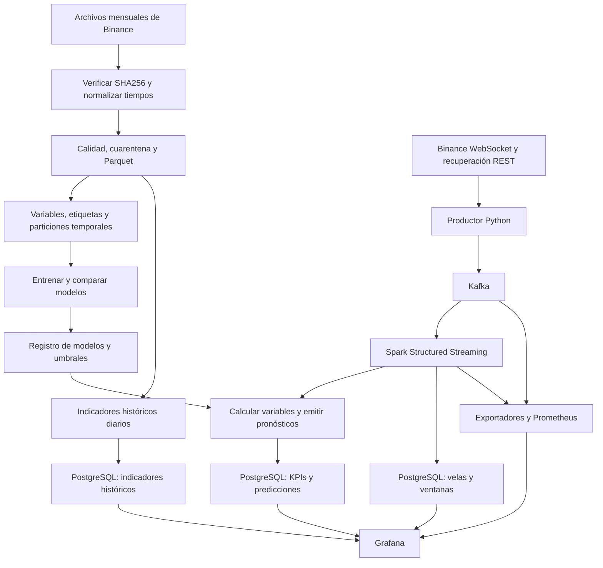

> Estado histórico: este documento conserva los resultados y hallazgos de su fecha. Las correcciones y la operación vigente están en [PRODUCTO_FINAL.md](PRODUCTO_FINAL.md).

# Revisión de CryptoPulse, origen de los datos y guía de Grafana

Fecha de revisión: 28 de octubre de 2026, aproximadamente 19:34–19:40, hora de Lima (UTC−5). Los estados y contadores corresponden a esa revisión y cambian mientras el sistema está encendido.

Proyecto activo: `D:\bigdata`. Tablero: http://localhost:43000/d/cryptopulse-main. Registro de modelos examinado: `20261026T223241Z`.

## 1. Dictamen

La arquitectura funciona como prototipo local: recibe datos públicos reales, los transmite por Kafka, ejecuta Spark, conserva resultados en PostgreSQL y permite consultarlos desde Grafana. Sin embargo, **durante esta revisión la inferencia estaba degradada**: las velas recientes avanzaban, pero las siete series de pronósticos no se actualizaban.

Por tanto, no corresponde afirmar que todo el producto está funcionando correctamente solo porque Docker muestre contenedores activos o S12 diga `PASS`. La verificación actual necesita comprobar la continuidad de las velas y la frescura de las predicciones.

Se revisaron código, archivos de procedencia, registro de modelos, consultas SQL de los 19 paneles, estado de los contenedores, API del producto, métricas de Prometheus y registros de Spark. También se consultó directamente Binance para verificar un dato ausente. La herramienta de inspección del navegador falló al leer la pestaña y capturar su imagen; esta revisión confirma consultas y datos, pero no certifica el aspecto visual de cada gráfico.

## 2. Hallazgos por prioridad

### Prioridad alta: un hueco de ingesta interrumpe los pronósticos

En ambos activos falta la vela que abre el **28 de octubre a las 19:07:00 en Lima**, equivalente al 29 de octubre a las 00:07:00 UTC. Su `open_ms` es `1793232420000`.

La base local contiene el minuto anterior y el siguiente:

| Activo | Último minuto anterior, UTC | Siguiente minuto, UTC | Minutos ausentes |
|---|---|---|---:|
| BTCUSDT | 2026-10-29 00:06:00 | 2026-10-29 00:08:00 | 1 |
| SOLUSDT | 2026-10-29 00:06:00 | 2026-10-29 00:08:00 | 1 |

La consulta REST oficial devolvió ambas velas ausentes: cierre BTCUSDT `81344.00000000` y cierre SOLUSDT `102.47000000`. La consulta local para esa clave devolvió cero filas. La falta está en el pipeline local, no en la disponibilidad del dato de origen comprobado.

El último pronóstico de cada dimensión estaba asociado al cierre `2026-10-29 00:06:59.999 UTC`, mientras las velas ya llegaban hasta `00:33:59.999 UTC` en la primera captura de esta revisión. En la comprobación final los siete pronósticos tenían **33,4 minutos de antigüedad** y los nueve servicios de la plataforma seguían en ejecución.

La causa identificada en `producer.py` es el uso de una única marca `last_sent` por activo. Al llegar una vela posterior por WebSocket, esa marca avanza; la recuperación REST empieza después de esa marca y `publish()` descarta cualquier evento anterior. Una vela intermedia perdida puede quedar permanentemente fuera. El cambio entre recuperación inicial y conexión WebSocket deja expuesta esa situación.

Las variables de `features.py` exigen 60 rendimientos consecutivos. Es correcto no calcularlas sobre minutos inventados, pero mientras el hueco permanezca dentro de su ventana, `inference.py` descarta las filas incompletas y no emite los pronósticos nuevos. También quedan pendientes evaluaciones futuras que atraviesen ese hueco.

**Corrección pendiente:** recuperar los minutos intermedios disponibles en la fuente y separar la última vela recibida de la última secuencia completa confirmada; probar que la transición REST/WebSocket y una reconexión no dejan huecos. No basta con esperar a que el minuto ausente salga de la ventana de cálculo.

Referencias de código: `pyspark/sesiones/cryptopulse/producer.py`, especialmente `publish()` y `catch_up()`; `features.py`, cálculo de `rv60`; `inference.py`, filtro de variables completas.

### Prioridad alta: S12 puede dar un falso resultado de salud completa

Se ejecutó otra vez `scripts/verificar_producto.ps1`: devolvió `S12: PASS` a las **19:36:25 de Lima**, a pesar de los pronósticos detenidos.

`verify_inference()` comprueba que existan siete combinaciones de dimensión/activo y que la inferencia esté habilitada. No exige que sus tiempos sean recientes ni que se hayan emitido nuevas predicciones. `verify_final()` comprueba la frescura de las velas, pero no la de los pronósticos. Además, consulta el resultado guardado de integración del 26 de octubre; no vuelve a ejecutar todas esas pruebas en cada S12.

Las cinco reglas operativas de Prometheus comprueban exportador, velas, heartbeat de Spark, retraso de Kafka y actividad WebSocket. Ninguna mide la antigüedad de cada serie de pronósticos. Por eso pueden estar saludables mientras la inferencia está detenida.

**Corrección pendiente:** exigir frescura de las siete series, detectar discontinuidades recientes y mostrar una alerta específica de inferencia degradada. Si faltan datos para predecir, el producto debe expresar ese motivo de forma visible.

### Limitación analítica: el modelo de caídas tiene capacidad limitada

En la prueba histórica su precisión fue **13,54 %** y su recall **26,21 %** con el umbral seleccionado. De 2.674 alertas de esa prueba, 362 fueron verdaderos positivos; se omitieron 1.019 eventos positivos. Mejora algunas métricas respecto de la referencia, pero no justifica presentarlo como un predictor fiable de todas las caídas.

El umbral de alerta del clasificador es aproximadamente 5,80 % de probabilidad estimada. Un umbral así puede parecer bajo, pero fue seleccionado en validación para un evento poco frecuente. No equivale a decir que el precio caerá 5,80 %.

### Limitación analítica: divergencia despliega una referencia cero

Se entrenó un regresor, pero no mejoró el RMSE de la referencia en validación. La política conservó `baseline`, que pronostica cero puntos porcentuales. La línea de pronóstico plana en cero es el comportamiento configurado, no evidencia de que SOL y BTC siempre se muevan igual.

La divergencia observada sí cambia. La alerta basada en el pronóstico desplegado de divergencia no se activará al comparar cero contra un umbral positivo de aproximadamente 0,778 puntos porcentuales.

### Mejoras necesarias de interpretación del tablero

- Los precios están en **USDT**, aunque el formato visual de los paneles usa un símbolo de dólar. No deben explicarse como precios de otro mercado o de una cuenta del usuario.
- «Última vela · antigüedad» usa el máximo entre ambos activos. Puede ocultar que uno se haya atrasado mientras el otro avanza. Conviene mostrar el estado de cada activo.
- «Actividad actual» contiene el último KPI calculado. En esta revisión también estaba atrasado por el fallo de inferencia; su nombre no garantiza que esté fresco.
- «Evaluación en vivo» acumula toda la historia `live` de la base. No se restringe a las tres horas que el usuario seleccione arriba y mezcla activos por dimensión. Tampoco separa versiones de modelo.
- «Kafka · mensajes por topic» representa offsets por partición. No es una tasa de mensajes por segundo ni necesariamente el número de mensajes que quedan retenidos.
- «Costo ilustrativo» usa tarifas y recursos configurados. No es una factura ni una medición automática del costo real de este equipo.

## 3. Qué se comprobó funcionando

En la captura inicial había nueve servicios de la plataforma en ejecución, Kafka y PostgreSQL saludables y el entorno Jupyter disponible. El productor tenía WebSocket conectado, 1.324 mensajes recibidos desde este arranque y cero rechazos registrados por el productor.

PostgreSQL tenía 3.363 velas por activo en esa captura, incluyendo modos `live`, `backfill` y `replay`. Ese total no es el tamaño del histórico de entrenamiento. No se encontraron claves duplicadas en `market_candles` ni filas en `rejected_events`.

Las tres consultas Spark estaban activas: archivo durable, ventanas fijas y ventanas deslizantes. El heartbeat tenía aproximadamente 1,36 segundos de antigüedad y el archivo de Kafka se había consumido hasta los offsets disponibles. Los tres targets de Prometheus estaban `up` y la consulta de alertas no mostraba alertas activas en esa captura. Estos indicadores confirman transporte y ejecución; no resuelven el fallo de inferencia descrito arriba.

## 4. De dónde vienen los datos

### Mercado y unidad de observación

La fuente es **Binance Spot**, para los pares **BTCUSDT** y **SOLUSDT**. BTCUSDT es el precio de bitcoin expresado en USDT y SOLUSDT es el precio de solana expresado en USDT. Los datos describen ese mercado específico.

La unidad de trabajo es una **vela cerrada de un minuto**: un resumen del minuto con apertura, máximo, mínimo, cierre, volumen del activo, volumen negociado en USDT y número de operaciones. No se guarda cada operación individual como entrada principal de este proyecto. Tampoco se utilizan noticias, sentimiento, datos de una cuenta privada ni órdenes de compra/venta.

### Históricos para análisis y entrenamiento

Se usan archivos mensuales oficiales:

```text
https://data.binance.vision/data/spot/monthly/klines/{SIMBOLO}/1m/{SIMBOLO}-1m-{AAAA-MM}.zip
```

Ejemplo de ruta usada por el descargador:

```text
https://data.binance.vision/data/spot/monthly/klines/BTCUSDT/1m/BTCUSDT-1m-2026-01.zip
```

El corte descargado va de enero de 2022 a septiembre de 2026, con 57 meses por activo: **114 archivos**. Se verifica el SHA256 oficial de cada ZIP y se conserva el registro de procedencia en `pyspark/sesiones/s02-fundamentos/data/provenance.json`.

Se descargaron **4.993.759 registros**. Después del control de calidad quedaron **4.993.757**; dos se pusieron en cuarentena. El informe de calidad registra tres huecos históricos que suman 163 minutos ausentes contando ambos activos. Estos huecos históricos son distintos del minuto perdido durante el arranque detectado en esta revisión.

El dato Spot archivado desde enero de 2025 utiliza microsegundos. El proyecto normaliza esas marcas a milisegundos antes de unir períodos.

Fuente oficial: [Binance Public Data: formato, archivos y checksum](https://github.com/binance/binance-public-data).

### Datos en vivo y recuperación

El productor se conecta a:

```text
wss://data-stream.binance.vision/stream?streams=btcusdt@kline_1m/solusdt@kline_1m
```

Publica únicamente mensajes que marcan la vela como cerrada (`k.x = true`). Los mensajes de actualización de una vela aún abierta no generan una nueva vela cerrada en PostgreSQL.

Para recuperar datos se consulta:

```text
https://data-api.binance.vision/api/v3/time
https://data-api.binance.vision/api/v3/klines
```

Estas interfaces sirven datos públicos y no requieren una clave API. El respaldo REST implementado necesita la corrección de huecos descrita en la sección 2.

Fuente oficial: [Binance: interfaces públicas de datos de mercado](https://github.com/binance/binance-spot-api-docs/blob/master/faqs/market_data_only.md).

## 5. Cómo se llega desde esos datos a Grafana



### Preparación y entrenamiento

1. El descargador obtiene ZIP y checksum; extrae los CSV y registra procedencia y hashes.
2. PySpark comprueba valores obligatorios, coherencia de precios, volúmenes no negativos, intervalos y duplicados. Los datos problemáticos se conservan aparte; no se inventan precios.
3. Los registros válidos se escriben en Parquet particionado por activo, año y mes.
4. Se calculan variables retrospectivas: rendimientos de distintos horizontes, volatilidad realizada, actividad, relación de volumen, características de la vela y hora UTC. El modelo conjunto añade correlación y diferencia de rendimientos.
5. Las etiquetas usan lo ocurrido después del instante de observación: volatilidad de 15 minutos, caída al cierre de 30 minutos, actividad de los siguientes cinco minutos y diferencia futura SOL menos BTC a 15 minutos.
6. Se entrena con 2022–2024, se valida con 2025 y se prueba con enero–septiembre de 2026. Hay una separación de 30 minutos antes de los límites principales. Los clasificadores se calibran con enero–agosto de 2025 y seleccionan umbrales con septiembre–diciembre; entre esas dos subetapas no hay otra separación de 30 minutos implementada.
7. Los candidatos se comparan con referencias sencillas. La referencia se conserva si el candidato no mejora. El entrenamiento y la evaluación histórica toman observaciones cada 15 minutos; la inferencia pretende emitir en cada cierre de un minuto, por lo que conviene evaluar también esa distribución en vivo.

### Procesamiento continuo

1. El productor construye un evento con contrato versionado e identificador `ACTIVO:1m:open_ms` y lo publica en Kafka con la clave del activo.
2. Kafka conserva los eventos para desacoplar recepción y procesamiento.
3. Spark ejecuta tres consultas: archivo de velas, ventanas fijas de cinco minutos y ventanas de cinco minutos con paso de un minuto.
4. El archivo valida y guarda velas con clave única `(symbol, open_ms)`. Las ventanas aplican deduplicación y watermark de dos minutos. Los checkpoints guardan el avance para reiniciar.
5. La inferencia consulta las últimas 180 velas disponibles por activo y reutiliza las funciones de variables del batch. Cuando hay continuidad suficiente, aplica los modelos y guarda predicciones e indicadores.
6. Al transcurrir el horizonte, la evaluación intenta calcular la realidad observada con velas consecutivas y completa `actual`. Un horizonte transcurrido sin datos completos puede seguir pendiente.
7. Grafana consulta PostgreSQL para los paneles de mercado y Prometheus para los de operación. Grafana presenta resultados; el entrenamiento y los pronósticos se calculan fuera de Grafana.

Las claves únicas hacen idempotentes las escrituras repetidas. Esto no constituye una transacción global exactamente una vez entre todos los componentes.

## 6. Qué significa cada cuadro de Grafana

El dashboard provisionado tiene 19 paneles. El último usa internamente el ID 99, pero es el cuadro 19 en esta explicación.

| Nº | Cuadro | Qué muestra y para qué sirve | Cómo interpretarlo |
|---:|---|---|---|
| 1 | Histórico validado · velas | Cantidad de registros históricos limpios publicados en `batch_kpis`. Indica el tamaño del histórico preparado. | Son 4.993.757 en el corte revisado; no es el contador de velas de hoy ni de Kafka. |
| 2 | BTCUSDT · último cierre USDT | Precio de cierre de la última vela BTC guardada. | Precio por BTC en USDT, al cierre de un minuto. No es un precio por operación actualizado continuamente. |
| 3 | SOLUSDT · último cierre USDT | Precio de cierre de la última vela SOL guardada. | Precio por SOL en USDT. Tiene la misma cadencia de velas que BTC. |
| 4 | Última vela · antigüedad | Segundos desde el cierre más reciente de toda la tabla de velas. | Sube si dejan de llegar datos. Actualmente combina ambos activos con un máximo; no prueba que los dos estén frescos. |
| 5 | Volatilidad · actual y pronóstico a 15 min | Compara la volatilidad retrospectiva de 15 minutos, el pronóstico de los próximos 15 y su resultado futuro cuando existe. | Más valor significa más intensidad de variaciones, no una dirección alcista o bajista. El resultado futuro se dibuja en el instante de origen del pronóstico para compararlos. |
| 6 | Caída significativa · probabilidad a 30 min | Probabilidad estimada de que el rendimiento al final de 30 minutos sea inferior al umbral histórico del activo. | Probabilidad, no magnitud de caída. El umbral de evento es aproximadamente −0,558 % en BTC y −1,116 % en SOL. No representa el mínimo que podría tocar dentro del intervalo. |
| 7 | Actividad anómala · probabilidad a 5 min | Pronóstico de actividad inusualmente alta en los próximos cinco minutos y bandera de anomalía de los cinco minutos recientes. | La curva de probabilidad va de 0 a 1 y se formatea en porcentaje. La bandera observada solo toma 0/1: puede verse como 0 %/100 %, pero no es una probabilidad adicional. |
| 8 | Divergencia SOL menos BTC · pronóstico a 15 min | Diferencia reciente de rendimientos, pronóstico y diferencia futura realizada. | Se mide en puntos porcentuales. Positivo significa mayor rendimiento de SOL; negativo, de BTC. El pronóstico desplegado es la referencia fija cero. |
| 9 | Correlación móvil de rendimientos · 60 min | Correlación entre los rendimientos de un minuto de BTC y SOL usando 60 observaciones consecutivas. | Cerca de +1: se mueven de forma parecida; cerca de 0: poca relación lineal; cerca de −1: movimientos opuestos. No mide causalidad. |
| 10 | Alertas de mercado · señales para revisar | Predicciones que superan los umbrales guardados, con activo, dimensión, valor, método y versión. | Una tabla vacía puede significar que no hubo alertas o que no se están emitiendo predicciones recientes. Debe leerse junto con la salud de la inferencia. |
| 11 | Evaluación histórica · prueba cronológica 2026 | Métricas del método desplegado en el período de prueba reservado. | MAE/RMSE son errores para regresión; PR AUC/Brier/Recall son métricas de clasificación. Las celdas que no aplican a una dimensión quedan vacías. |
| 12 | Evaluación en vivo · resultados futuros disponibles | Número de predicciones `live` con realidad disponible y errores acumulados por dimensión. | No es el resultado del instante actual ni del rango de tres horas: acumula la base. Para clasificadores, el promedio del error al cuadrado es Brier y su raíz es raíz Brier; no es un error de precio en USDT. |
| 13 | WebSocket conectado | Estado reportado por el productor: 1 conectado, 0 desconectado. | Confirma conexión; no garantiza continuidad de todas las velas ni calidad de los pronósticos. |
| 14 | Spark · edad heartbeat | Segundos desde la última señal de vida del driver. | Un valor pequeño indica que el bucle del driver sigue activo. Puede estar activo mientras no emite predicciones por datos incompletos. |
| 15 | Kafka · eventos pendientes | Suma de offsets disponibles menos offsets procesados por la consulta de archivo. | Cerca de cero indica que el archivo está al día. No mide por sí mismo si se generaron pronósticos. |
| 16 | Costo ilustrativo USD por mes | Estimación con CPU, memoria, almacenamiento, horas y tarifas de `config/cost-assumptions.json`. | Con los valores revisados son 65,145 USD/mes, aproximadamente 65,15. Docker local no está generando esa factura. |
| 17 | Duración de micro-lotes | Tiempo de ejecución del último micro-lote informado por cada consulta Spark. | Permite ver si el procesamiento se acerca o supera su intervalo de 15 segundos. Los lotes de recuperación pueden tardar más; los vacíos pueden durar casi cero. |
| 18 | Kafka · mensajes por topic | Offset actual por tópico y partición obtenido del exportador de Kafka. | Una curva creciente refleja avance. No es mensajes/segundo; distintas particiones del mismo tópico pueden compartir nombre visible. |
| 19 | Actividad actual · volumen, operaciones y umbrales históricos | Últimos KPIs: volumen en USDT y operaciones en cinco minutos, referencias P95 y Z score del volumen. | P95 es una referencia calculada con entrenamiento por activo y hora UTC. Superarla indica actividad alta respecto de esa referencia. Revisa la columna de cierre: puede contener un KPI atrasado. |

Los gráficos temporales de predicción, correlación y alertas usan el rango elegido en Grafana. Los cuadros de último valor, histórico y las dos tablas de evaluación no comparten todos ese filtro. Actualizar la pantalla cada diez segundos tampoco crea datos nuevos cada diez segundos: las entradas de mercado son velas de un minuto.

### Definiciones que conviene conocer

- **Volatilidad realizada:** `100 * sqrt(sum(log(close_t / close_anterior)^2))` sobre 15 rendimientos de un minuto. No está anualizada y no es una probabilidad.
- **Rendimiento:** variación porcentual entre dos cierres. Una caída de 1 % no equivale a una probabilidad de caída de 1 %.
- **P95:** valor que deja aproximadamente el 95 % de las observaciones históricas por debajo; aquí depende del activo y la hora UTC.
- **Z score:** cuántas desviaciones estándar se separa el volumen actual de su media histórica de referencia. No convierte por sí mismo una observación en una certeza estadística.
- **MAE/RMSE:** errores de regresión; menos es mejor en la misma tarea y unidad. No corresponde comparar directamente un RMSE de volatilidad con otro de divergencia como si fueran la misma variable.
- **PR AUC:** resumen de precisión frente a recall para clasificación; se interpreta frente a la prevalencia y una referencia de la misma tarea.
- **Brier:** promedio del cuadrado de la diferencia entre probabilidad y resultado 0/1; menos es mejor.
- **Precision:** proporción de alertas que fueron positivas en realidad. **Recall:** proporción de positivos reales que el modelo detectó.

## 7. Resultados históricos y su alcance

| Dimensión | Método desplegado | Resultado de prueba | Lectura |
|---|---|---|---|
| Volatilidad | Random Forest | MAE 0,07874; RMSE 0,12919. Referencia RMSE 0,15080. | Mejoró la referencia histórica en RMSE. No implica que acierte cada minuto. |
| Caídas | Regresión logística calibrada | PR AUC 0,10308; Brier 0,02500; precisión 13,54 %; recall 26,21 %. | Señal limitada, con muchas falsas alertas y eventos no detectados en esa prueba. |
| Actividad anómala | Regresión logística calibrada | PR AUC 0,65955; Brier 0,03913; precisión 56,93 %; recall 63,60 %. | Mejor desempeño observado que el clasificador de caídas en su propia tarea; mantiene errores. |
| Divergencia | Referencia cero | MAE 0,13139; RMSE 0,19955 puntos porcentuales. | El candidato ML no mejoró la referencia en validación. |

Estas cifras proceden de los modelos guardados y las tablas locales, no de una nueva corrida completa de entrenamiento. La prueba histórica usa datos hasta septiembre de 2026 y no equivale a una validación de rentabilidad, costos de operación o desempeño futuro. El producto no ejecuta órdenes.

## 8. Qué conviene resolver primero

1. Corregir y probar la recuperación de huecos entre REST y WebSocket; recuperar la vela ausente desde el origen verificado.
2. Incorporar frescura por serie de pronósticos, continuidad de velas y motivo de falta de inferencia en las comprobaciones y alertas.
3. Mostrar claramente la edad de KPIs y predicciones, separar estado por activo y aclarar alcance temporal, unidades y referencia cero en Grafana.
4. Reforzar la evaluación de los clasificadores y comprobar el comportamiento con la cadencia real de un minuto, manteniendo separado el conjunto de prueba.

El siguiente criterio de aceptación debería exigir que avancen tanto las velas como las siete series de pronósticos durante varios cierres de minuto, y que una interrupción controlada se recupere sin dejar un minuto intermedio ausente.

## 9. Archivos de referencia del proyecto

- Descarga y procedencia: `scripts/descargar_historicos_s02.py` y `pyspark/sesiones/s02-fundamentos/data/provenance.json`.
- Calidad: `pyspark/sesiones/cryptopulse/quality.py` y `pyspark/sesiones/_runtime/s03.json`.
- Variables y entrenamiento: `pyspark/sesiones/cryptopulse/features.py`, `training.py` y `pyspark/sesiones/s04-modelos/artifacts/model_registry.json`.
- Recepción y procesamiento: `pyspark/sesiones/cryptopulse/producer.py`, `stream.py` y `inference.py`.
- Persistencia: `database/init.sql` y `pyspark/sesiones/cryptopulse/db.py`.
- Paneles: `observability/grafana/dashboards/cryptopulse.json`.
- Métricas y alertas: `pyspark/sesiones/cryptopulse/exporter.py` y `observability/alerts.yml`.
- Verificaciones: `pyspark/sesiones/cryptopulse/verify.py` e `integration.py`.
- Guía de arranque: `docs/GUIA_INICIO_LOCAL.md`.
- Informes anteriores: `docs/INFORME_PROYECTO_CRYPTOPULSE.md` y `docs/INFORME_SESIONES_S01_S12.md`. Sus estados operativos corresponden a sus propias fechas y deben distinguirse del hallazgo actual.
