# Evidencias y galería técnica

## Ejecución real del 30 de octubre de 2026

El producto se levantó en **Docker Desktop, desde `D:\bigdata`**, y se capturaron sus interfaces locales entre las **06:55 y las 07:02 de Lima**. Las **14 capturas** de esta página proceden de esa ejecución. GitHub Pages conserva estas imágenes; los valores no cambian al actualizar esta página.

La verificación **S12 pasó a las 06:51:29 de Lima** (`11:51:29 UTC`) con la versión `20261029T011759858407Z.cal`. También se repitieron publicación/lectura Kafka e integración. Durante la captura se confirmó estado integral `ready`, 61 velas consecutivas y cero huecos por activo, siete series recientes y tres targets Prometheus UP.

| Comprobación repetida el 30/10 | Resultado registrado |
|---|---|
| Contrato | Evento real válido; seis variantes inválidas rechazadas |
| Kafka y Spark | Duplicado contado una vez, un evento descartado por watermark y recuperación desde checkpoint |
| Modelos e inferencia | Siete predicciones de replay y siete objetivos futuros evaluados en las cuatro dimensiones |
| Temporalidad e idempotencia | Modificar datos futuros no cambia variables pasadas; upsert de predicciones idempotente |
| Verificación S12 | PASS, cero velas duplicadas, salud lista y siete series recientes |

[Descargar el registro de ejecución y capturas](assets/downloads/ejecucion-capturas-2026-10-30.json). El registro contiene fechas, salud muestreada, integración y catálogo de imágenes. Las pruebas de replay están identificadas y no se presentan como resultados futuros de la sesión en vivo.

### Condiciones de este arranque

El motor Docker disponible comenzó sin imágenes ni volúmenes anteriores. Se reconstruyeron/descargaron las imágenes y se crearon los servicios. Los históricos y modelos montados desde Windows se conservaron. Antes de conectar el streaming al nuevo broker se archivaron los checkpoints anteriores en `_runtime/backups/checkpoints-before-new-kafka-20261030-064412`; sus offsets correspondían al broker anterior.

Se republicaron en PostgreSQL **3.468 filas del resumen diario batch** y **12 filas de métricas de modelos**, usando los artefactos guardados. No se reentrenaron los modelos ni se repitió la descarga completa del histórico. REST repobló el contexto reciente y WebSocket continuó aportando cierres reales de Binance.

## Grafana · del estado técnico a la revisión de mercado

### Estado integral y continuidad

*30/10/2026, 07:01:26 · Lima (UTC−5). LISTO resume la política de salud; 7/7 confirma series recientes. La tabla comprueba 61 velas consecutivas por activo y cero minutos internos ausentes. Los precios pertenecen al último cierre, en USDT. Pulsa la imagen para verla a tamaño completo.*

### Señales con valor, umbral y explicación

[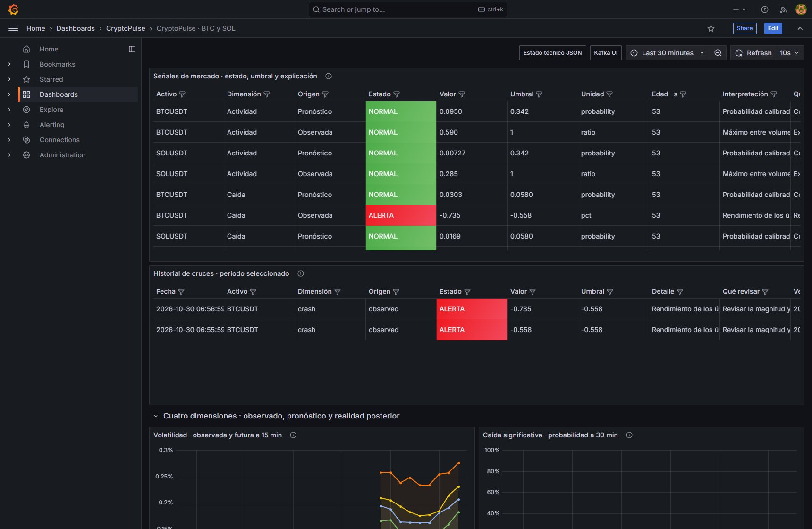](assets/evidencias/grafana-senales.jpg)

*30/10/2026, 06:57:57 · Lima (UTC−5). La tabla conserva evaluaciones aunque no haya cruces. NORMAL significa una evaluación válida sin cruce; REFERENCIA identifica el baseline. La ausencia de alertas de mercado puede ser un resultado correcto y no requiere inventar eventos. Pulsa la imagen para verla a tamaño completo.*

### Volatilidad y probabilidad de caída

[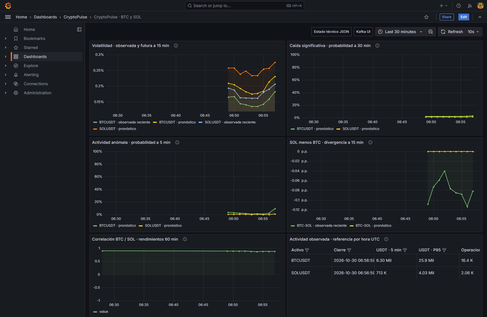](assets/evidencias/grafana-riesgos.jpg)

*30/10/2026, 06:57:58 · Lima (UTC−5). Se comparan observaciones y pronósticos en sus escalas propias. Las curvas en vivo comenzaron en este arranque; no representan cinco años continuos de inferencia. Pulsa la imagen para verla a tamaño completo.*

### Actividad, divergencia y correlación

[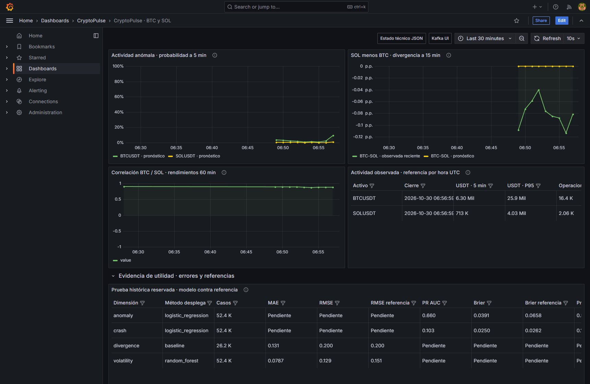](assets/evidencias/grafana-divergencia.jpg)

*30/10/2026, 06:57:59 · Lima (UTC−5). La referencia de divergencia es cero, seleccionada al no ganar el candidato en validación. Una línea plana en cero es el método desplegado; no demuestra ausencia de movimiento en el mercado. Pulsa la imagen para verla a tamaño completo.*

### Evaluación histórica y evaluación posterior en vivo

[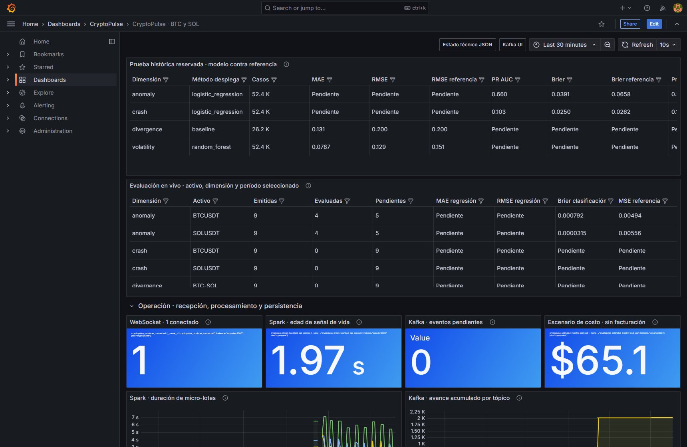](assets/evidencias/grafana-modelos.jpg)

*30/10/2026, 06:58:01 · Lima (UTC−5). El test histórico compara modelo y referencia. La evaluación viva espera la verdad futura de cada ancla y horizonte. En columnas no aplicables —por ejemplo MAE para clasificadores— el nulo también puede mostrarse como «Pendiente»; se interpreta según el tipo de métrica, no como una avería. Pulsa la imagen para verla a tamaño completo.*

Las nuevas predicciones esperan **5, 15 o 30 minutos**, según la dimensión, antes de poder evaluarse. Un resultado `pending` en la consulta de la última predicción es esperado: esa predicción acaba de nacer. El registro S12 de las 06:51 todavía no tenía objetivos vivos maduros; los siete objetivos evaluados allí pertenecen al replay controlado. No se adelanta la verdad futura ni se mezclan ambas procedencias.

### Transporte, procesamiento y costo

[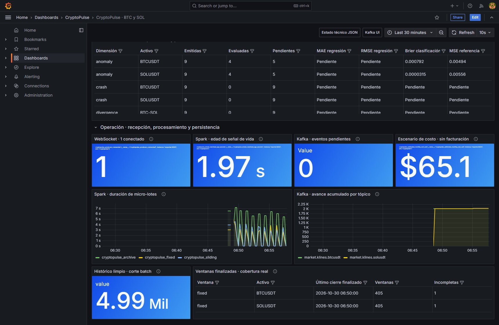](assets/evidencias/grafana-operacion.jpg)

*30/10/2026, 06:58:02 · Lima (UTC−5). WebSocket=1, heartbeat y lag describen operación. El costo es un escenario ilustrativo configurable de aproximadamente USD 65,15/mes; no es una factura de Docker ni una tarifa contratada. Pulsa la imagen para verla a tamaño completo.*

[Interpretar los 23 paneles de datos](dashboard.md) · [Modelos y métricas](modelos.md).

## Kafka UI · eventos que llegan al pipeline

### Topics y particiones

[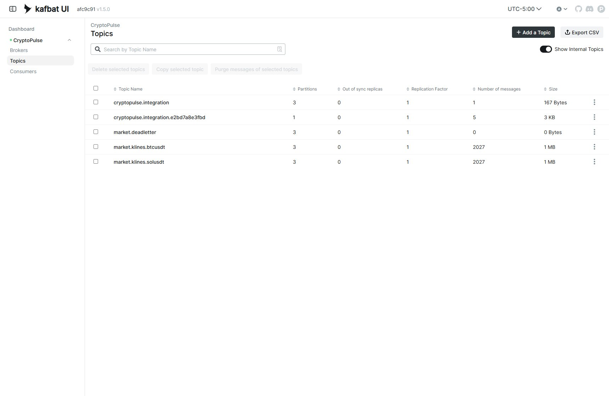](assets/evidencias/kafka-topics.jpg)

*30/10/2026, 06:55:34 · Lima (UTC−5). Se observan los topics reales por activo, sus particiones y conteos. El topic de integración está separado del flujo del producto. La existencia de market.deadletter no significa que los rechazos SQL se publiquen allí automáticamente. Pulsa la imagen para verla a tamaño completo.*

### Mensajes, clave y offset

[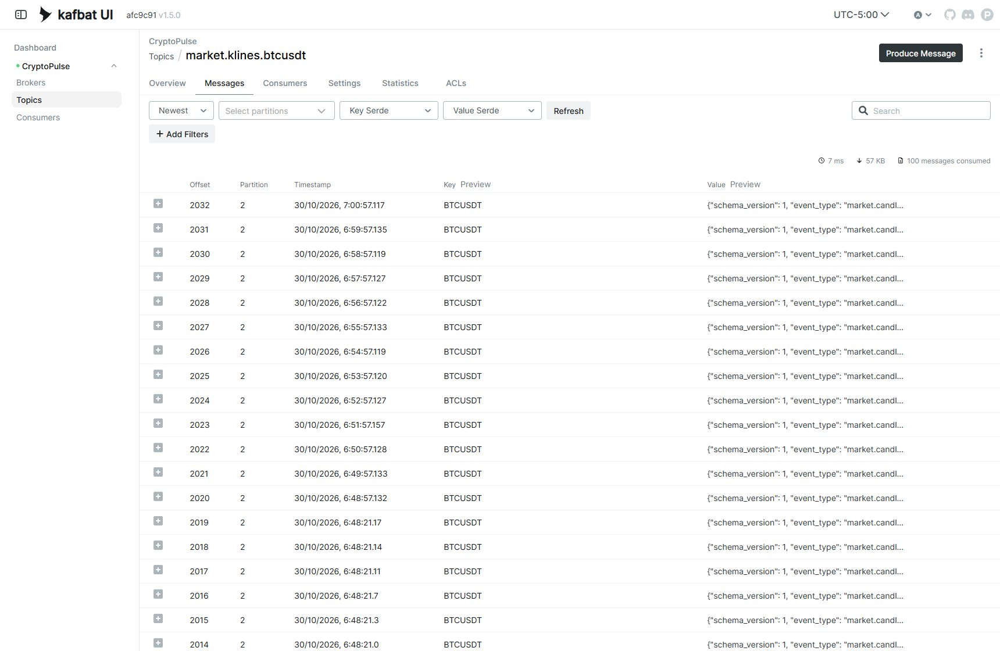](assets/evidencias/kafka-mensajes.jpg)

*30/10/2026, 07:01:33 · Lima (UTC−5). La clave BTCUSDT mantiene afinidad por activo; el offset identifica la posición dentro de una partición. Value Preview muestra el contrato JSON, no un gráfico generado ni datos de demostración. Pulsa la imagen para verla a tamaño completo.*

[Contrato, reconciliación REST y streaming](pipeline.md).

## Prometheus · disponibilidad y alertas técnicas

### Targets de scraping

[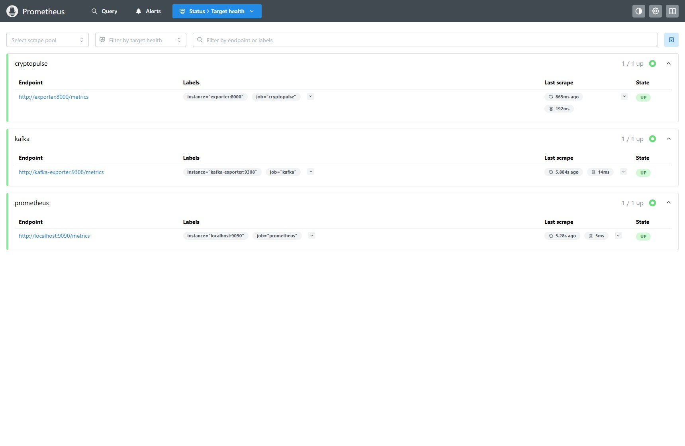](assets/evidencias/prometheus-targets.jpg)

*30/10/2026, 06:55:29 · Lima (UTC−5). Los tres targets son el exportador CryptoPulse, Kafka Exporter y Prometheus. UP acredita que el scraping respondió; la salud completa del producto se decide además con frescura, contexto e inferencia. Pulsa la imagen para verla a tamaño completo.*

### Ocho reglas operativas

[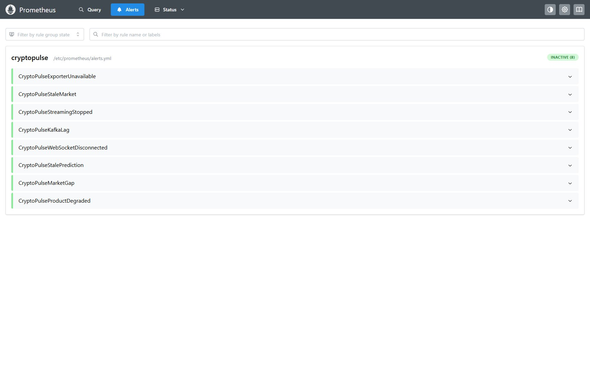](assets/evidencias/prometheus-alertas.jpg)

*30/10/2026, 06:55:32 · Lima (UTC−5). Las ocho reglas están cargadas y aparecen inactivas en este instante. Una regla INACTIVE no es «No data»: significa que no se cumple su condición de disparo. Estas reglas técnicas son distintas de las señales de mercado de Grafana. Pulsa la imagen para verla a tamaño completo.*

[Métricas, política de salud y condiciones de las reglas](observabilidad.md).

## PostgreSQL · predicciones persistidas

[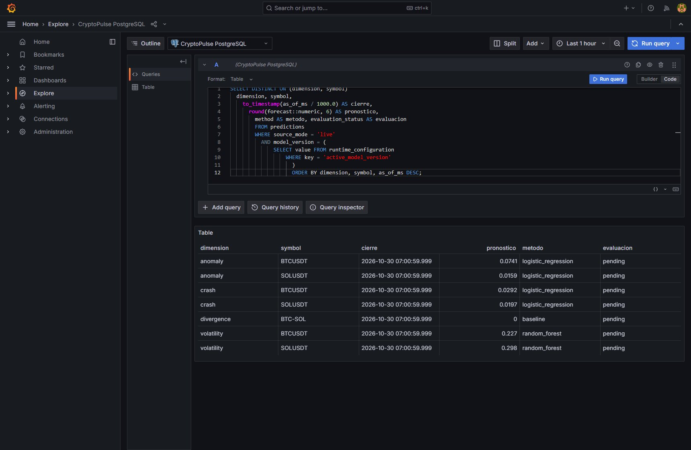](assets/evidencias/postgresql-consulta.jpg)

*30/10/2026, 07:01:31 · Lima (UTC−5). Consulta SELECT ejecutada a través de la fuente PostgreSQL de Grafana, con dimensión, activo, cierre, pronóstico, método y estado de evaluación. Es la base de servicio real; la interfaz visible es Grafana Explore. Pulsa la imagen para verla a tamaño completo.*

[Descargar la consulta SQL de la captura](assets/downloads/consulta-predicciones-2026-10-30.sql). La selección DISTINCT ON recupera el ancla más reciente de cada serie de la versión activa y excluye replay.

## JupyterLab y Spark · ejecución verificable

### Notebook con datos reales y consulta de salud

[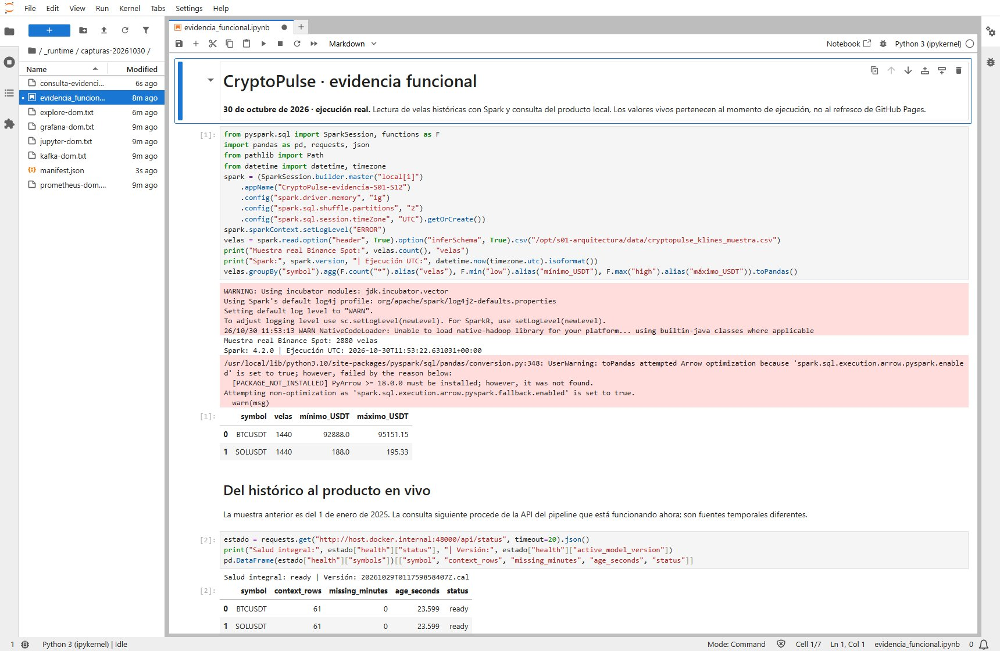](assets/evidencias/jupyter-spark.jpg)

*30/10/2026, 07:01:39 · Lima (UTC−5). Spark leyó una muestra histórica real de 2.880 velas, 1.440 por activo, del 1 de enero de 2025. Otra celda consultó la API de esta ejecución. Se distinguen explícitamente la fecha de la muestra y la del producto vivo. Pulsa la imagen para verla a tamaño completo.*

Los avisos visibles de inicio de Spark y de optimización Arrow son advertencias del entorno interactivo: la conversión utilizó su alternativa sin Arrow y las celdas terminaron correctamente. No son fallos del pipeline ni resultados de entrenamiento nuevo.

### Trabajos Spark completados

[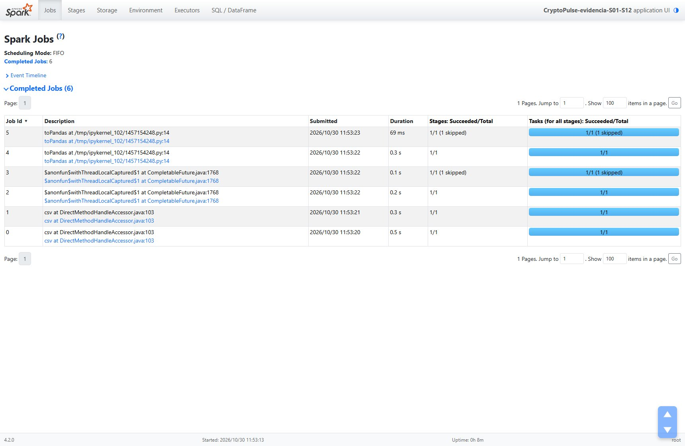](assets/evidencias/spark-ui.jpg)

*30/10/2026, 07:01:41 · Lima (UTC−5). Esta UI corresponde a la sesión auxiliar del notebook, con trabajos completados de lectura y agregación. No es la UI del driver persistente de Structured Streaming ni evidencia de haber reentrenado los modelos hoy. Pulsa la imagen para verla a tamaño completo.*

## Docker Desktop · entorno local activo

[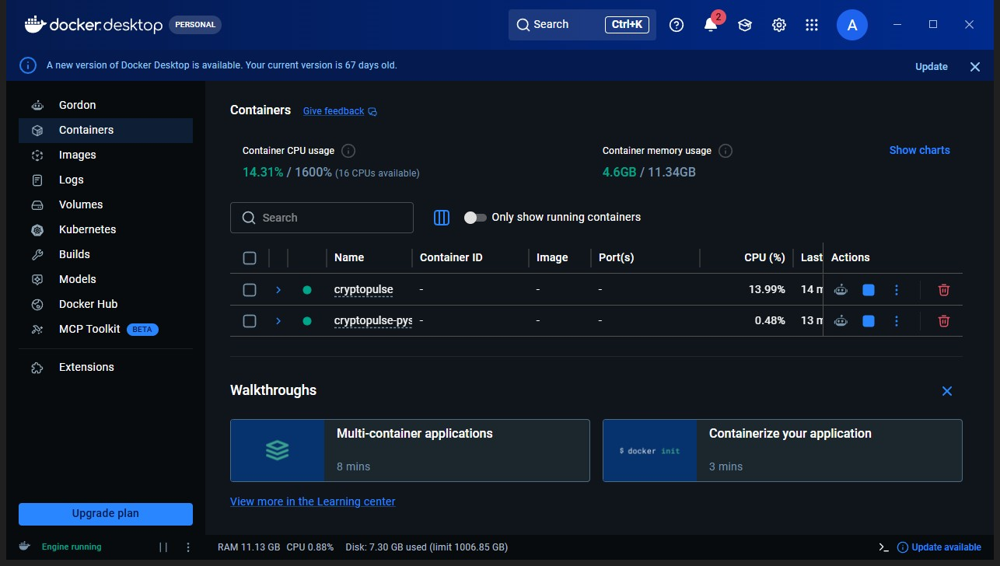](assets/evidencias/docker-desktop.jpg)

*30/10/2026, 07:02:19 · Lima (UTC−5). Se ven los dos grupos Compose activos, producto y entorno PySpark, con sus filas contraídas. Los consumos son una lectura puntual compartida del motor; no una reserva de recursos por servicio. Pulsa la imagen para verla a tamaño completo.*

## Aceptación anterior conservada · 28 de octubre

La [aceptación del 28/10/2026, 20:25:50 de Lima](assets/downloads/aceptacion-2026-10-28.json) contiene **40 pruebas de regresión y cinco pruebas Spark PASS**, integración, 16 consultas SQL y siete expresiones Prometheus comprobadas, además de una interrupción real del productor durante 75 segundos con degradación y recuperación. Esas baterías y esa interrupción **no se repitieron para tomar estas capturas**. Se conservan con su fecha, separadas de la nueva integración y S12.

## Diagramas de apoyo

*Diagrama documental de las conexiones batch, streaming, servicio y observabilidad.*

*Método de validación temporal; no es una captura de entrenamiento en ejecución.*

*Visualización de métricas guardadas en el registro. Cada objetivo conserva su escala.*

[Levantar y verificar el producto](ejecucion.md) · [Entrega U2](u2-producto.md) · [Límites de las conclusiones](limites.md).
