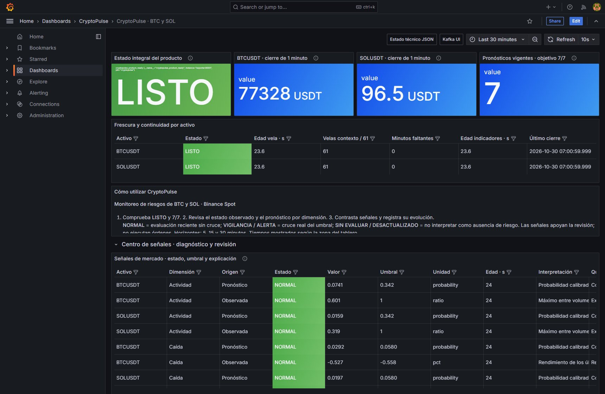
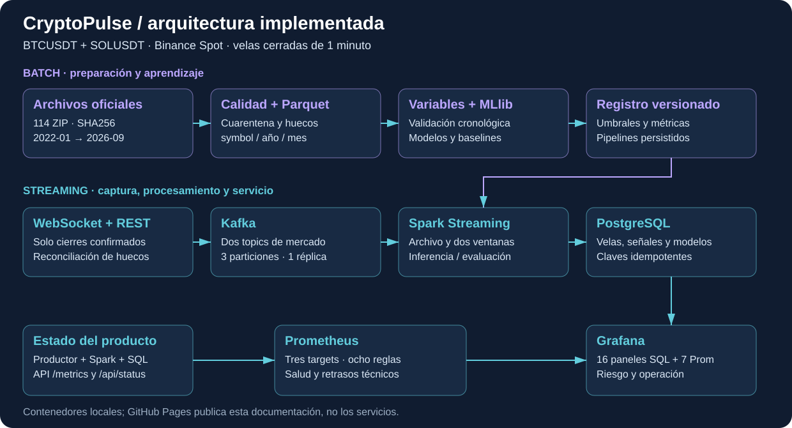

<section class="hero" markdown="1">
PRODUCTO UNIDAD II · S06–S12

# CryptoPulse

**Del cierre de una vela a una señal que se puede explicar.**

Vigilancia de BTC y SOL con datos reales de Binance Spot. Un histórico validado entrena los modelos; Kafka y Spark procesan los nuevos cierres; Grafana reúne riesgos, predicciones y salud del sistema.

[Explorar el producto U2](u2-producto.md){ .cp-button }
[Entender las métricas](dashboard.md){ .cp-button .secondary }

</section>

4,99 Mvelas históricas válidas

7series de pronóstico

14evaluaciones observadas / futuras

23paneles de datos Grafana

## El producto funcionando

*30/10/2026, 07:01:26 · Lima (UTC−5). Captura real del producto local, con continuidad BTC/SOL y datos de Binance. Pulsa la imagen para verla a tamaño completo.*

[Ver las 14 capturas y las pruebas del arranque](evidencias.md).

## Qué problema resuelve

Mirar el precio actual deja preguntas abiertas: ¿es una fluctuación extraordinaria?, ¿hay riesgo de caída?, ¿la actividad es inusual para ese horario?, ¿SOL se está separando de BTC? CryptoPulse combina esas cuatro perspectivas y muestra valor, unidad, umbral, antigüedad y motivo de revisión.

| Dimensión | Observación | Estimación futura |
|---|---|---|
| Volatilidad | Intensidad de cambios recientes | Volatilidad realizada a 15 minutos |
| Caída | Rendimiento reciente bajo referencia | Probabilidad de caída al cierre de 30 minutos |
| Actividad | Volumen y operaciones frente a P95 | Probabilidad de actividad inusual a 5 minutos |
| Divergencia | Rendimiento SOL menos BTC y correlación | Referencia cero a 15 minutos, seleccionada por validación |

El regresor de divergencia no superó la referencia. El clasificador de caídas tiene precisión limitada. Estas conclusiones se conservan junto a los resultados, para que el tablero ayude a revisar condiciones sin atribuir ventajas predictivas no demostradas.

*Diagrama de la implementación local: rutas batch y streaming, persistencia y observabilidad.*

## Qué está publicado aquí

Este sitio es documentación estática en GitHub Pages. **No ejecuta Kafka, Spark ni Grafana en Internet.** El producto corre en contenedores locales y se reproduce con la [guía de ejecución](ejecucion.md). Las capturas y evidencias indican cuándo fueron tomadas; no son cotizaciones en directo.

El **30 de octubre de 2026** se levantó el producto y se añadieron 14 capturas reales. La integración y la verificación S12 volvieron a pasar; la galería incluye su registro descargable. La revisión técnica del contenido se realizó contra código, registro de modelos y aceptación guardada. Versión analítica: `20261029T011759858407Z.cal`. La aceptación del 28 de octubre registró 40 pruebas unitarias, cinco con Spark e integración PASS. La [galería y evidencia](evidencias.md) distingue esas ejecuciones de las comprobaciones actuales.

## Recorrido de lectura

1. [Brief y preguntas](brief.md): alcance BTC/SOL y utilidad de las cuatro dimensiones.
2. [Producto U2](u2-producto.md): capacidades por sesión y correspondencia con la plantilla del curso.
3. [Arquitectura](arquitectura.md), [pipeline](pipeline.md) y [modelos](modelos.md): cómo se construye cada resultado.
4. [Grafana](dashboard.md) y [Prometheus](observabilidad.md): significado de indicadores y alertas.
5. [Ejecución](ejecucion.md), [sesiones](sesiones.md) e [informe integral descargable](https://raw.githubusercontent.com/abdul8377/big-data-btc-sol/main/site/resources/informe-integral-cryptopulse.md): reproducción y detalle.
