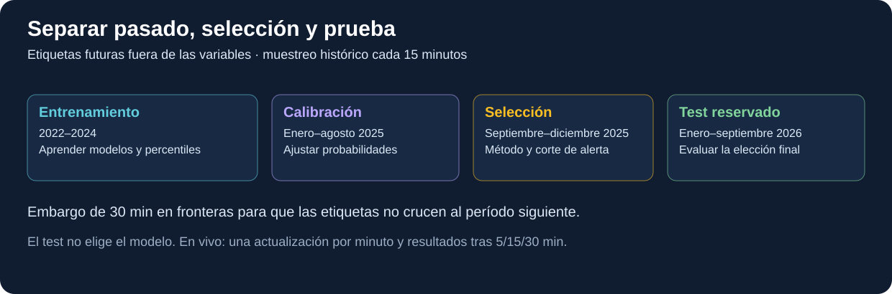
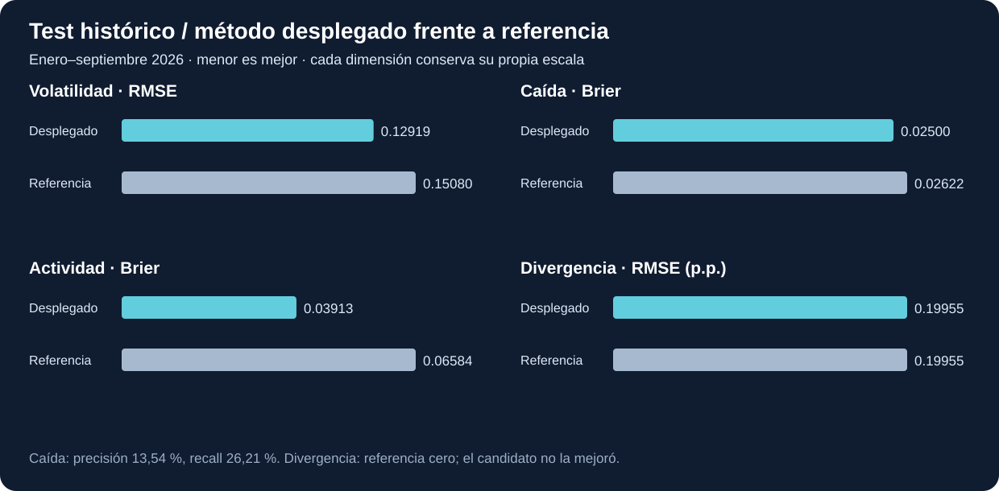

# Variables, modelos y resultados




*Cronología implementada; embargos de 30 minutos y prueba posterior separada.*
## Variables analíticas: significado, fórmulas y condiciones

### Convenciones de lectura

Sea `t` el minuto ancla cerrado, `P_t` su precio de cierre, `O_t` su apertura, `H_t` su máximo, `L_t` su mínimo, `Q_t` su volumen en USDT y `N_t` su número de operaciones. Las variables retrospectivas solo utilizan datos con minuto menor o igual a `t`. `features.past_features()` contiene su definición compartida para batch e inferencia.

Una ventana de 60 rendimientos de un minuto necesita 61 cierres: uno anterior para calcular el primer rendimiento y los 60 cierres siguientes. Por eso el contexto integral comprueba 61 velas consecutivas por activo. Una variable calculada a partir de cinco filas no representa necesariamente cinco minutos: el código comprueba también el tiempo transcurrido para evitar ese error cuando hay huecos.

### Las catorce variables realmente entregadas a los modelos por activo

1. **`r1`: rendimiento de un minuto.** `100 × (P_t/P_(t−1) − 1)`. Se expresa en porcentaje. Si el cierre pasa de 100 a 101, el resultado es 1. Mide el cambio inmediato, no la probabilidad de subida.
2. **`r5`: rendimiento de cinco minutos.** `100 × (P_t/P_(t−5) − 1)`. Compara extremos separados exactamente cinco minutos; no es la suma aritmética de cinco porcentajes de un minuto.
3. **`r15`: rendimiento de quince minutos.** La misma fórmula con retraso 15. Aporta dirección reciente en el horizonte usado también por volatilidad y divergencia.
4. **`r30`: rendimiento de treinta minutos.** La misma fórmula con retraso 30. Sirve además para la señal de caída ya observada. Un valor negativo indica pérdida relativa entre extremos.
5. **`rv15`: volatilidad realizada retrospectiva de quince minutos.** `100 × sqrt(sum(log(P_i/P_(i−1))²))`, con los últimos 15 rendimientos logarítmicos. Es no negativa y se expresa en porcentaje. No está anualizada, no resta una media como la desviación estándar muestral y no representa probabilidad.
6. **`rv60`: volatilidad realizada retrospectiva de sesenta minutos.** La misma fórmula sobre 60 rendimientos. Introduce un contexto de variabilidad más largo. No es directamente comparable con `rv15` como si ambas midieran el mismo horizonte.
7. **`log_quote5`: actividad monetaria reciente transformada.** Primero `quote5 = sum(Q_i)` sobre las cinco velas consecutivas más recientes, incluyendo `t`; luego `log_quote5 = ln(1 + quote5)`. La transformación reduce la diferencia de escala entre actividad habitual y valores muy grandes. El logaritmo no conserva la unidad USDT.
8. **`log_trades5`: actividad por operaciones transformada.** Primero `trades5 = sum(N_i)` en esas cinco velas; después `ln(1 + trades5)`. Cuenta operaciones reportadas, no participantes.
9. **`range_pct`: amplitud de la vela actual.** `100 × (H_t − L_t)/O_t`. Mide el recorrido interno máximo-mínimo relativo a la apertura. Una vela puede tener un rango amplio y un cuerpo pequeño si termina cerca de donde abrió.
10. **`body_pct`: cuerpo firmado de la vela.** `100 × (P_t − O_t)/O_t`. Es positivo si cierre supera apertura y negativo si queda por debajo.
11. **`volume_ratio`: intensidad reciente relativa a la última hora.** `12 × quote5/quote60`, donde `quote60 = sum(Q_i)` en las 60 velas recientes. Multiplicar por 12 compara la actividad de cinco minutos con la actividad media de un bloque de cinco minutos de esa hora. Un valor 1 equivale a la media; un valor 2 equivale al doble. Si `quote60` no es positivo o el contexto está incompleto, la variable queda nula.
12. **`hour_sin`: componente seno de la hora UTC.** `sin(2π × hora/24)`. Representa la posición en el ciclo diario sin crear una discontinuidad artificial entre las 23 y las 0 horas.
13. **`hour_cos`: componente coseno de esa hora.** `cos(2π × hora/24)`. Junto con el seno permite distinguir posiciones que tendrían el mismo seno. Se usa la hora entera del cierre, no minuto fraccionario ni hora de Lima.
14. **`is_sol`: identidad del activo.** Vale 1 para SOLUSDT y 0 para BTCUSDT. Los tres modelos por activo se entrenan con filas de ambos activos y esta variable informa de cuál corresponde a cada fila. No hay seis modelos independientes, uno por activo y dimensión.

También se calculan `r60`, `log_r1`, `quote5`, `quote60`, `trades5`, `trades60`, `hour_utc` y `close_d` como variables auxiliares. `r60` y `trades60` no figuran entre las catorce entradas del modelo actual, aunque estén disponibles durante la transformación. `log_r1 = ln(P_t/P_(t−1))` es la base de las volatilidades realizadas.

Para `rN`, el retraso por filas debe coincidir con `N × 60000` ms. Para `rvN`, además deben existir N rendimientos válidos. Para actividad de cinco/sesenta minutos, se exige N filas y diferencia de tiempo entre primera y última igual a `(N−1) × 60000`. Estas condiciones impiden presentar un período incompleto como si fuera una ventana temporal completa.

### Variables conjuntas BTC–SOL

`features.pair_features()` hace un `inner join` de BTC y SOL por `open_ms`. Cada fila conjunta representa el mismo minuto en ambos activos. El vector del candidato de divergencia tiene **30 entradas**: las 14 variables anteriores con prefijo `btc_`, las mismas 14 con prefijo `sol_` y dos adicionales:

- **`correlation_60m`: correlación de Pearson entre rendimientos de un minuto de BTC y SOL**, con 60 observaciones simultáneas y consecutivas. Se calcula como covarianza poblacional dividida por el producto de desviaciones poblacionales. Oscila entre −1 y 1 si está definida. Cerca de 1 indica movimientos lineales similares; cerca de −1, opuestos; cerca de 0, poca asociación lineal en esa ventana. No demuestra causalidad ni mide rentabilidad. Si alguna desviación es cero, `try_divide` devuelve nulo; no se fabrica una correlación cero.
- **`current_spread15`: diferencia de rendimientos de quince minutos.** `r15_SOL − r15_BTC`, en **puntos porcentuales**. Si SOL gana 2 % y BTC gana 0,5 %, el resultado es +1,5 puntos. El signo positivo significa que SOL rindió más que BTC durante ese intervalo; un signo negativo, lo contrario. No es diferencia entre los precios monetarios de ambas monedas.

En vivo, la inferencia requiere además que las últimas velas de ambos activos tengan exactamente el mismo minuto. No toma un último par antiguo para aparentar que la comparación está al día.

### KPI de actividad adicional

La inferencia publica `volume_zscore = (quote5 − media_historica)/desviacion_historica`, con referencia del activo y su hora UTC. Es una medida descriptiva de alejamiento respecto de una distribución histórica, no una probabilidad ni una prueba de normalidad. La media y desviación se guardan en los umbrales; el criterio principal de actividad anómala utiliza percentiles P95 y número de operaciones, no un corte de z-score.

## Objetivos de aprendizaje y señales que se quieren anticipar

### Dimensión 1: volatilidad en los próximos 15 minutos

La etiqueta `target_volatility` aplica la fórmula de volatilidad realizada a los rendimientos de los minutos `t+1` a `t+15`. Exige todos los rendimientos válidos y que el extremo futuro esté exactamente quince minutos después. El modelo responde «qué intensidad de variación podría haber en el próximo intervalo», sin predecir el precio de cierre ni su dirección.

Su referencia sencilla es **persistencia**: pronosticar que la volatilidad futura será igual a `rv15`, la volatilidad observada en los últimos quince minutos. La señal de vigilancia compara el pronóstico con el P95 de `rv15` del entrenamiento, por activo: BTC **0,5390712168 %** y SOL **1,0093271195 %**. Esos límites son referencias históricas de volatilidad, no probabilidades de 53,9 % y 100,9 %.

### Dimensión 2: evento de caída al terminar los próximos 30 minutos

Primero se calcula `future_r30 = 100 × (P_(t+30)/P_t − 1)`. La etiqueta `target_crash` vale 1 cuando ese rendimiento es menor o igual al P5 histórico del activo calculado con entrenamiento. Los límites actuales son BTC **−0,5577403410 %** y SOL **−1,1164904654 %**.

La definición es una caída **entre el cierre ancla y el cierre a 30 minutos**. No es el mínimo intrahorizonte, el máximo drawdown ni una caída de cualquier magnitud ocurrida en algún momento del intervalo. Si el precio cae mucho y se recupera antes del cierre final, la etiqueta puede ser 0.

El resultado del clasificador es una probabilidad entre 0 y 1. La vigilancia predictiva se activa al superar el umbral de probabilidad seleccionado, actualmente **0,0580141132**, aproximadamente 5,80 %. Este número es distinto del umbral de rendimiento negativo que define el evento. Un umbral probabilístico bajo se explica por un evento poco frecuente y una selección basada en F1; no debe describirse como un evento «casi seguro».

### Dimensión 3: actividad inusual en los próximos 5 minutos

Se suman el volumen en USDT y el número de operaciones de los minutos `t+1` a `t+5`. `target_anomaly` vale 1 si el volumen supera o iguala su P95 **o** las operaciones superan o igualan el suyo. Las referencias se calculan por símbolo y hora UTC usando entrenamiento. La etiqueta futura usa la hora del final de ese horizonte: `future_hour5`.

La combinación OR es importante: basta que una de las dos medidas cruce el límite. El P95 de cada medida por separado no implica que la unión ocurra exactamente el 5 % de las veces. La actividad inusual puede responder a noticias, cambios de liquidez, volatilidad u otros motivos; el dato agregado no identifica fraude, manipulación ni personas.

La salida predictiva es una probabilidad. El umbral actual es **0,3424626109**, aproximadamente 34,25 %. La observación actual usa la actividad de los últimos cinco minutos y las referencias de la hora actual; la etiqueta futura usa el siguiente tramo. Ambas deben mantenerse diferenciadas.

### Dimensión 4: divergencia relativa en los próximos 15 minutos

`target_divergence = future_r15_SOL − future_r15_BTC`, expresado en puntos porcentuales. La referencia es pronosticar siempre **0**: ausencia de ventaja de rendimiento de un activo frente al otro en el horizonte. Se entrenó un candidato ridge con 30 variables, pero no superó la RMSE de esa referencia en validación. Por eso el producto despliega cero y lo identifica como **REFERENCIA**.

El límite de magnitud para divergencia observada es el P95 del valor absoluto de la divergencia futura del entrenamiento: **0,7777201924 puntos porcentuales**. La divergencia observada mantiene utilidad descriptiva; la línea de pronóstico cero no prueba que se haya aprendido a anticipar desacoplamientos.

## Entrenamiento, separación temporal y selección

### Preparación del conjunto supervisado

`training.prepare()` lee el Parquet limpio, crea las variables retrospectivas y añade las etiquetas futuras. Los percentiles se calculan exclusivamente en el tramo de entrenamiento. Las filas con alguna de las catorce entradas o etiquetas requeridas nula se excluyen del conjunto común. Por este diseño, los tres modelos por activo comparten filas completas para todos sus objetivos: un faltante futuro de una dimensión puede excluir la fila de ese conjunto común aunque otra etiqueta sí existiera.

Después conserva anclas con `open_ms % 900000 == 0`: una observación cada quince minutos. Esto reduce la carga de entrenamiento y parte de la superposición entre ejemplos; no elimina toda dependencia temporal, especialmente para el horizonte de treinta minutos. Para el par aplica el mismo muestreo y exige sus treinta variables y su etiqueta completas.

Los resultados se guardan como `s04-modelos/artifacts/model_dataset` y `pair_dataset`. Una huella SHA256 de `features.py` y `_runtime/s03.json` se registra en `preparation.json`. Si ambos conjuntos tienen `_SUCCESS` y la firma coincide, se reutilizan. La firma controla esos insumos concretos; no es una versión criptográfica exhaustiva de todos los archivos del proyecto.

### Cronología de las particiones

- **Entrenamiento:** histórico de 2022–2024, con `open_ms + 30 min < 2025-01-01 00:00 UTC`.
- **Validación:** desde 2025-01-01, con `open_ms + 30 min < 2026-01-01 00:00 UTC`.
- **Prueba/test:** desde 2026-01-01 hasta el final disponible de septiembre de 2026, excluyendo las filas finales cuyo futuro no puede construirse.

El margen de treinta minutos evita que la etiqueta de una fila del tramo anterior utilice datos del siguiente tramo. Es conservador para los objetivos de cinco y quince minutos. No se hace una mezcla aleatoria de pasado y futuro.

Para los clasificadores, la validación se divide de nuevo:

1. Calibración: enero–agosto de 2025, exigiendo `open_ms + 30 min < 2025-09-01`.
2. Selección: septiembre–diciembre de 2025, ya protegida también por el embargo antes del test.

La versión vigente tiene **46.652 filas de calibración** y **23.420 de selección** por clasificador. La última ancla de calibración es `1756682100000`, 45 minutos antes del límite de septiembre, por la combinación de muestreo de quince minutos y comparación estricta del embargo. La primera de selección es `1756684800000`.

El conjunto común registra 210.392 filas de entrenamiento, 70.076 de validación y 52.412 de test. El conjunto conjunto BTC–SOL registra 105.195, 35.038 y 26.207 respectivamente. Las cantidades son ejemplos analíticos muestreados; no son los millones de velas originales.

### Modelos candidatos y parámetros concretos

**Ridge para regresión.** Se usa `VectorAssembler` y `LinearRegression` de Spark ML con `regParam=0.1`, `elasticNetParam=0` y `maxIter=40`. La penalización L2 reduce coeficientes extremos. Participa como candidato para volatilidad y divergencia. El código no incorpora un `StandardScaler` explícito en este pipeline de regresión.

Eso no implica que el estimador lineal tenga deshabilitada su opción interna de estandarización: el código no modifica ese parámetro predeterminado. En cambio, la logística sí desactiva expresamente la segunda estandarización tras su etapa `StandardScaler`.

**Random Forest para volatilidad.** Se usa `RandomForestRegressor` con 20 árboles, profundidad máxima 5, al menos 30 ejemplos por nodo y semilla 26. Aprende relaciones no lineales y combinaciones entre variables mediante árboles. Se compara con ridge y con persistencia. La salida negativa, si alguna apareciera en el tratamiento común de regresión de volatilidad, se recorta a cero: una volatilidad negativa no tiene sentido.

**Regresión logística para caída y actividad.** Cada dimensión usa su propio pipeline de `VectorAssembler`, `StandardScaler(withMean=True, withStd=True)` y `LogisticRegression(maxIter=60, regParam=0.01, standardization=False)`. El escalador centra y normaliza las variables usando el entrenamiento; el último `standardization=False` evita pedir una segunda estandarización al estimador. La logística produce la probabilidad de la etiqueta 1. No se usa un LLM, una red neuronal, un modelo de lenguaje ni una API de IA externa.

**Calibración tipo Platt.** La probabilidad logística se convierte con:

```text
p_clip = limitar(p, 0.000001, 0.999999)
p_calibrada = 1 / (1 + exp(-(a × ln(p_clip/(1-p_clip)) + b)))
```

Los parámetros `a,b` se ajustan en el tramo de calibración, mediante hasta 60 iteraciones de un método de Newton amortiguado, regularización pequeña y límites numéricos. El ajuste favorece probabilidades que correspondan mejor a frecuencias observadas, sin garantizar calibración perfecta fuera de muestra. Los parámetros vigentes son `(1,3739171646; 0,6002486738)` para caída y `(2,1138630089; 2,6778928930)` para actividad.

### Cómo se elige lo que realmente se despliega

En regresión, la referencia empieza siendo la ganadora. Un candidato solo la reemplaza si consigue RMSE estrictamente menor en validación. Todos los candidatos entrenados se guardan, incluso si no serán desplegados. Para volatilidad ganó Random Forest; para divergencia conservó la referencia cero.

Para cada clasificador se calcula una referencia probabilística constante por activo igual a su prevalencia en entrenamiento. En caída es aproximadamente 5,0210 % BTC y 5,0022 % SOL. En actividad es 7,0276 % BTC y 7,4539 % SOL. El candidato calibrado se despliega solamente si su Brier en selección es menor que el de esa referencia.

El umbral de alarma del candidato se busca en hasta 80 cuantiles entre 0,05 y 0,995 de sus probabilidades de selección. Para cada corte calcula F1 y conserva el mejor. Se evalúan dos decisiones diferentes: **Brier selecciona el método probabilístico** y **F1 selecciona el corte que convierte probabilidad en positivo/negativo**. El test de 2026 evalúa la decisión ya tomada; no interviene en elegir modelo, calibración o corte.

Los percentiles históricos usan `percentile_approx` con precisión configurada 10.000. Las referencias de actividad se calculan sobre las ventanas retrospectivas válidas del entrenamiento por activo/hora; después se aplican al tramo futuro que se quiere etiquetar, utilizando la hora de su final. La muestra que fija esos percentiles no es exclusivamente el conjunto supervisado ya reducido a anclas cada quince minutos.

### Versiones y recalibración vigente

El registro activo es `s04-modelos/artifacts/model_registry.json`, versión **`20261029T011759858407Z.cal`**. La fecha del identificador es UTC. Reutiliza los estimadores de la versión base **`20261026T223241Z`** y corrige la separación temporal de calibración/selección. Los regresores y sus informes se conservaron; los clasificadores base no se reentrenaron desde cero.

`training --recalibrate` exige el conjunto supervisado existente, conserva una copia del registro anterior en `registries`, recalcula ambos calibradores, selección y evaluación de test, guarda las predicciones del test bajo la nueva versión y publica el nuevo registro **al final** mediante reemplazo atómico. Así, un lector ve un registro anterior completo o uno nuevo completo. Esa publicación no equivale a recargar mágicamente un `ModelBundle` ya creado en el proceso de streaming: los scripts de operación reinician/recrean el servicio cuando corresponde y la salud compara su versión con la activa.

El registro contiene rutas de los modelos, variables, objetivos, límites temporales, criterios de selección, parámetros de calibración, prevalencias, umbrales, tamaños de partición y métricas. Su ruta relativa apunta a modelos en `s04-modelos/artifacts/models/...`. No se usa MLflow ni un registro cloud; el control de versiones del modelo es local mediante archivos y la tabla de registros en PostgreSQL.

## Métricas de calidad de modelos: interpretación completa

### Métricas de regresión

**`n`** es el número de ejemplos evaluados. Un error basado en cinco observaciones no tiene el mismo respaldo que uno basado en decenas de miles.

**MAE**, error absoluto medio, es `sum(abs(predicción − real))/n`. Se interpreta en la unidad del objetivo. Para volatilidad está en puntos de la escala porcentual de volatilidad y para divergencia en puntos porcentuales de rendimiento relativo. Menor es mejor. No significa porcentaje de aciertos.

**RMSE**, raíz del error cuadrático medio, es `sqrt(sum((predicción − real)^2)/n)`. Penaliza más los errores grandes que MAE. Es la medida usada para seleccionar regresores. Puede preferir un modelo distinto del que tenga MAE ligeramente menor, como ocurre con el candidato de divergencia.

### Métricas de clasificación y calibración

**TP** son eventos reales detectados; **FP**, avisos positivos que no se materializaron; **FN**, eventos reales que no fueron avisados; **TN**, ausencias de evento clasificadas negativas. Se calculan al comparar la probabilidad con el corte de alarma del método evaluado.

**Precisión** es `TP/(TP+FP)`: de lo avisado, qué parte realmente ocurrió. **Recall/sensibilidad** es `TP/(TP+FN)`: de lo ocurrido, qué parte se detectó. Ambas dependen del corte y no son intercambiables. El código utiliza denominador mínimo 1 para evitar una división por cero cuando no hay positivos.

**F1** es `2TP/(2TP+FP+FN)`. Equilibra precisión y recall en una sola cifra para buscar el umbral. No considera explícitamente el costo económico de una falsa alarma ni el de una oportunidad perdida.

**PR-AUC** es el área bajo la curva precisión–recall calculada por el evaluador de Spark sobre la puntuación probabilística. Resume la capacidad de ordenar eventos frente a no eventos al variar el corte. Resulta especialmente relevante cuando los positivos son poco frecuentes. No equivale a «probabilidad de que una alerta sea correcta» y depende de la prevalencia y de la muestra evaluada.

**Brier** es `sum((p−y)^2)/n`, donde `y` es 0 o 1. Evalúa la calidad global de las probabilidades; menor es mejor. Una probabilidad 0,9 cuando no ocurre el evento recibe error 0,81, frente a 0,01 de una probabilidad 0,1. Un Brier bajo en eventos raros no basta por sí mismo para demostrar que se detectan muchos de ellos, por eso se muestran también precisión y recall.

**ECE**, error esperado de calibración, agrupa las probabilidades en diez intervalos de anchura 0,1 y suma, ponderando por cantidad, la diferencia absoluta entre probabilidad media y frecuencia observada. Menor sugiere mejor acuerdo en esos intervalos. Es sensible a la elección de bins y puede ocultar inestabilidad en los grupos con pocas observaciones.

**`reliability_bins`** conserva para cada bin su índice, número de ejemplos, probabilidad media y frecuencia observada. Permite ver, por ejemplo, si predicciones cercanas a 0,3 terminan siendo eventos con frecuencia parecida a 30 %. Los extremos con pocos ejemplos no deben leerse con la misma confianza que el bin más poblado.

### Resultados de la versión actual, con su referencia

Estos valores son evaluación histórica del test de enero–septiembre de 2026 y no una garantía de comportamiento futuro ni un backtest de rentabilidad.

| Dimensión | Método desplegado | n test | MAE | RMSE | RMSE referencia |
|---|---|---:|---:|---:|---:|
| Volatilidad 15 min | Random Forest | 52.412 | 0,07874413 | 0,12919140 | 0,15080186 |
| Divergencia 15 min | Referencia cero | 26.207 | 0,13139352 | 0,19955140 | 0,19955140 |

En volatilidad, la RMSE de validación fue 0,16002523 para persistencia, 0,14214638 para ridge y 0,14111539 para Random Forest. La selección eligió Random Forest antes de consultar el test. En divergencia, la RMSE de validación de cero fue 0,32161442 y la de ridge 0,32191136; como ridge fue algo peor, no se despliega. El MAE test del candidato ridge fue ligeramente menor, 0,13135892, pero su RMSE fue mayor, 0,19986704. No se cambia el criterio después de mirar el test para presentar al candidato como ganador.

| Dimensión | n test | Brier | Brier referencia | PR-AUC | Precisión | Recall | ECE |
|---|---:|---:|---:|---:|---:|---:|---:|
| Caída 30 min | 52.412 | 0,02500196 | 0,02621798 | 0,10307654 | 0,13537771 | 0,26212889 | 0,00309960 |
| Actividad 5 min | 52.412 | 0,03913273 | 0,06583923 | 0,65954759 | 0,56929381 | 0,63597200 | 0,01172822 |

La caída produjo TP=362, FP=2.312, FN=1.019 y TN=48.719. Su precisión aproximada de **13,54 %** significa que la mayoría de sus avisos no se materializaron según la definición del evento; su recall aproximado de **26,21 %** significa que dejó sin avisar una proporción importante de caídas. Que mejore ligeramente Brier frente a la referencia no convierte al clasificador en una herramienta fiable para operar por sí sola.

La actividad produjo TP=2.362, FP=1.787, FN=1.352 y TN=46.911. Su precisión aproximada de 56,93 % y recall de 63,60 % son mejores que los del clasificador de caída, pero siguen existiendo falsos positivos y eventos no detectados.

En las referencias probabilísticas constantes se utiliza corte 0,5, de modo que no se emiten positivos porque sus prevalencias son menores que 0,5. Por eso sus precisión y recall reportados son cero. La comparación Brier de probabilidad sigue siendo válida como referencia simple; la comparación de avisos no está ajustando el umbral del baseline para optimizarlo.

Las métricas históricas agregan BTC y SOL en los modelos comunes. Las diferencias de régimen por activo pueden quedar ocultas en ese agregado, razón para mantener evaluación en vivo por símbolo y dimensión. Las anclas históricas son cada quince minutos, mientras que el vivo predice cada minuto; esa diferencia de frecuencia es otra razón para no transferir sin más los resultados históricos al funcionamiento diario.

## Publicación del batch y evaluación posterior en vivo

`publish_batch.publish_metadata()` inserta en `model_metrics` tres grupos de resultados por dimensión: `test_candidate` (candidato ML auditado), `test_baseline` (referencia simple) y `test_deployed` (método efectivamente seleccionado). Usa una clave con dimensión, split, método y versión, de modo que repetir la publicación actualiza la misma combinación. Registra además la versión activa y conserva el registro mediante `db.ensure_product_schema()`.

`publish_batch.run()` agrupa el Parquet limpio por símbolo y fecha UTC. Produce `batch_kpis` con número de velas, suma del volumen en USDT y suma de operaciones. Son resúmenes diarios del histórico; no son la tabla de velas en vivo ni se cargan los casi cinco millones de registros crudos en PostgreSQL solo para alimentar Grafana. Con `--metadata-only` se publica el registro y las métricas sin volver a ejecutar esa agregación Spark.

En vivo se conserva una predicción original con ancla, horizonte, versión, referencia, observación actual y procedencia. Cuando pasa el horizonte, `inference.actual_for()` reconstruye el objetivo con todas las velas consecutivas necesarias. El resultado de caída/actividad es 0 o 1; el de volatilidad/divergencia es numérico continuo.

`evaluate_matured()` consulta predicciones aún sin `actual`, cuyo horizonte ya podría haber madurado. Comprueba cada caso con el registro de **su propia versión**; no aplica los umbrales de la versión nueva a una predicción antigua. Si no conserva el registro, marca `unknown_model`. Si faltan velas, marca `missing_data` y registra un motivo sin fabricar el resultado. Las consultas rotan por el momento de última comprobación, esperan al menos treinta segundos para reintentar y procesan hasta 500 pendientes por llamada; así, registros antiguos incompletos no bloquean indefinidamente a los demás.

Es normal que las predicciones más recientes tengan `actual` nulo: todavía no han pasado cinco, quince o treinta minutos. Esa ausencia no debe reemplazarse por cero, porque cero significaría un resultado real diferente. Una vez evaluada, la predicción original se mantiene y se añaden `actual`, `evaluated_at` y estado de evaluación. El tablero puede entonces contrastar el pronóstico con la realidad posterior.

### Límites metodológicos que deben conservarse en la interpretación

Los percentiles y modelos actuales se basan en 2022–2024 y la calibración/selección en 2025; no se actualizan automáticamente cada vez que llega una vela. El script de entrenamiento es una acción explícita. No hay detector completo de cambio de distribución, reentrenamiento programado, optimización económica de umbrales, simulación de comisiones/deslizamiento ni validación por múltiples mercados. Las operaciones de mercado siguen fuera del producto.

La actividad usa una referencia por hora UTC y activo; no modela por separado día de semana, noticias ni cambios estructurales de Binance. La etiqueta de caída mide el cierre final, no un stop intraminuto. La correlación se basa en la última hora y puede cambiar rápidamente. La divergencia tiene un baseline desplegado. Estas limitaciones son parte de la especificación real de lo construido y deben permanecer visibles junto a las cifras.

### Archivos y funciones de referencia de este capítulo

Todas las rutas siguientes son relativas a `D:\bigdata`:

- `scripts/descargar_muestra_s01.py`: muestra inicial real y manifiesto diario.
- `scripts/descargar_historicos_s02.py`: rango mensual, descarga, checksums y manifiesto.
- `config/pipeline.json`: meses del histórico completo.
- `pyspark/sesiones/cryptopulse/quality.py`: carga, normalización, reglas, conflictos, cuarentena, huecos y Parquet.
- `pyspark/sesiones/cryptopulse/core.py`: raíces, símbolos, fechas de corte, lista de variables y sesión Spark.
- `pyspark/sesiones/cryptopulse/features.py`: `past_features`, `supervised`, `pair_features` y `PAIR_FEATURES`.
- `pyspark/sesiones/cryptopulse/training.py`: preparación, splits, calibración, selección, entrenamiento y recalibración.
- `pyspark/sesiones/cryptopulse/publish_batch.py`: resúmenes históricos y métricas a PostgreSQL.
- `pyspark/sesiones/cryptopulse/inference.py`: carga, aplicación de modelos y resultado observado al madurar.
- `pyspark/sesiones/s04-modelos/artifacts/model_registry.json`: registro activo inspeccionado para las cifras anteriores.
- `pyspark/sesiones/_runtime/s03.json`: evidencia de volumen y calidad histórica.




*Valores del test histórico del registro activo; menor error es mejor. No es rendimiento financiero.*
