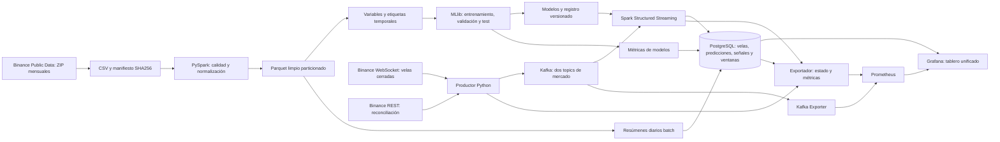

# CryptoPulse — Informe técnico y operativo integral

**Proyecto activo:** `D:\bigdata`  
**Fecha de revisión documental:** 29 de octubre de 2026, America/Lima (UTC−5).  
**Alcance:** producto funcional adaptado a las sesiones S01–S12 del curso Big Data, unidades 1 y 2.  
**Registro de modelos inspeccionado:** `20261029T011759858407Z.cal`.  
**Documento base del dominio:** `CryptoPulse_Brief_Tecnico_Analitico.docx`, suministrado por el usuario.

<a id="capitulo-01"></a>

## 1. Propósito, alcance y forma de leer este informe

CryptoPulse es una plataforma local para observar y anticipar condiciones de riesgo de BTC y SOL en el mercado Spot de Binance. Combina un histórico de velas de un minuto con eventos nuevos y reúne en Grafana cuatro dimensiones: volatilidad, caída significativa, actividad de negociación inusual y divergencia entre rendimientos. Su resultado es una evaluación explicada que permite decidir qué condiciones merecen revisión y con qué evidencia.

El usuario previsto es una persona que sigue el mercado: puede comprobar si el sistema tiene datos suficientes, revisar qué acaba de ocurrir, distinguirlo de lo que el modelo estima para después y consultar el resultado real cuando termina el horizonte. El producto conserva errores, referencias y procedencia para que una cifra en pantalla pueda rastrearse hasta sus datos y su método.

Este informe describe la implementación encontrada en los archivos, no una arquitectura ideal pendiente de construir. Las cantidades históricas y métricas proceden de artefactos guardados; los detalles de funcionamiento se contrastaron con los módulos Python, SQL, Compose y el generador del tablero. Los informes anteriores conservan estados de sus propias fechas: por ejemplo, un informe inicial menciona 19 paneles; el tablero actual tiene 23 paneles de datos, una guía y cuatro encabezados.

La última aceptación integral guardada es del **28 de octubre de 2026 a las 20:25:50 de Lima** y figura como PASS en `pyspark/sesiones/_runtime/aceptacion_producto.json`. Al consultar Docker durante esta revisión del 29 de octubre, el motor no estaba disponible: no existía su canal `dockerDesktopLinuxEngine`. Por ello, este documento no presenta aquella aceptación como una prueba en vivo realizada hoy. No fue necesario arrancar el proyecto, reentrenar modelos ni interrumpir servicios para documentarlo.

Los ejemplos numéricos explicativos se identifican como ejemplos y no sustituyen observaciones. Los estados de mercado cambian: una aceptación con `no_alerts` describe ese instante y no la situación actual ni futura.

El alcance financiero es el del brief: vigilancia analítica. El sistema no ejecuta órdenes, calcula beneficios de una estrategia ni proporciona una evaluación personalizada de inversión. Tampoco identifica fraude a partir del volumen. Estas delimitaciones explican cómo interpretar sus salidas, no son funciones pendientes ocultas.

### Índice navegable

- [1. Propósito, alcance y forma de leer este informe](#capitulo-01)
- [2. Las cuatro dimensiones y las ocho preguntas del proyecto](#capitulo-02)
- [3. Arquitectura implementada y recorrido completo](#capitulo-03)
- [4. Herramientas y responsabilidad concreta de cada una](#capitulo-04)
- [5. Despliegue físico, puertos y datos persistentes](#capitulo-05)
- [Datos históricos, preparación batch y calidad](#capitulo-06)
- [Variables analíticas: significado, fórmulas y condiciones](#capitulo-07)
- [Objetivos de aprendizaje y señales que se quieren anticipar](#capitulo-08)
- [Entrenamiento, separación temporal y selección](#capitulo-09)
- [Métricas de calidad de modelos: interpretación completa](#capitulo-10)
- [Publicación del batch y evaluación posterior en vivo](#capitulo-11)
- [Ingesta de datos nuevos: captura, contrato y publicación](#capitulo-12)
- [Kafka y procesamiento continuo con estado](#capitulo-13)
- [Inferencia, evaluación futura y señales explicables](#capitulo-14)
- [Diccionario de persistencia y trazabilidad](#capitulo-15)
- [API de producto, salud y observabilidad técnica](#capitulo-16)
- [Prometheus: qué mide, cómo lo guarda y para qué sirve](#capitulo-17)
- [Grafana: explicación de cada elemento visible](#capitulo-18)
- [Operación del proyecto: arranque, verificación y parada](#capitulo-19)
- [Reproducción del batch y preparación desde una copia sin artefactos](#capitulo-20)
- [Pruebas, evidencias y alcance de lo comprobado](#capitulo-21)
- [Qué se hizo en cada sesión S01–S12](#capitulo-22)
- [Diagnóstico de problemas frecuentes](#capitulo-23)
- [Persistencia, tamaño de carpeta y copias](#capitulo-24)
- [Limitaciones y correspondencia honesta con el brief](#capitulo-25)
- [Inventario de archivos y responsabilidad para mantenimiento](#capitulo-26)
- [Glosario aplicado](#capitulo-27)
- [Fuentes utilizadas y criterio de evidencia](#capitulo-28)
- [Anexo: cómo rastrear una cifra hasta sus datos](#capitulo-29)
- [Anexo: consultas exactas del dashboard inspeccionado](#capitulo-30)
- [Anexo: referencias de actividad por activo y hora UTC](#capitulo-31)
- [Anexo: calibración observada y métricas complementarias](#capitulo-32)

Las fórmulas, ejemplos, comandos y anexos forman parte del mismo informe. Las rutas del inventario son relativas a la raíz indicada; los accesos HTTP son locales.

<a id="capitulo-02"></a>

## 2. Las cuatro dimensiones y las ocho preguntas del proyecto

Cada dimensión tiene una pregunta batch sobre patrones históricos y aprendizaje, y otra streaming sobre el estado actual y su pronóstico. Las ocho preguntas comparten fuente y plataforma; no son ocho productos ni ocho modelos independientes.

**Volatilidad, E2.** En batch se estudia cuánto varían los precios y si sus patrones permiten estimar la volatilidad siguiente. En vivo se calcula la volatilidad reciente y se pronostica la realizada durante los próximos 15 minutos. Su magnitud expresa intensidad, no dirección: movimientos fuertes hacia arriba también elevan volatilidad.

**Caídas significativas, E5.** En batch se define un evento bajista con el percentil 5 de rendimientos futuros de entrenamiento. En vivo se estima la probabilidad de que el rendimiento entre el cierre actual y el cierre a 30 minutos esté bajo ese umbral. La probabilidad de evento y el porcentaje de pérdida que define el evento son dos números diferentes.

**Actividad anómala, E6.** En batch se estudian volumen monetario y operaciones por activo y hora UTC. En vivo se observa si la actividad reciente supera su referencia y se estima que la actividad de los próximos 5 minutos supere el P95 histórico de volumen o de operaciones. La salida significa actividad inusual bajo esa regla; no determina su causa.

**Correlación y divergencia, E4.** En batch se sincronizan los activos y se evalúa un regresor del rendimiento futuro de SOL menos el de BTC a 15 minutos. En vivo se actualizan correlación de rendimientos durante 60 minutos, divergencia reciente y pronóstico relativo. El candidato no superó la referencia cero y esa referencia es la desplegada, identificada como tal.

Con dos activos hay dos salidas de volatilidad, dos de caída, dos de actividad y una conjunta de divergencia: **siete series predictivas**. A cada una le corresponde una evaluación observada y una predictiva: **catorce combinaciones en el centro de señales**.

<a id="capitulo-03"></a>

## 3. Arquitectura implementada y recorrido completo

### 3.1 Por qué se considera una arquitectura Lambda

Lambda separa el trabajo histórico de la actualización de baja latencia y reúne sus resultados en una capa de consulta. En CryptoPulse la capa batch prepara millones de velas, entrena y valida modelos. La capa de velocidad incorpora velas recién cerradas, calcula variables y aplica los modelos ya guardados. La capa de servicio es PostgreSQL con tablas/vistas consultadas por Grafana, más una API de estado y señales.

La convergencia ocurre de dos maneras: los modelos y umbrales del batch se usan en la inferencia viva; los resúmenes históricos y resultados recientes se publican en la misma base de servicio. Las funciones de variables se comparten para reducir diferencias entre entrenamiento e inferencia.

La arquitectura no es Kappa pura: no se ha construido todo el histórico exclusivamente reproduciendo un único log Kafka. El batch descarga archivos mensuales y tiene su propio camino de preparación. Tampoco es una instalación de alta disponibilidad: hay contenedores separados, un solo broker y un motor Spark local en un equipo.



Si el lector Markdown no representa Mermaid, cada flecha equivale a una transferencia de datos o una consulta entre los componentes nombrados; el texto de los capítulos desarrolla el mismo recorrido.

### 3.2 Ejemplo temporal de una actualización

Supóngase una vela que abre a las 10:00:00 UTC y termina a las 10:00:59.999. Mientras está abierta, Binance puede emitir varias actualizaciones; CryptoPulse espera `k.x=true`. Ese cierre se convierte en el ancla analítica `as_of_ms`.

El productor valida el evento y espera confirmación de Kafka. En un micro-lote posterior, el archivo lo inserta en PostgreSQL. La inferencia consulta hasta 180 velas recientes por activo; si las variables necesarias están completas, produce las siete salidas del ancla disponible y sus señales. Grafana las consulta al refrescar. El procesamiento no espera 15 minutos para emitir la primera predicción de volatilidad: emite una estimación ahora y espera ese horizonte para conocer su verdad futura.

Para ese cierre de ejemplo, la actividad futura abarca los cinco cierres siguientes y termina a las 10:05:59.999; la volatilidad y divergencia terminan a las 10:15:59.999; la caída se evalúa con el cierre de las 10:30:59.999. Las tablas conservan el origen temporal de la estimación. La verdad futura aparece después y se alinea en los gráficos al ancla del pronóstico, no al instante en que terminó de evaluarse.

Las ventanas fijas de streaming siguen otra lógica: acumulan eventos por intervalos de calendario y se publican cuando avanza el watermark. No son el mecanismo que bloquea o dispara los horizontes de los modelos.

### 3.3 Qué aporta la plataforma más allá de dibujar precios

El precio aislado no informa si la actividad es extraordinaria para su horario, si la variación actual es extrema en la escala del activo o si SOL se separa de BTC en términos relativos. CryptoPulse añade esas comparaciones, anticipaciones evaluadas y una comprobación técnica de que los datos permiten interpretarlas.

Su utilidad tiene tres niveles: seguimiento descriptivo de hechos, vigilancia predictiva con errores visibles y trazabilidad operativa del proceso. La calidad del pipeline y la capacidad predictiva son dimensiones diferentes: un sistema puede estar técnicamente listo y tener un modelo con baja precisión. El informe y el tablero mantienen esa diferencia.

<a id="capitulo-04"></a>

## 4. Herramientas y responsabilidad concreta de cada una

### Docker Desktop y Docker Compose

Docker Desktop ejecuta contenedores Linux en Windows. Un contenedor encapsula el proceso y su entorno; una imagen contiene las dependencias necesarias para crearlo. Compose declara servicios, red, puertos, volúmenes, comandos y condiciones de arranque. `platform.yml` es la declaración del producto persistente; `pyspark/compose.yml` declara el entorno interactivo independiente.

Esto permite ejecutar el mismo Python y Java aunque Windows tenga otras versiones instaladas. Los puertos publicados se ligan a `127.0.0.1`, por lo que los accesos descritos son locales. Tener varios contenedores permite separar responsabilidades; no multiplica la memoria física ni convierte un único ordenador en un clúster de varios servidores.

Los servicios persistentes tienen `restart: unless-stopped`: pueden reiniciar tras un fallo mientras Docker esté disponible, pero una parada deliberada permanece hasta volver a arrancarlos. `tools` es una ejecución temporal para tareas de mantenimiento/verificación y no un servicio que deba quedar encendido.

### Python 3.10, Java 21 y PySpark 4.2.0

Python organiza descarga, validación, publicación, inferencia y comprobaciones. Java 21 proporciona la JVM que ejecuta Spark. PySpark es la interfaz Python del motor Spark; sus DataFrames expresan operaciones que Spark planifica y ejecuta. Una transformación como `filter` define un plan; acciones como `count`, `collect` o escritura lo ejecutan. El entorno conserva esa distinción desde S02.

El batch usa por defecto `local[4]`, memoria de driver `4g`, 16 particiones de shuffle, zona UTC y ejecución adaptativa. El streaming se lanza con `local[2]`, driver `3g` y cuatro particiones de shuffle. Esas cifras son configuraciones del proceso, no medidas de consumo permanente ni número de máquinas. El batch puede competir por recursos con el vivo; por eso el script de entrenamiento pausa el stream del proyecto y lo restaura al salir.

### Spark SQL y Structured Streaming

Spark SQL ejecuta filtros, joins, expresiones, agregaciones y funciones de ventana sobre tablas lógicas. Structured Streaming aplica ese motor a datos que crecen. En este proyecto utiliza micro-lotes cada 15 segundos, Kafka como entrada y `foreachBatch` como salida a PostgreSQL. Sus checkpoints conservan offsets y estado; las claves SQL hacen que una repetición no duplique resultados por negocio.

El conector Kafka cargado es `org.apache.spark:spark-sql-kafka-0-10_2.13:4.2.0`; el sufijo `_2.13` identifica compatibilidad binaria de Scala. Los JAR se resuelven mediante Ivy y se cachean en `_runtime/ivy`; no se usa ese directorio como almacenamiento de precios.

### Spark MLlib y sus pipelines

MLlib entrena los estimadores y guarda pipelines con ensamblado de variables y, cuando corresponde, escalado. `PipelineModel.load` permite aplicar esas mismas transformaciones en vivo. El entrenamiento es batch; `.transform()` en streaming aplica un modelo existente. No hay actualización incremental de pesos con cada vela.

Se entrenaron regresión lineal ridge, Random Forest y regresiones logísticas, y se compararon con referencias simples. La selección concreta y la calibración se detallan más adelante. No se usan APIs de IA, claves de OpenAI ni modelos de lenguaje para producir estos indicadores.

### Apache Kafka 4.3.1 y el cliente kafka-python 3.0.12

Kafka conserva eventos ordenados por partición en disco y desacopla el productor del consumidor. Si Spark se retrasa, puede continuar desde sus offsets mientras Kafka conserve esos datos. El cliente Python crea topics, publica eventos, espera confirmaciones y consulta offsets para diagnóstico.

El broker usa KRaft y combina roles `broker,controller`; no hay ZooKeeper. Hay un único nodo, factor de replicación 1 y retención configurada de 168 horas. Por ello, una copia perdida del volumen Kafka no tiene una segunda réplica local que la reemplace. El productor usa idempotencia y `acks=all`, lo que protege frente a determinados reintentos, pero con un solo broker «all» no significa varias copias independientes.

### PostgreSQL 17.6 y psycopg2-binary 2.9.13

PostgreSQL es la base de servicio: conserva velas recientes/recuperadas, predicciones originales, resultados posteriores, señales, ventanas, resúmenes batch y registros de modelos. Sus claves primarias resuelven idempotencia por identidad de negocio. `psycopg2` es el controlador Python; usa parámetros SQL para valores y `execute_values` para inserciones en lote. Cada bloque de conexión confirma o revierte su transacción.

El usuario de Grafana, `grafana_reader`, tiene permisos de lectura. El escritor del pipeline utiliza el usuario de la base configurado en Compose. PostgreSQL no publica un puerto al host en `platform.yml`: se consulta mediante red interna, Docker exec o Grafana. No se utiliza un data warehouse cloud ni una réplica CDC.

### Grafana 11.4.0

Grafana consulta PostgreSQL para datos analíticos y Prometheus para métricas técnicas. Presenta ambas fuentes en un único tablero; no entrena modelos ni captura el feed de Binance. El JSON se genera en `scripts/generar_dashboard.py` y se monta con provisión automática. La definición se revisa cada 10 segundos; el refresco visual predeterminado es también 10 segundos, pero son operaciones diferentes.

El tablero conserva UID `cryptopulse-main`, carpeta CryptoPulse, intervalo inicial de tres horas y zona horaria del navegador. Una URL antigua puede imponer UTC u otro intervalo. Cambiar el reloj mostrado no cambia la hora UTC usada para umbrales estacionales.

### Prometheus 3.14.0 y prometheus_client

Prometheus recoge y guarda series de salud operativa. Consulta `/metrics` del exportador cada 15 segundos y evalúa reglas cada 15 segundos. La biblioteca Python `prometheus_client` convierte las mediciones del proyecto a su formato de exposición. Esas mediciones responden si llegan datos, si Spark avanza y si las predicciones son recientes; no sustituyen las señales financieras almacenadas en PostgreSQL.

### Kafka Exporter 1.10.0 y Kafbat Kafka UI 1.5.0

Kafka Exporter consulta el broker y expone métricas de topics, particiones y offsets a Prometheus. El tablero usa el offset actual por partición agregado por topic para observar avance. El lag principal de CryptoPulse se calcula por separado comparando broker y checkpoint de Spark, porque los offsets de Structured Streaming no deben confundirse con el commit de un consumidor convencional.

Kafka UI permite inspeccionar topics, particiones y mensajes desde el navegador. Es una herramienta de diagnóstico; el recorrido de producción no necesita que una persona abra su interfaz. Tampoco es el productor del mercado.

### Jupyter Notebook 7.6.2, nbclient 0.10.2 y pandas 2.3.3

Jupyter ofrece el entorno de exploración y los notebooks iniciales del curso. `nbclient` permite ejecutar notebooks de forma automatizada y conservar salidas. pandas facilita operaciones tabulares auxiliares en ese entorno; la transformación y el aprendizaje principales usan Spark. Jupyter no es el servidor del pipeline vivo y puede detenerse sin cerrar Grafana ni el streaming.

Los módulos funcionales del producto están en `pyspark/sesiones/cryptopulse`. Las sesiones posteriores se implementaron en esos módulos y scripts compartidos; no debe suponerse que existen doce notebooks o doce carpetas completas de producto por tener doce sesiones cubiertas.

### Formatos y bibliotecas auxiliares

CSV conserva el intercambio de origen; ZIP comprime la descarga; SHA256 compara integridad con el checksum oficial; JSON guarda configuración y evidencias; JSONB permite consultar estructuras dentro de PostgreSQL; Parquet almacena columnas tipadas para lectura analítica; los modelos Spark incluyen metadatos y archivos propios de sus estimadores. Son representaciones con propósitos diferentes, no copias accidentalmente idénticas.

`requests` realiza llamadas HTTP REST, `websocket-client` recibe el feed público y las bibliotecas estándar manejan fechas, decimales, hashes, JSON y archivos. Los Dockerfiles fijan las versiones principales indicadas arriba; varias bibliotecas auxiliares llegan como dependencias transitivas y no tienen un lockfile completo de entorno. Conviene registrar un inventario de paquetes si se necesita reproducir exactamente todas sus versiones en otra fecha.

NumPy se utiliza de forma concreta en la calibración y selección: convierte probabilidades/etiquetas en arrays, calcula cuantiles y resuelve el pequeño sistema lineal del ajuste tipo Platt. Ese ajuste recoge las puntuaciones del tramo de validación en el driver; no es un entrenamiento completamente distribuido de cada operación numérica. También es una razón para no extrapolar el diseño local a un conjunto de calibración ilimitado sin revisar memoria.

PowerShell organiza arranque, entrenamiento, pruebas y parada desde Windows. Git conserva el código; `.gitignore` excluye `.env`, datos raw, artefactos y `_runtime`. Clonar solo el repositorio no incluye automáticamente históricos, modelos o checkpoints excluidos.

<a id="capitulo-05"></a>

## 5. Despliegue físico, puertos y datos persistentes

### 5.1 Servicios y conexiones

| Servicio | Proceso o función | Dirección desde Windows | Dirección entre servicios |
|---|---|---|---|
| `kafka` | Broker/controlador KRaft | `localhost:49092` | `kafka:9092`; controlador interno 9093 |
| `postgres` | Base CryptoPulse | Sin puerto publicado | `postgres:5432` |
| `producer` | Captura WS y reconciliación REST | Sin interfaz publicada | Kafka y salidas HTTPS/WSS |
| `streaming` | Driver Spark y tres consultas | Sin puerto de UI publicado | Kafka y PostgreSQL |
| `exporter` | API y métricas | `http://localhost:48000` | `exporter:8000` |
| `kafka-exporter` | Métricas del broker | Sin puerto publicado | `kafka-exporter:9308` |
| `kafka-ui` | Inspección Kafka | `http://localhost:48085` | `kafka-ui:8080` |
| `prometheus` | Series técnicas y reglas | `http://localhost:49090` | `prometheus:9090` |
| `grafana` | Dashboard | `http://localhost:43000` | `grafana:3000` |
| `tools` | Tareas efímeras, perfil tools | Sin interfaz publicada | Misma red del producto |
| `pyspark` | Jupyter/Spark interactivo separado | `http://localhost:4488`; Spark UI 4042 si existe una sesión activa | Proyecto Compose independiente |

Los nueve servicios persistentes del producto comparten `cryptopulse-net`. Jupyter tiene su configuración Compose separada y monta la misma carpeta de sesiones para acceder a históricos y modelos; no es el consumidor Kafka del producto. Su interfaz Spark UI en 4042 corresponde al Spark interactivo, no necesariamente al driver persistente de streaming.

Los nombres de host internos solo se resuelven en la red Docker. En un navegador Windows se usa `localhost` y el puerto publicado; desde un contenedor, `localhost` se refiere al propio contenedor, por lo que Grafana consulta `postgres:5432` y `prometheus:9090`.

### 5.2 Imágenes, montajes y volúmenes

La imagen base `cryptopulse-pyspark-pyspark:latest` se construye con `pyspark/Dockerfile`. `cryptopulse-runtime:local` parte de esa imagen y añade clientes Kafka y PostgreSQL. Productor, streaming, exportador y tools reutilizan ese runtime, cada uno con un comando distinto.

La carpeta `D:\bigdata\pyspark\sesiones` se monta como `/opt` en los procesos Python. Allí están el código, datos, modelos y `_runtime`. Un cambio del código montado se ve en disco dentro del contenedor, pero un proceso que ya importó módulos o cargó un modelo puede necesitar reinicio para utilizarlo. El registro de modelos se lee al crear `ModelBundle`.

Los volúmenes nombrados del producto son `cryptopulse_kafka_data`, `cryptopulse_postgres_data`, `cryptopulse_prometheus_data` y `cryptopulse_grafana_data`. Guardan respectivamente log Kafka, base PostgreSQL, series técnicas y configuración/usuarios de Grafana. Docker puede mostrar además volúmenes anónimos derivados de imágenes. No todos esos datos son archivos ordinarios visibles bajo `D:\bigdata`.

Detener contenedores conserva sus volúmenes y los bind mounts. Copiar únicamente la carpeta del proyecto conserva fuentes y artefactos montados, pero no equivale a una copia de PostgreSQL ni de los otros volúmenes. El procedimiento de copia se explica en operación.

### 5.3 Configuración y parámetros de entorno

`config/pipeline.json` define `history_from=2022-01` y `history_to=2026-09`. `config/cost-assumptions.json` contiene las hipótesis del escenario económico. `.env` permite a Compose suministrar `INFERENCE_ENABLED`, contraseña local de PostgreSQL, acceso Grafana y token de Jupyter cuando corresponde. No se precisan tokens Binance para las fuentes públicas de este producto.

Las aplicaciones reciben `PYTHONPATH=/opt`, `KAFKA_BOOTSTRAP=kafka:9092`, `PGHOST=postgres`, `PGDATABASE=cryptopulse`, `PGUSER=cryptopulse` y `PGPASSWORD` desde Compose. `CRYPTOPULSE_ROOT` permite sustituir `/opt` en las utilidades compartidas; el despliegue descrito usa `/opt`. La inferencia solo se activa cuando `INFERENCE_ENABLED` es `true` en el servicio streaming; la salud integral informa si está deshabilitada.

Los accesos de uso solicitados por el usuario son Grafana con usuario `admin`, contraseña `la contraseña configurada localmente`, y Jupyter con token local el token configurado localmente. No se necesita una clave de cuenta para abrir Prometheus o Kafka UI en esta configuración local. Es una configuración de equipo local; publicar esos puertos a una red requeriría revisar autenticación y acceso.

<a id="capitulo-06"></a>

## Datos históricos, preparación batch y calidad

### Qué representa exactamente una fila

La unidad de observación de CryptoPulse es una **vela cerrada de un minuto del mercado Spot de Binance**. Una vela resume las operaciones que ocurrieron en un intervalo de un minuto. No es una orden del libro, una operación individual, un precio tomado de una página ni una cotización de futuros. `BTCUSDT` representa BTC cotizado en USDT y `SOLUSDT` representa SOL cotizado en USDT. USDT es la moneda de cotización; el proyecto no debe llamar USD a estos importes sin aclarar la diferencia.

Los doce campos del CSV de origen, en orden, son:

1. `open_time_raw`: instante de inicio del intervalo; su unidad cambia según el mes del archivo.
2. `open`: precio de la primera operación de la vela, en USDT por unidad del activo.
3. `high`: precio máximo de la vela.
4. `low`: precio mínimo de la vela.
5. `close`: precio de la última operación de la vela; es la base de los rendimientos utilizados por los modelos.
6. `volume`: volumen negociado expresado en el activo base: BTC o SOL.
7. `close_time_raw`: final del intervalo.
8. `quote_asset_volume`: importe negociado expresado en USDT; permite comparar actividad sin confundir cantidad de monedas con importe.
9. `number_of_trades`: número de operaciones incluidas en la vela. No es número de personas, cuentas ni órdenes únicas.
10. `taker_buy_base_volume`: volumen de compras iniciadas por el tomador de liquidez, en el activo base.
11. `taker_buy_quote_volume`: ese volumen de compra expresado en USDT.
12. `ignore`: campo del formato de Binance que el proceso limpio descarta.

Los campos `taker_buy_*` se conservan en el conjunto limpio, pero no forman parte de las catorce variables de los modelos actuales. Su presencia no significa que CryptoPulse tenga implementado un análisis de desequilibrio comprador/vendedor.

El precio y los volúmenes originales se leen con `DecimalType(28,8)`. Así, Spark usa una representación decimal con hasta 28 dígitos totales y 8 decimales al validar y almacenar esos valores. En los cálculos estadísticos y modelos se convierten expresamente a `double`, porque los logaritmos, covarianzas y estimadores operan con números de punto flotante. Esta conversión es intencional y no convierte la salida estadística en una medición de precisión monetaria exacta.

### Procedencia y trazabilidad

La descarga histórica mensual utiliza esta plantilla real:

```text
https://data.binance.vision/data/spot/monthly/klines/{SYMBOL}/1m/{SYMBOL}-1m-{AAAA-MM}.zip
```

Cada ZIP tiene un archivo acompañante `.CHECKSUM`. `scripts/descargar_historicos_s02.py` descarga el checksum oficial, calcula SHA256 del ZIP recibido y exige coincidencia antes de aceptarlo. Si ya existe una copia local cuyo hash coincide, reutiliza ese ZIP. El CSV se extrae leyendo el único miembro CSV del archivo; no se extraen rutas arbitrarias del ZIP. Se escribe primero un archivo temporal `.part` y después se reemplaza el destino.

El manifiesto `pyspark/sesiones/s02-fundamentos/data/provenance.json` conserva símbolo, mes, URL, URL del checksum, hash del ZIP, hash del CSV, filas, filas teóricas del calendario y unidad temporal de origen. `synthetic: false` indica que el origen descargado es real; la validación posterior determina si esas filas cumplen el contrato. SHA256 detecta cambios o corrupción respecto de la copia cuya huella se verificó; no demuestra que un precio del proveedor sea económicamente correcto.

La descarga usa hasta tres intentos ante errores recuperables de red/servidor y una espera exponencial corta. Un 404 produce un error explícito: no se sustituye el archivo ausente por datos simulados. Solo admite meses UTC cerrados. El script, ejecutado sin argumentos, tiene valores iniciales reducidos `2024-12` a `2025-01`; el intervalo del producto completo está en `config/pipeline.json`, de `2022-01` a `2026-09`, y los scripts del producto le pasan ese rango. No debe confundirse el valor predeterminado del ejercicio inicial con el histórico realmente preparado.

La sesión S01 usó una muestra diaria distinta: 1 de enero de 2025, 1.440 velas por activo y 2.880 filas en total. Se descargó desde `data/spot/daily/klines/...`, se comprobó SHA256 y se generó `cryptopulse_klines_muestra.csv`. Su misión fue comprobar el entorno Spark y las primeras transformaciones. Esa muestra no es el entrenamiento completo ni es un stream en vivo.

### Dimensión del histórico validado

La ejecución registrada de S03 informa:

| Magnitud | Valor registrado | Interpretación |
|---|---:|---|
| Meses | 57 | Enero de 2022 a septiembre de 2026, ambos incluidos. |
| Archivos mensuales | 114 | 57 meses multiplicados por 2 activos. |
| Filas originales | 4.993.759 | Suma de los archivos descargados. |
| Filas inválidas | 2 | Se conservaron en cuarentena. |
| Filas limpias | 4.993.757 | Entradas admitidas tras calidad. |
| BTCUSDT limpio | 2.496.879 | Velas válidas de BTC. |
| SOLUSDT limpio | 2.496.878 | Velas válidas de SOL. |
| Claves con precios/actividad contradictorios | 0 | No se encontraron conflictos en esa ejecución. |
| Filas eliminadas por duplicación/conflicto adicional | 0 | No hay una deduplicación masiva ocultando registros. |
| Tramos con huecos | 3 | Discontinuidades entre velas consecutivas. |
| Minutos-activo faltantes | 163 | La suma por activo; no equivale necesariamente a 163 minutos distintos de calendario. |

El primer inicio de vela es `1640995200000` y el último `1790812740000`, ambos en milisegundos UTC. El informe de calidad persiste en `_runtime/s03.json` y `s03-calidad/artifacts/verificacion_s03.json`. Los contadores no significan que se hayan corregido los huecos inventando precios: el sistema conserva y comunica esos huecos.

### Normalización temporal

Los archivos históricos anteriores a enero de 2025 utilizan milisegundos. Desde enero de 2025, los archivos utilizados tienen marcas en microsegundos. `quality.load_raw()` identifica el mes a partir del nombre del CSV y, cuando corresponde, realiza división entera por 1.000. Los campos normalizados son `open_ms` y `close_ms`.

En una vela normalizada de un minuto se exige:

```text
open_ms % 60000 = 0
close_ms - open_ms = 59999
```

`event_time` se crea a partir de `close_ms`; por tanto, representa el final de la vela. Spark trabaja con `spark.sql.session.timeZone=UTC`. Los campos `year`, `month` y `date_utc` se derivan de ese tiempo normalizado. Esto evita interpretar como una fecha remota un timestamp de microsegundos tratado erróneamente como milisegundos.

### Reglas de calidad y qué ocurre al fallar

`quality.mark_quality()` construye `quality_errors`, una lista que puede contener varios motivos en la misma fila:

- `required_null`: falta al menos uno de los campos fundamentales de símbolo, tiempos, OHLC o actividad. No todos los campos auxiliares del proveedor son obligatorios para este control; `taker_buy_*` e `ignore` no forman parte de esa lista mínima.
- `unknown_symbol`: el símbolo no pertenece a BTCUSDT o SOLUSDT.
- `invalid_ohlc`: existe precio no positivo, `high` es menor que apertura/cierre, `low` supera apertura/cierre o el máximo es menor que el mínimo.
- `negative_activity`: volumen base, volumen en USDT o número de operaciones negativo.
- `invalid_interval`: el minuto no está alineado o su duración normalizada no es exactamente 59.999 ms entre inicio y cierre.

La lectura CSV tiene esquema explícito y modo `FAILFAST`: un error de parseo incompatible con el esquema puede detener la lectura antes de obtener una fila marcada. Las reglas de cuarentena actúan sobre las filas que sí pudieron convertirse al esquema. Conviene distinguir un fallo de carga estructural de una fila cargada pero semánticamente inválida.

Las filas inválidas se escriben en `s03-calidad/artifacts/quarantine`. Para las filas válidas, el código agrupa por `(symbol, open_ms)` y compara las versiones de `(open, high, low, close, volume, quote_asset_volume, number_of_trades)`. Si una misma clave trae valores contradictorios en ese conjunto, conserva la evidencia en `conflicting_duplicates` y excluye la clave de los datos limpios. No selecciona de forma arbitraria uno de los precios. Después aplica `dropDuplicates` sobre la clave para eliminar repeticiones equivalentes. Los campos auxiliares `taker_buy_*` no forman parte de la comparación de conflicto: es una limitación concreta del control actual.

Finalmente calcula el salto entre `open_ms` y el de la fila anterior del mismo activo. Un salto superior a 60.000 ms genera un registro en `s03-calidad/artifacts/gaps`. El número faltante es `delta_ms/60000 - 1`. No hay interpolación, relleno hacia delante ni sustitución por cero en los precios.

### Por qué Parquet y por qué esas particiones

El conjunto limpio se escribe como Parquet bajo `s03-calidad/artifacts/clean_parquet`, particionado por `symbol/year/month`. Parquet conserva tipos, almacena por columnas y reduce la lectura necesaria cuando solo se consultan ciertas variables. El particionado permite que una consulta de BTC de enero de 2025 descarte carpetas de SOL y de otros meses antes de leer todos sus contenidos.

La escritura usa `repartition(16, symbol, year, month)` y Spark configura 16 particiones de shuffle para estas tareas locales. Esto reparte trabajo dentro del proceso Spark disponible; no significa que existan dieciséis servidores. S03 verifica que el plan de una consulta filtrada contiene `PartitionFilters` y guarda ese plan en `partition_pruning.txt`.

Hay un archivo original CSV, un ZIP y varias representaciones derivadas porque cumplen funciones distintas: reproducibilidad de la fuente, copia compacta, conjunto tipado de calidad y datos listos para aprendizaje. Esa coexistencia explica una parte importante del tamaño de la carpeta.

<a id="capitulo-07"></a>

## Variables analíticas: significado, fórmulas y condiciones

### Convenciones de lectura

Sea `t` el minuto ancla cerrado, `P_t` su precio de cierre, `O_t` su apertura, `H_t` su máximo, `L_t` su mínimo, `Q_t` su volumen en USDT y `N_t` su número de operaciones. Las variables retrospectivas solo utilizan datos con minuto menor o igual a `t`. `features.past_features()` contiene su definición compartida para batch e inferencia.

Una ventana de 60 rendimientos de un minuto necesita 61 cierres: uno anterior para calcular el primer rendimiento y los 60 cierres siguientes. Por eso el contexto integral comprueba 61 velas consecutivas por activo. Una variable calculada a partir de cinco filas no representa necesariamente cinco minutos: el código comprueba también el tiempo transcurrido para evitar ese error cuando hay huecos.

### Las catorce variables realmente entregadas a los modelos por activo

1. **`r1`: rendimiento de un minuto.** `100 × (P_t/P_(t−1) − 1)`. Se expresa en porcentaje. Si el cierre pasa de 100 a 101, el resultado es 1. Mide el cambio inmediato, no la probabilidad de subida.
2. **`r5`: rendimiento de cinco minutos.** `100 × (P_t/P_(t−5) − 1)`. Compara extremos separados exactamente cinco minutos; no es la suma aritmética de cinco porcentajes de un minuto.
3. **`r15`: rendimiento de quince minutos.** La misma fórmula con retraso 15. Aporta dirección reciente en el horizonte usado también por volatilidad y divergencia.
4. **`r30`: rendimiento de treinta minutos.** La misma fórmula con retraso 30. Sirve además para la señal de caída ya observada. Un valor negativo indica pérdida relativa entre extremos.
5. **`rv15`: volatilidad realizada retrospectiva de quince minutos.** `100 × sqrt(sum(log(P_i/P_(i−1))²))`, con los últimos 15 rendimientos logarítmicos. Es no negativa y se expresa en porcentaje. No está anualizada, no resta una media como la desviación estándar muestral y no representa probabilidad.
6. **`rv60`: volatilidad realizada retrospectiva de sesenta minutos.** La misma fórmula sobre 60 rendimientos. Introduce un contexto de variabilidad más largo. No es directamente comparable con `rv15` como si ambas midieran el mismo horizonte.
7. **`log_quote5`: actividad monetaria reciente transformada.** Primero `quote5 = sum(Q_i)` sobre las cinco velas consecutivas más recientes, incluyendo `t`; luego `log_quote5 = ln(1 + quote5)`. La transformación reduce la diferencia de escala entre actividad habitual y valores muy grandes. El logaritmo no conserva la unidad USDT.
8. **`log_trades5`: actividad por operaciones transformada.** Primero `trades5 = sum(N_i)` en esas cinco velas; después `ln(1 + trades5)`. Cuenta operaciones reportadas, no participantes.
9. **`range_pct`: amplitud de la vela actual.** `100 × (H_t − L_t)/O_t`. Mide el recorrido interno máximo-mínimo relativo a la apertura. Una vela puede tener un rango amplio y un cuerpo pequeño si termina cerca de donde abrió.
10. **`body_pct`: cuerpo firmado de la vela.** `100 × (P_t − O_t)/O_t`. Es positivo si cierre supera apertura y negativo si queda por debajo.
11. **`volume_ratio`: intensidad reciente relativa a la última hora.** `12 × quote5/quote60`, donde `quote60 = sum(Q_i)` en las 60 velas recientes. Multiplicar por 12 compara la actividad de cinco minutos con la actividad media de un bloque de cinco minutos de esa hora. Un valor 1 equivale a la media; un valor 2 equivale al doble. Si `quote60` no es positivo o el contexto está incompleto, la variable queda nula.
12. **`hour_sin`: componente seno de la hora UTC.** `sin(2π × hora/24)`. Representa la posición en el ciclo diario sin crear una discontinuidad artificial entre las 23 y las 0 horas.
13. **`hour_cos`: componente coseno de esa hora.** `cos(2π × hora/24)`. Junto con el seno permite distinguir posiciones que tendrían el mismo seno. Se usa la hora entera del cierre, no minuto fraccionario ni hora de Lima.
14. **`is_sol`: identidad del activo.** Vale 1 para SOLUSDT y 0 para BTCUSDT. Los tres modelos por activo se entrenan con filas de ambos activos y esta variable informa de cuál corresponde a cada fila. No hay seis modelos independientes, uno por activo y dimensión.

También se calculan `r60`, `log_r1`, `quote5`, `quote60`, `trades5`, `trades60`, `hour_utc` y `close_d` como variables auxiliares. `r60` y `trades60` no figuran entre las catorce entradas del modelo actual, aunque estén disponibles durante la transformación. `log_r1 = ln(P_t/P_(t−1))` es la base de las volatilidades realizadas.

Para `rN`, el retraso por filas debe coincidir con `N × 60000` ms. Para `rvN`, además deben existir N rendimientos válidos. Para actividad de cinco/sesenta minutos, se exige N filas y diferencia de tiempo entre primera y última igual a `(N−1) × 60000`. Estas condiciones impiden presentar un período incompleto como si fuera una ventana temporal completa.

### Variables conjuntas BTC–SOL

`features.pair_features()` hace un `inner join` de BTC y SOL por `open_ms`. Cada fila conjunta representa el mismo minuto en ambos activos. El vector del candidato de divergencia tiene **30 entradas**: las 14 variables anteriores con prefijo `btc_`, las mismas 14 con prefijo `sol_` y dos adicionales:

- **`correlation_60m`: correlación de Pearson entre rendimientos de un minuto de BTC y SOL**, con 60 observaciones simultáneas y consecutivas. Se calcula como covarianza poblacional dividida por el producto de desviaciones poblacionales. Oscila entre −1 y 1 si está definida. Cerca de 1 indica movimientos lineales similares; cerca de −1, opuestos; cerca de 0, poca asociación lineal en esa ventana. No demuestra causalidad ni mide rentabilidad. Si alguna desviación es cero, `try_divide` devuelve nulo; no se fabrica una correlación cero.
- **`current_spread15`: diferencia de rendimientos de quince minutos.** `r15_SOL − r15_BTC`, en **puntos porcentuales**. Si SOL gana 2 % y BTC gana 0,5 %, el resultado es +1,5 puntos. El signo positivo significa que SOL rindió más que BTC durante ese intervalo; un signo negativo, lo contrario. No es diferencia entre los precios monetarios de ambas monedas.

En vivo, la inferencia requiere además que las últimas velas de ambos activos tengan exactamente el mismo minuto. No toma un último par antiguo para aparentar que la comparación está al día.

### KPI de actividad adicional

La inferencia publica `volume_zscore = (quote5 − media_historica)/desviacion_historica`, con referencia del activo y su hora UTC. Es una medida descriptiva de alejamiento respecto de una distribución histórica, no una probabilidad ni una prueba de normalidad. La media y desviación se guardan en los umbrales; el criterio principal de actividad anómala utiliza percentiles P95 y número de operaciones, no un corte de z-score.

<a id="capitulo-08"></a>

## Objetivos de aprendizaje y señales que se quieren anticipar

### Dimensión 1: volatilidad en los próximos 15 minutos

La etiqueta `target_volatility` aplica la fórmula de volatilidad realizada a los rendimientos de los minutos `t+1` a `t+15`. Exige todos los rendimientos válidos y que el extremo futuro esté exactamente quince minutos después. El modelo responde «qué intensidad de variación podría haber en el próximo intervalo», sin predecir el precio de cierre ni su dirección.

Su referencia sencilla es **persistencia**: pronosticar que la volatilidad futura será igual a `rv15`, la volatilidad observada en los últimos quince minutos. La señal de vigilancia compara el pronóstico con el P95 de `rv15` del entrenamiento, por activo: BTC **0,5390712168 %** y SOL **1,0093271195 %**. Esos límites son referencias históricas de volatilidad, no probabilidades de 53,9 % y 100,9 %.

### Dimensión 2: evento de caída al terminar los próximos 30 minutos

Primero se calcula `future_r30 = 100 × (P_(t+30)/P_t − 1)`. La etiqueta `target_crash` vale 1 cuando ese rendimiento es menor o igual al P5 histórico del activo calculado con entrenamiento. Los límites actuales son BTC **−0,5577403410 %** y SOL **−1,1164904654 %**.

La definición es una caída **entre el cierre ancla y el cierre a 30 minutos**. No es el mínimo intrahorizonte, el máximo drawdown ni una caída de cualquier magnitud ocurrida en algún momento del intervalo. Si el precio cae mucho y se recupera antes del cierre final, la etiqueta puede ser 0.

El resultado del clasificador es una probabilidad entre 0 y 1. La vigilancia predictiva se activa al superar el umbral de probabilidad seleccionado, actualmente **0,0580141132**, aproximadamente 5,80 %. Este número es distinto del umbral de rendimiento negativo que define el evento. Un umbral probabilístico bajo se explica por un evento poco frecuente y una selección basada en F1; no debe describirse como un evento «casi seguro».

### Dimensión 3: actividad inusual en los próximos 5 minutos

Se suman el volumen en USDT y el número de operaciones de los minutos `t+1` a `t+5`. `target_anomaly` vale 1 si el volumen supera o iguala su P95 **o** las operaciones superan o igualan el suyo. Las referencias se calculan por símbolo y hora UTC usando entrenamiento. La etiqueta futura usa la hora del final de ese horizonte: `future_hour5`.

La combinación OR es importante: basta que una de las dos medidas cruce el límite. El P95 de cada medida por separado no implica que la unión ocurra exactamente el 5 % de las veces. La actividad inusual puede responder a noticias, cambios de liquidez, volatilidad u otros motivos; el dato agregado no identifica fraude, manipulación ni personas.

La salida predictiva es una probabilidad. El umbral actual es **0,3424626109**, aproximadamente 34,25 %. La observación actual usa la actividad de los últimos cinco minutos y las referencias de la hora actual; la etiqueta futura usa el siguiente tramo. Ambas deben mantenerse diferenciadas.

### Dimensión 4: divergencia relativa en los próximos 15 minutos

`target_divergence = future_r15_SOL − future_r15_BTC`, expresado en puntos porcentuales. La referencia es pronosticar siempre **0**: ausencia de ventaja de rendimiento de un activo frente al otro en el horizonte. Se entrenó un candidato ridge con 30 variables, pero no superó la RMSE de esa referencia en validación. Por eso el producto despliega cero y lo identifica como **REFERENCIA**.

El límite de magnitud para divergencia observada es el P95 del valor absoluto de la divergencia futura del entrenamiento: **0,7777201924 puntos porcentuales**. La divergencia observada mantiene utilidad descriptiva; la línea de pronóstico cero no prueba que se haya aprendido a anticipar desacoplamientos.

<a id="capitulo-09"></a>

## Entrenamiento, separación temporal y selección

### Preparación del conjunto supervisado

`training.prepare()` lee el Parquet limpio, crea las variables retrospectivas y añade las etiquetas futuras. Los percentiles se calculan exclusivamente en el tramo de entrenamiento. Las filas con alguna de las catorce entradas o etiquetas requeridas nula se excluyen del conjunto común. Por este diseño, los tres modelos por activo comparten filas completas para todos sus objetivos: un faltante futuro de una dimensión puede excluir la fila de ese conjunto común aunque otra etiqueta sí existiera.

Después conserva anclas con `open_ms % 900000 == 0`: una observación cada quince minutos. Esto reduce la carga de entrenamiento y parte de la superposición entre ejemplos; no elimina toda dependencia temporal, especialmente para el horizonte de treinta minutos. Para el par aplica el mismo muestreo y exige sus treinta variables y su etiqueta completas.

Los resultados se guardan como `s04-modelos/artifacts/model_dataset` y `pair_dataset`. Una huella SHA256 de `features.py` y `_runtime/s03.json` se registra en `preparation.json`. Si ambos conjuntos tienen `_SUCCESS` y la firma coincide, se reutilizan. La firma controla esos insumos concretos; no es una versión criptográfica exhaustiva de todos los archivos del proyecto.

### Cronología de las particiones

- **Entrenamiento:** histórico de 2022–2024, con `open_ms + 30 min < 2025-01-01 00:00 UTC`.
- **Validación:** desde 2025-01-01, con `open_ms + 30 min < 2026-01-01 00:00 UTC`.
- **Prueba/test:** desde 2026-01-01 hasta el final disponible de septiembre de 2026, excluyendo las filas finales cuyo futuro no puede construirse.

El margen de treinta minutos evita que la etiqueta de una fila del tramo anterior utilice datos del siguiente tramo. Es conservador para los objetivos de cinco y quince minutos. No se hace una mezcla aleatoria de pasado y futuro.

Para los clasificadores, la validación se divide de nuevo:

1. Calibración: enero–agosto de 2025, exigiendo `open_ms + 30 min < 2025-09-01`.
2. Selección: septiembre–diciembre de 2025, ya protegida también por el embargo antes del test.

La versión vigente tiene **46.652 filas de calibración** y **23.420 de selección** por clasificador. La última ancla de calibración es `1756682100000`, 45 minutos antes del límite de septiembre, por la combinación de muestreo de quince minutos y comparación estricta del embargo. La primera de selección es `1756684800000`.

El conjunto común registra 210.392 filas de entrenamiento, 70.076 de validación y 52.412 de test. El conjunto conjunto BTC–SOL registra 105.195, 35.038 y 26.207 respectivamente. Las cantidades son ejemplos analíticos muestreados; no son los millones de velas originales.

### Modelos candidatos y parámetros concretos

**Ridge para regresión.** Se usa `VectorAssembler` y `LinearRegression` de Spark ML con `regParam=0.1`, `elasticNetParam=0` y `maxIter=40`. La penalización L2 reduce coeficientes extremos. Participa como candidato para volatilidad y divergencia. El código no incorpora un `StandardScaler` explícito en este pipeline de regresión.

Eso no implica que el estimador lineal tenga deshabilitada su opción interna de estandarización: el código no modifica ese parámetro predeterminado. En cambio, la logística sí desactiva expresamente la segunda estandarización tras su etapa `StandardScaler`.

**Random Forest para volatilidad.** Se usa `RandomForestRegressor` con 20 árboles, profundidad máxima 5, al menos 30 ejemplos por nodo y semilla 26. Aprende relaciones no lineales y combinaciones entre variables mediante árboles. Se compara con ridge y con persistencia. La salida negativa, si alguna apareciera en el tratamiento común de regresión de volatilidad, se recorta a cero: una volatilidad negativa no tiene sentido.

**Regresión logística para caída y actividad.** Cada dimensión usa su propio pipeline de `VectorAssembler`, `StandardScaler(withMean=True, withStd=True)` y `LogisticRegression(maxIter=60, regParam=0.01, standardization=False)`. El escalador centra y normaliza las variables usando el entrenamiento; el último `standardization=False` evita pedir una segunda estandarización al estimador. La logística produce la probabilidad de la etiqueta 1. No se usa un LLM, una red neuronal, un modelo de lenguaje ni una API de IA externa.

**Calibración tipo Platt.** La probabilidad logística se convierte con:

```text
p_clip = limitar(p, 0.000001, 0.999999)
p_calibrada = 1 / (1 + exp(-(a × ln(p_clip/(1-p_clip)) + b)))
```

Los parámetros `a,b` se ajustan en el tramo de calibración, mediante hasta 60 iteraciones de un método de Newton amortiguado, regularización pequeña y límites numéricos. El ajuste favorece probabilidades que correspondan mejor a frecuencias observadas, sin garantizar calibración perfecta fuera de muestra. Los parámetros vigentes son `(1,3739171646; 0,6002486738)` para caída y `(2,1138630089; 2,6778928930)` para actividad.

### Cómo se elige lo que realmente se despliega

En regresión, la referencia empieza siendo la ganadora. Un candidato solo la reemplaza si consigue RMSE estrictamente menor en validación. Todos los candidatos entrenados se guardan, incluso si no serán desplegados. Para volatilidad ganó Random Forest; para divergencia conservó la referencia cero.

Para cada clasificador se calcula una referencia probabilística constante por activo igual a su prevalencia en entrenamiento. En caída es aproximadamente 5,0210 % BTC y 5,0022 % SOL. En actividad es 7,0276 % BTC y 7,4539 % SOL. El candidato calibrado se despliega solamente si su Brier en selección es menor que el de esa referencia.

El umbral de alarma del candidato se busca en hasta 80 cuantiles entre 0,05 y 0,995 de sus probabilidades de selección. Para cada corte calcula F1 y conserva el mejor. Se evalúan dos decisiones diferentes: **Brier selecciona el método probabilístico** y **F1 selecciona el corte que convierte probabilidad en positivo/negativo**. El test de 2026 evalúa la decisión ya tomada; no interviene en elegir modelo, calibración o corte.

Los percentiles históricos usan `percentile_approx` con precisión configurada 10.000. Las referencias de actividad se calculan sobre las ventanas retrospectivas válidas del entrenamiento por activo/hora; después se aplican al tramo futuro que se quiere etiquetar, utilizando la hora de su final. La muestra que fija esos percentiles no es exclusivamente el conjunto supervisado ya reducido a anclas cada quince minutos.

### Versiones y recalibración vigente

El registro activo es `s04-modelos/artifacts/model_registry.json`, versión **`20261029T011759858407Z.cal`**. La fecha del identificador es UTC. Reutiliza los estimadores de la versión base **`20261026T223241Z`** y corrige la separación temporal de calibración/selección. Los regresores y sus informes se conservaron; los clasificadores base no se reentrenaron desde cero.

`training --recalibrate` exige el conjunto supervisado existente, conserva una copia del registro anterior en `registries`, recalcula ambos calibradores, selección y evaluación de test, guarda las predicciones del test bajo la nueva versión y publica el nuevo registro **al final** mediante reemplazo atómico. Así, un lector ve un registro anterior completo o uno nuevo completo. Esa publicación no equivale a recargar mágicamente un `ModelBundle` ya creado en el proceso de streaming: los scripts de operación reinician/recrean el servicio cuando corresponde y la salud compara su versión con la activa.

El registro contiene rutas de los modelos, variables, objetivos, límites temporales, criterios de selección, parámetros de calibración, prevalencias, umbrales, tamaños de partición y métricas. Su ruta relativa apunta a modelos en `s04-modelos/artifacts/models/...`. No se usa MLflow ni un registro cloud; el control de versiones del modelo es local mediante archivos y la tabla de registros en PostgreSQL.

<a id="capitulo-10"></a>

## Métricas de calidad de modelos: interpretación completa

### Métricas de regresión

**`n`** es el número de ejemplos evaluados. Un error basado en cinco observaciones no tiene el mismo respaldo que uno basado en decenas de miles.

**MAE**, error absoluto medio, es `sum(abs(predicción − real))/n`. Se interpreta en la unidad del objetivo. Para volatilidad está en puntos de la escala porcentual de volatilidad y para divergencia en puntos porcentuales de rendimiento relativo. Menor es mejor. No significa porcentaje de aciertos.

**RMSE**, raíz del error cuadrático medio, es `sqrt(sum((predicción − real)^2)/n)`. Penaliza más los errores grandes que MAE. Es la medida usada para seleccionar regresores. Puede preferir un modelo distinto del que tenga MAE ligeramente menor, como ocurre con el candidato de divergencia.

### Métricas de clasificación y calibración

**TP** son eventos reales detectados; **FP**, avisos positivos que no se materializaron; **FN**, eventos reales que no fueron avisados; **TN**, ausencias de evento clasificadas negativas. Se calculan al comparar la probabilidad con el corte de alarma del método evaluado.

**Precisión** es `TP/(TP+FP)`: de lo avisado, qué parte realmente ocurrió. **Recall/sensibilidad** es `TP/(TP+FN)`: de lo ocurrido, qué parte se detectó. Ambas dependen del corte y no son intercambiables. El código utiliza denominador mínimo 1 para evitar una división por cero cuando no hay positivos.

**F1** es `2TP/(2TP+FP+FN)`. Equilibra precisión y recall en una sola cifra para buscar el umbral. No considera explícitamente el costo económico de una falsa alarma ni el de una oportunidad perdida.

**PR-AUC** es el área bajo la curva precisión–recall calculada por el evaluador de Spark sobre la puntuación probabilística. Resume la capacidad de ordenar eventos frente a no eventos al variar el corte. Resulta especialmente relevante cuando los positivos son poco frecuentes. No equivale a «probabilidad de que una alerta sea correcta» y depende de la prevalencia y de la muestra evaluada.

**Brier** es `sum((p−y)^2)/n`, donde `y` es 0 o 1. Evalúa la calidad global de las probabilidades; menor es mejor. Una probabilidad 0,9 cuando no ocurre el evento recibe error 0,81, frente a 0,01 de una probabilidad 0,1. Un Brier bajo en eventos raros no basta por sí mismo para demostrar que se detectan muchos de ellos, por eso se muestran también precisión y recall.

**ECE**, error esperado de calibración, agrupa las probabilidades en diez intervalos de anchura 0,1 y suma, ponderando por cantidad, la diferencia absoluta entre probabilidad media y frecuencia observada. Menor sugiere mejor acuerdo en esos intervalos. Es sensible a la elección de bins y puede ocultar inestabilidad en los grupos con pocas observaciones.

**`reliability_bins`** conserva para cada bin su índice, número de ejemplos, probabilidad media y frecuencia observada. Permite ver, por ejemplo, si predicciones cercanas a 0,3 terminan siendo eventos con frecuencia parecida a 30 %. Los extremos con pocos ejemplos no deben leerse con la misma confianza que el bin más poblado.

### Resultados de la versión actual, con su referencia

Estos valores son evaluación histórica del test de enero–septiembre de 2026 y no una garantía de comportamiento futuro ni un backtest de rentabilidad.

| Dimensión | Método desplegado | n test | MAE | RMSE | RMSE referencia |
|---|---|---:|---:|---:|---:|
| Volatilidad 15 min | Random Forest | 52.412 | 0,07874413 | 0,12919140 | 0,15080186 |
| Divergencia 15 min | Referencia cero | 26.207 | 0,13139352 | 0,19955140 | 0,19955140 |

En volatilidad, la RMSE de validación fue 0,16002523 para persistencia, 0,14214638 para ridge y 0,14111539 para Random Forest. La selección eligió Random Forest antes de consultar el test. En divergencia, la RMSE de validación de cero fue 0,32161442 y la de ridge 0,32191136; como ridge fue algo peor, no se despliega. El MAE test del candidato ridge fue ligeramente menor, 0,13135892, pero su RMSE fue mayor, 0,19986704. No se cambia el criterio después de mirar el test para presentar al candidato como ganador.

| Dimensión | n test | Brier | Brier referencia | PR-AUC | Precisión | Recall | ECE |
|---|---:|---:|---:|---:|---:|---:|---:|
| Caída 30 min | 52.412 | 0,02500196 | 0,02621798 | 0,10307654 | 0,13537771 | 0,26212889 | 0,00309960 |
| Actividad 5 min | 52.412 | 0,03913273 | 0,06583923 | 0,65954759 | 0,56929381 | 0,63597200 | 0,01172822 |

La caída produjo TP=362, FP=2.312, FN=1.019 y TN=48.719. Su precisión aproximada de **13,54 %** significa que la mayoría de sus avisos no se materializaron según la definición del evento; su recall aproximado de **26,21 %** significa que dejó sin avisar una proporción importante de caídas. Que mejore ligeramente Brier frente a la referencia no convierte al clasificador en una herramienta fiable para operar por sí sola.

La actividad produjo TP=2.362, FP=1.787, FN=1.352 y TN=46.911. Su precisión aproximada de 56,93 % y recall de 63,60 % son mejores que los del clasificador de caída, pero siguen existiendo falsos positivos y eventos no detectados.

En las referencias probabilísticas constantes se utiliza corte 0,5, de modo que no se emiten positivos porque sus prevalencias son menores que 0,5. Por eso sus precisión y recall reportados son cero. La comparación Brier de probabilidad sigue siendo válida como referencia simple; la comparación de avisos no está ajustando el umbral del baseline para optimizarlo.

Las métricas históricas agregan BTC y SOL en los modelos comunes. Las diferencias de régimen por activo pueden quedar ocultas en ese agregado, razón para mantener evaluación en vivo por símbolo y dimensión. Las anclas históricas son cada quince minutos, mientras que el vivo predice cada minuto; esa diferencia de frecuencia es otra razón para no transferir sin más los resultados históricos al funcionamiento diario.

<a id="capitulo-11"></a>

## Publicación del batch y evaluación posterior en vivo

`publish_batch.publish_metadata()` inserta en `model_metrics` tres grupos de resultados por dimensión: `test_candidate` (candidato ML auditado), `test_baseline` (referencia simple) y `test_deployed` (método efectivamente seleccionado). Usa una clave con dimensión, split, método y versión, de modo que repetir la publicación actualiza la misma combinación. Registra además la versión activa y conserva el registro mediante `db.ensure_product_schema()`.

`publish_batch.run()` agrupa el Parquet limpio por símbolo y fecha UTC. Produce `batch_kpis` con número de velas, suma del volumen en USDT y suma de operaciones. Son resúmenes diarios del histórico; no son la tabla de velas en vivo ni se cargan los casi cinco millones de registros crudos en PostgreSQL solo para alimentar Grafana. Con `--metadata-only` se publica el registro y las métricas sin volver a ejecutar esa agregación Spark.

En vivo se conserva una predicción original con ancla, horizonte, versión, referencia, observación actual y procedencia. Cuando pasa el horizonte, `inference.actual_for()` reconstruye el objetivo con todas las velas consecutivas necesarias. El resultado de caída/actividad es 0 o 1; el de volatilidad/divergencia es numérico continuo.

`evaluate_matured()` consulta predicciones aún sin `actual`, cuyo horizonte ya podría haber madurado. Comprueba cada caso con el registro de **su propia versión**; no aplica los umbrales de la versión nueva a una predicción antigua. Si no conserva el registro, marca `unknown_model`. Si faltan velas, marca `missing_data` y registra un motivo sin fabricar el resultado. Las consultas rotan por el momento de última comprobación, esperan al menos treinta segundos para reintentar y procesan hasta 500 pendientes por llamada; así, registros antiguos incompletos no bloquean indefinidamente a los demás.

Es normal que las predicciones más recientes tengan `actual` nulo: todavía no han pasado cinco, quince o treinta minutos. Esa ausencia no debe reemplazarse por cero, porque cero significaría un resultado real diferente. Una vez evaluada, la predicción original se mantiene y se añaden `actual`, `evaluated_at` y estado de evaluación. El tablero puede entonces contrastar el pronóstico con la realidad posterior.

### Límites metodológicos que deben conservarse en la interpretación

Los percentiles y modelos actuales se basan en 2022–2024 y la calibración/selección en 2025; no se actualizan automáticamente cada vez que llega una vela. El script de entrenamiento es una acción explícita. No hay detector completo de cambio de distribución, reentrenamiento programado, optimización económica de umbrales, simulación de comisiones/deslizamiento ni validación por múltiples mercados. Las operaciones de mercado siguen fuera del producto.

La actividad usa una referencia por hora UTC y activo; no modela por separado día de semana, noticias ni cambios estructurales de Binance. La etiqueta de caída mide el cierre final, no un stop intraminuto. La correlación se basa en la última hora y puede cambiar rápidamente. La divergencia tiene un baseline desplegado. Estas limitaciones son parte de la especificación real de lo construido y deben permanecer visibles junto a las cifras.

### Archivos y funciones de referencia de este capítulo

Todas las rutas siguientes son relativas a `D:\bigdata`:

- `scripts/descargar_muestra_s01.py`: muestra inicial real y manifiesto diario.
- `scripts/descargar_historicos_s02.py`: rango mensual, descarga, checksums y manifiesto.
- `config/pipeline.json`: meses del histórico completo.
- `pyspark/sesiones/cryptopulse/quality.py`: carga, normalización, reglas, conflictos, cuarentena, huecos y Parquet.
- `pyspark/sesiones/cryptopulse/core.py`: raíces, símbolos, fechas de corte, lista de variables y sesión Spark.
- `pyspark/sesiones/cryptopulse/features.py`: `past_features`, `supervised`, `pair_features` y `PAIR_FEATURES`.
- `pyspark/sesiones/cryptopulse/training.py`: preparación, splits, calibración, selección, entrenamiento y recalibración.
- `pyspark/sesiones/cryptopulse/publish_batch.py`: resúmenes históricos y métricas a PostgreSQL.
- `pyspark/sesiones/cryptopulse/inference.py`: carga, aplicación de modelos y resultado observado al madurar.
- `pyspark/sesiones/s04-modelos/artifacts/model_registry.json`: registro activo inspeccionado para las cifras anteriores.
- `pyspark/sesiones/_runtime/s03.json`: evidencia de volumen y calidad histórica.

<a id="capitulo-12"></a>

## Ingesta de datos nuevos: captura, contrato y publicación

### Fuente en vivo y diferencia entre un mensaje y una vela

El productor se conecta a:

```text
wss://data-stream.binance.vision/stream?streams=btcusdt@kline_1m/solusdt@kline_1m
```

La conexión combinada entrega actualizaciones de ambos activos. `from_websocket()` abre la envoltura `data`, verifica `e='kline'` y exige que `k.x` confirme el cierre. Las actualizaciones parciales sirven para saber que la conexión recibe mensajes, pero no se publican como velas analíticas. Por tanto, el contador de mensajes WebSocket puede crecer mucho más deprisa que el de velas publicadas.

El mercado produce normalmente una vela cerrada por activo y minuto: aproximadamente dos eventos nuevos por minuto en total. La plataforma admite más eventos por recuperación/reintentos; su utilidad Big Data en este despliegue procede principalmente del histórico y la integración de procesamiento, no de un caudal vivo masivo de miles de operaciones individuales por segundo.

La fuente REST de apoyo es `https://data-api.binance.vision`. `/api/v3/time` proporciona la hora del servidor y `/api/v3/klines` devuelve velas con símbolo, intervalo `1m`, inicio, final y límite 1.000. El último inicio cerrado se calcula como `(serverTime // 60000 − 1) × 60000`. Se consulta el minuto anterior completo, no el que todavía está formando su precio final.

Ambas interfaces son públicas de datos de mercado. No se emplea una cuenta Binance ni se descargan saldos, órdenes privadas, identidades de operadores, libro completo, futuros o datos on-chain.

### Contrato de eventos versión 1

`make_event()` convierte REST y WebSocket al mismo objeto. Su identidad estable es `SYMBOL:1m:open_ms`, por ejemplo `BTCUSDT:1m:1793232420000`. La identidad depende del minuto del mercado, no de la hora a la que se recibió o republicó. Una recuperación REST del mismo minuto conserva su identidad.

| Campo | Tipo/valor del contrato | Función |
|---|---|---|
| `schema_version` | Entero 1 | Identifica la versión aceptada del esquema. |
| `event_type` | `market.candle.closed` | Indica que la unidad es una vela finalizada. |
| `event_id` | Cadena de símbolo, intervalo e inicio | Permite deduplicar el mismo hecho entre transportes. |
| `symbol` | BTCUSDT o SOLUSDT | Identifica el mercado. |
| `interval` | `1m` | Declara la duración esperada. |
| `open_ms`, `close_ms` | Enteros UTC en milisegundos | Determinan posición temporal, duración y orden. |
| `event_time` | Fecha ISO UTC generada desde `close_ms` | Representación legible del cierre. |
| `open`, `high`, `low`, `close` | Cadenas decimales | Conservan precios sin pasar primero por un flotante. |
| `volume` | Cadena decimal, BTC o SOL | Cantidad negociada del activo base. |
| `quote_asset_volume` | Cadena decimal, USDT | Importe negociado. |
| `number_of_trades` | Entero no negativo | Cuenta operaciones agregadas. |
| `is_closed` | `true` | Excluye actualizaciones abiertas. |
| `source` | `binance_spot` | Identifica procedencia declarada. |
| `source_mode` | `live`, `backfill` o `replay` | Distingue actualidad, recuperación y prueba histórica. |
| `transport` | `websocket`, `rest` o `replay` | Explica cómo entró el registro. |
| `published_ms` | Entero UTC | Marca el momento de publicación preparado por el productor. |
| `synthetic` | `false` | Declara que no se generó una vela artificial. |

`source_mode` y `transport` son ejes distintos. Una vela REST de los últimos 120 segundos se publica como `live`; una más antigua, como `backfill`. Por ello, «live» no equivale necesariamente a «recibida por WebSocket». `replay` identifica datos reales históricos utilizados en pruebas, no una simulación del precio.

El JSON Schema está en `schemas/market-kline-v1.schema.json`, con una copia junto a los módulos. El recorrido de ejecución no invoca un motor JSON Schema: usa `contract.validate()`. La validación Python agrega reglas de negocio, pero no es idéntica al archivo declarativo. Por ejemplo, exige tipos enteros exactos y valores decimales representables, pero no comprueba expresamente el formato de `event_time` ni rechaza todas las propiedades adicionales. El pipeline deriva su tiempo efectivo de `close_ms`, no de una fecha de texto enviada por un tercero. No hay Schema Registry externo ni negociación automática de versiones.

### Reglas efectivas de validación

Se exige un objeto, versión 1, tipo de evento correcto, símbolo permitido, intervalo 1m, `is_closed=true`, origen declarado y bandera no sintética. Los tipos enteros se comprueban con `type(...) is int`, de modo que un booleano de Python no pasa como número de operaciones o timestamp.

Los tiempos deben ser no negativos, caber en bigint, estar ordenados, empezar en un múltiplo exacto de 60.000 y separarse 59.999 ms. Se toleran como máximo 10 segundos de cierre por delante del reloj local; un desfase mayor se rechaza. `published_ms` debe existir como entero representable; no se calcula a partir de él un SLA completo de latencia.

Cada precio/volumen se convierte a `Decimal`, se rechazan NaN e infinito y se exige representabilidad en `numeric(28,8)`: magnitud menor que `1e20` y hasta ocho decimales efectivos. Los precios deben cumplir `0 < low ≤ min(open,close) ≤ max(open,close) ≤ high`. Volúmenes y operaciones no pueden ser negativos. El identificador debe coincidir exactamente con símbolo e inicio.

Estas reglas protegen la coherencia técnica y semántica del registro. Que el evento declare `source='binance_spot'` no constituye una firma criptográfica del exchange; el productor es quien establece la conexión al origen público. El sistema no consulta un segundo exchange para demostrar que cada precio es correcto.

### Reconciliación REST y protección contra minutos intermedios perdidos

El productor mantiene dos conceptos separados: `last_open_ms`, máximo minuto recibido, y `rest_reconciled_open_ms`, hasta dónde se consultó y confirmó una recuperación. WebSocket actualiza el máximo recibido, pero no mueve el cursor REST. Esta separación corrige el caso en que llega el minuto 12:02 y falta 12:01: el máximo no demuestra que los minutos anteriores estén completos.

Al arrancar, primero reconcilia REST y después abre WebSocket. Sin estado previo toma aproximadamente las últimas tres horas de velas cerradas. Si encuentra un estado antiguo sin el nuevo cursor, retrocede unas 24 horas respecto del máximo para revisar posibles pérdidas ocultas. Con cursor establecido revisita al menos las últimas 180 velas y recorre hacia delante lo que haga falta.

La petición se divide en páginas de hasta 1.000 minutos. Cada respuesta debe ser una lista de velas de estructura válida; se ordena por inicio y se exige que cada vela pertenezca al tramo cerrado pedido. Tras publicar todas las velas de una página y recibir sus confirmaciones, avanza el cursor de esa página. Un fallo de ACK no confirma la página como terminada.

Durante la conexión, la reconciliación se repite aproximadamente cada 60 segundos. El productor puede así recuperar una vela perdida aunque otra posterior ya se hubiera recibido. Calcula también qué minutos del tramo no devolvió la fuente y los registra en `source_gaps`, con cantidad y una lista limitada de inicios. Ese diagnóstico no rellena precios ni impide por sí solo todo avance del cursor; la revisión solapada vuelve a intentar el tramo reciente. Un hueco muy antiguo puede requerir reparación explícita.

`ReconciledPublisher` conserva en memoria un `OrderedDict` de hasta 12.000 identidades vistas para evitar republicaciones repetitivas durante el mismo proceso. Ese conjunto no es un inventario duradero de todos los eventos históricos; al reiniciar puede volver a publicar registros que PostgreSQL ya tenga. Esa repetición está contemplada por las claves de persistencia.

### Confirmaciones, reintentos y reconexión

El productor Kafka utiliza `enable_idempotence=True`, `acks='all'` y diez reintentos. Para cada envío espera `.get(timeout=30)` antes de contar el evento como publicado. Serializa la clave como símbolo y el valor como JSON. El estado persistido incluye publicaciones acumuladas, publicaciones live/backfill, últimos inicios, cursor REST, última hora de cierre y último transporte.

La conexión WebSocket tiene timeout de recepción de cinco segundos. Recibir un timeout no fabrica una vela: permite volver al bucle y efectuar reconciliación/heartbeat. Ante una excepción general se marca desconectado, se conserva el error, se cierra la conexión y se reintenta con espera exponencial de 1 a 30 segundos. El contador de reconexiones y de mensajes corresponde a la ejecución actual; ciertos acumulados de publicación se recuperan del JSON anterior.

El heartbeat del productor se intenta actualizar cada diez segundos en el bucle normal y al confirmar eventos o páginas. Una operación de red lenta puede retrasarlo. La salud considera atrasos superiores a 60 segundos; no asume que `connected=true` demuestre continuidad.

El guardado de JSON compartido crea un temporal único en el mismo directorio, escribe/flush/fsync y reemplaza el destino. Si Windows bloquea temporalmente el reemplazo, reintenta hasta siete intentos con espera creciente. El lector puede encontrar un estado anterior completo mientras se publica el nuevo, en lugar de un JSON escrito a medias. Un fallo persistente sigue siendo un error observable, no se oculta indefinidamente.

### Reparación dirigida de huecos

`producer --repair-gaps --hours 72` consulta discontinuidades internas entre registros de PostgreSQL dentro del período, pide las velas reales a Binance y las republica como `backfill/rest`. Admite de 1 a 744 horas. Guarda `ingestion_repair.json` con rangos, cantidad republicada y minutos no disponibles.

La herramienta identifica huecos entre dos registros presentes; no certifica que exista todo dato anterior al primero, posterior al último o fuera del rango. Su PASS indica que publicó los minutos encontrados y disponibles. La verificación de producto comprueba después que Spark los archivó y el contexto reciente quedó utilizable. En la corrección anterior se recuperaron dos velas reales con inicio `1793232420000`, una por activo.

<a id="capitulo-13"></a>

## Kafka y procesamiento continuo con estado

### Topics, particiones y significado de los offsets

El productor crea, si no existen, `market.klines.btcusdt`, `market.klines.solusdt`, `market.deadletter` y `cryptopulse.integration`, con tres particiones y replicación 1. Las pruebas pueden crear además topics aislados con sufijo único.

Los dos primeros transportan el mercado. `cryptopulse.integration` se utiliza para la prueba de ida y vuelta. **`market.deadletter` está creado, pero el flujo actual guarda los rechazos en la tabla `rejected_events`; no los publica automáticamente en ese topic.** Un nombre configurado no debe confundirse con un circuito de errores implementado.

La clave es el símbolo. Todos los mensajes de un mismo activo se dirigen de forma estable a una partición bajo esa configuración; tres particiones no implican que un único activo se procese en tres flujos paralelos. Kafka ordena por partición, no impone orden de tiempo de mercado entre topics. Una reconciliación puede publicar un minuto antiguo después de uno reciente, y el procesamiento debe tolerarlo.

Un offset es una posición dentro de una partición. La suma de offsets finales indica avance acumulado aproximado, no número de eventos únicos, volumen negociado ni cantidad retenida. Los reintentos y recuperaciones también ocupan posiciones. La retención de 168 horas limita cuánto tiempo puede volver a leerse el log; PostgreSQL y los archivos tienen persistencias diferentes.

### Tres consultas Spark independientes

`stream.run()` define la entrada Kafka y lanza tres consultas; Spark mantiene offsets y checkpoints independientes para cada una. Todas suscriben ambos topics, con `startingOffsets='earliest'`, `maxOffsetsPerTrigger=2000` y `failOnDataLoss=true`.

`startingOffsets` se aplica cuando no existe un checkpoint válido: con checkpoint, la recuperación continúa desde los offsets guardados. `earliest` significa lo más antiguo todavía retenido, no todos los datos desde 2022. `failOnDataLoss=true` busca que una posición perdida por borrado/retención se convierta en error, en lugar de saltarse silenciosamente un tramo.

1. **`cryptopulse_archive`.** Procesa los JSON originales, aplica el contrato, archiva velas/rechazos y ejecuta inferencia/evaluación. No tiene watermark para descartar recuperaciones antiguas del archivo.
2. **`cryptopulse_fixed`.** Valida, deduplica dentro del watermark y agrega ventanas fijas de cinco minutos.
3. **`cryptopulse_sliding`.** Valida, deduplica dentro del watermark y agrega ventanas de cinco minutos con paso de un minuto.

Cada una utiliza trigger de procesamiento de 15 segundos. Es un intervalo de planificación: si un lote tarda más, no se garantiza que el siguiente termine a los 15 segundos exactos. Se registran duración y tasa para observar esa diferencia.

### Qué hace el micro-lote del archivo

Si el lote está vacío, retorna. Si contiene registros, recoge hasta el límite de entrada en el driver, interpreta JSON y valida cada evento. Los aceptados se envían en lote a `market_candles`. Los inválidos se guardan con SHA256 del texto, motivo y payload en `rejected_events`; una clave repetida no crea una fila nueva. Un tombstone Kafka, cuyo valor es nulo, también se trata como rechazo sin derribar por ello el archivo.

Si hay modelo habilitado y eventos válidos, obtiene las velas recientes de PostgreSQL, llama a `ModelBundle.predict()`, inserta las predicciones y evalúa resultados maduros. Finalmente registra `stream_batches`, con número de registros recibidos, duración, nuevas velas únicas y rechazados. No crea una fila de lote cuando estaba vacío.

La implementación usa `collect()` y escrituras desde el driver, adecuada para el caudal reducido descrito. No distribuye la escritura de cada partición Spark a varios escritores PostgreSQL; ese punto requeriría otro diseño si aumentan mucho los activos o eventos.

### Ventanas fijas y deslizantes: qué calculan

Las ventanas usan **tiempo de evento**, derivado de `close_ms`, y no la hora a la que Spark recibió el JSON. Cada una calcula `candles`, suma de `quote_asset_volume` y media aritmética de los cierres. `avg_close_usdt` no es VWAP: no pondera por volumen. El OHLC horario y VWAP del notebook S02 pertenecen a otro análisis.

Una ventana fija de cinco minutos agrupa intervalos consecutivos sin solapamiento. Una deslizante dura cinco minutos y comienza cada minuto: una vela puede contribuir a cinco ventanas distintas. No debe sumarse su volumen entre todas ellas para obtener un total sin descontar solapamientos.

Se usa `withWatermark('event_timestamp','2 minutes')` y `dropDuplicatesWithinWatermark(['event_id'])`. El watermark sigue el progreso del mayor tiempo de evento observado, con margen de dos minutos; no es un reloj de pared que cierre todo exactamente dos minutos después. Si dejan de llegar eventos, puede no avanzar el cierre de ventanas.

La salida es `append`: se escriben resultados una vez que Spark considera cerrada la ventana según su estado y watermark. Un evento demasiado tardío puede descartarse en estas consultas aunque el archivo lo acepte. `final=true` significa «resultado finalizado por el motor», no «contiene cinco velas garantizadas». La tabla de cobertura cuenta ventanas con `candles<>5` para hacer visible esa diferencia.

Una recuperación antigua no reabre automáticamente una ventana cuyo estado ya fue purgado. Recupera la vela en el archivo y puede permitir recalcular variables recientes, pero la agregación histórica de ventanas necesitaría una reconstrucción explícita si se quiere corregir también aquella salida. No hay un proceso automático de reparación retroactiva de todas las ventanas finalizadas.

### Checkpoints, reinicios y garantía real

Los checkpoints están en `_runtime/checkpoints/archive`, `fixed` y `sliding`. Incluyen metadatos de la consulta, offsets/commits y, para las consultas con estado, sus datos de estado. Permiten continuar tras reinicio sin comenzar por todos los eventos retenidos.

La garantía del producto es **entrega al menos una vez con efectos idempotentes por clave de negocio**, no una transacción global exactamente una vez entre Kafka y todas las tablas SQL. Cada bloque de escritura confirma su propia transacción. Si el proceso cae después de archivar velas y antes de terminar inferencia, el lote puede repetirse; las claves evitan repetir velas/predicciones existentes y permiten completar otras escrituras.

`market_candles` conserva la primera fila por símbolo/minuto mediante `ON CONFLICT DO NOTHING`; no reemplaza silenciosamente un precio anterior por otra versión de la fuente. Eso protege inmutabilidad de identidad, pero no incorpora una auditoría de correcciones del proveedor ni compara en vivo cada duplicado contradictorio. Los KPI y señales permiten actualizar valores de una misma identidad cuando se recupera contexto; las predicciones conservan su primera estimación.

No deben borrarse checkpoints para «solucionar» un atraso sin entender sus consecuencias. Cambiar esquemas de estado, particionado o identidad de consulta puede requerir un procedimiento de migración. Si Kafka ya eliminó offsets necesarios, hay que diagnosticar recuperación y alcance; el reinicio por sí solo no reconstruye mágicamente un log perdido.

El bucle del driver verifica cada cinco segundos que las tres consultas estén activas y sin excepciones, publica `stream_status.json` y atiende SIGTERM para detenerlas. Compose concede 60 segundos de gracia al streaming. Las excepciones de consulta se propagan para que un proceso fallado no siga anunciándose como sano.

<a id="capitulo-14"></a>

## Inferencia, evaluación futura y señales explicables

### Carga del modelo y cálculo de las siete series

Al iniciar, `ModelBundle` lee el registro activo, asegura el esquema de producto, registra su versión en PostgreSQL y carga los `PipelineModel` seleccionados que no sean baseline. Mantiene esos modelos en memoria. No vuelve a entrenarlos por evento ni consulta un servicio externo de predicción.

`db.recent_candles(limit=180)` trae hasta 180 velas por símbolo, excluyendo `replay`. Las variables se construyen con `past_features`, igual que en batch. El cálculo por activo selecciona únicamente su última vela y descarta filas con alguna de las catorce entradas nula. Puede emitir algunos KPI observados de horizonte corto aunque todavía falte contexto para todas las predicciones.

Los tres modelos compartidos por activo producen dos salidas cada uno. El par solo se calcula si el último minuto de BTC y SOL coincide exactamente y sus treinta variables son válidas. Una correlación indefinida o un hueco puede dejar sin salida el par; no se reutiliza una pareja antigua como si fuera actual.

Si el método fuera baseline, `score()` genera su referencia: `rv15` para volatilidad, prevalencia histórica por activo para clasificación o cero para divergencia. Con el registro actual se aplican Random Forest, dos logísticas calibradas y la referencia cero de divergencia. El resultado de volatilidad se limita a no negativo.

El modo de la salida por activo procede del ancla. Para el par es live si ambos anclajes son live, replay si ambos son replay y backfill en otro caso. El tablero principal filtra predicciones live y versión activa. La persistencia y las pruebas sí pueden conservar otros modos sin presentarlos como producción actual.

`inference_status.json` registra versión, cantidad de series, sincronización, diagnóstico de continuidad y un motivo. Las ejecuciones que solo contienen replay no sobrescriben ese diagnóstico vivo. `market_kpis.json` conserva además el último KPI de correlación/divergencia calculado; la fuente del tablero es PostgreSQL.

### Momento de emisión frente a momento del mercado

`as_of_ms` es el cierre de la vela ancla; `issued_at` es cuándo PostgreSQL guardó la predicción. `horizon_minutes` define cuándo se puede conocer su resultado. `observed` describe una condición ya medida al emitirla, mientras `actual` representa la verdad posterior del objetivo.

En volatilidad, `observed` es `rv15` reciente; en caída, el rendimiento retrospectivo `r30`; en actividad, un flag de anomalía ya observada; en divergencia, el spread retrospectivo. No todos los `observed` tienen la misma unidad que el pronóstico: la probabilidad de caída no debe compararse numéricamente como si fuera el rendimiento reciente. Los gráficos y tablas los separan según dimensión.

### Evaluación madura y estados de pendientes

La evaluación se dispara con micro-lotes válidos. Consulta hasta 500 predicciones con `actual IS NULL` cuyo horizonte cabe bajo el mayor cierre archivado, ordena por última comprobación nula/antigua y ancla y espera 30 segundos para reintentar una ya examinada.

El máximo cierre global solo sirve como filtro de candidatos. `actual_for()` exige la secuencia exacta de minutos para el activo o para ambos activos del par. Aunque otro activo esté más adelantado, una serie incompleta no obtiene un resultado inventado.

Cada predicción usa su registro en `model_versions`, incluyendo umbrales de esa versión. Si falta, se marca `unknown_model`; si faltan velas consecutivas, `missing_data`; al completarse, `evaluated`, con `actual`, `evaluated_at` y `evaluation_checked_at`. `evaluation_reason` explica lo que impide completar. Una predicción reciente pendiente porque su horizonte aún no pasó es normal; una madura que no se evalúa requiere revisar el motivo y el backlog.

La estrategia rotativa evita que las primeras predicciones antiguas con huecos ocupen siempre el límite de 500. La evaluación no cambia `forecast` ni usa el resultado real para corregir retrospectivamente lo que se dijo antes. No se realiza aprendizaje online después de cada evaluación.

### Las catorce evaluaciones y sus reglas exactas

`signals.build_signals()` produce observaciones y pronósticos con valor, umbral, unidad, método, versión, modo, explicación y acción de revisión. No guarda solo alarmas: una evaluación normal también es un hecho útil.

| Dimensión | Regla observada | Regla predictiva | Unidad |
|---|---|---|---|
| Volatilidad, BTC y SOL | `rv15 >= P95_volatilidad_activo` | `forecast >= mismo P95` | Escala porcentual de volatilidad |
| Caída, BTC y SOL | `r30 <= P5_retorno_activo` | `p_calibrada >= corte_probabilidad` | Observación en %, probabilidad en 0–1 |
| Actividad, BTC y SOL | `max(quote5/P95_quote, trades5/P95_trades) >= 1` | `p_calibrada >= corte_probabilidad` | Ratio observado, probabilidad en 0–1 |
| Divergencia, par | `abs(r15_SOL-r15_BTC) >= P95_abs_spread` | Mismo criterio de magnitud si se desplegara un modelo útil | Puntos porcentuales |

La referencia cero de divergencia se conserva en las predicciones, pero se marca como referencia y no activa una alerta predictiva sustentada en ML. Si faltan valores finitos o umbral, la evaluación se considera no disponible; un nulo no se transforma en una señal normal.

Un cruce de caída recibe severidad `high`; otros cruces reciben `warning`. Sin cruce y con datos válidos, `normal`; sin disponibilidad, `unavailable`. En la vista del tablero eso se convierte en ALERTA, VIGILANCIA, NORMAL, NO DISPONIBLE o REFERENCIA, con prioridad de estados de ausencia/antigüedad.

`expires_ms` guarda ancla más tres minutos para observaciones y ancla más horizonte para pronósticos. Es metadato persistido; **la vista actual usa un corte de frescura de 180 segundos para todas las filas y no utiliza `expires_ms` para decidir su estado**. El horizonte de validez del objetivo y la exigencia de una estimación reciente son conceptos diferentes. La aplicación no borra una señal al vencer ese tiempo.

`cp_signal_board` construye siete combinaciones por dos tipos y busca su última señal live de la versión activa. Cuando la configuración de versión existe, puede devolver las catorce filas incluso si faltan evaluaciones, con SIN EVALUAR. Si no existe `active_model_version`, su join de configuración no produce filas; la API lo detecta como degradación al no contar catorce.

`/api/signals` clasifica el conjunto como `degraded` si hay ausencia, indisponibilidad o antigüedad; si todas están disponibles y hay cruces, `alerts`; si están disponibles y no hay cruces, `no_alerts`. El historial filtra `triggered=true`; un período sin eventos debe mostrar una explicación y conservar el diagnóstico actual, no llenar la tabla con avisos artificiales.

<a id="capitulo-15"></a>

## Diccionario de persistencia y trazabilidad

Todas las tablas pertenecen a la base `cryptopulse`, esquema público. Los timestamps SQL de auditoría son `timestamptz`; los tiempos de mercado `*_ms` son bigint UTC. Las columnas JSONB guardan estructuras, no un archivo externo que Grafana deba abrir.

### `market_candles`: archivo de velas ingeridas

Clave primaria: `(symbol, open_ms)`. `close_ms` cierra el intervalo; `open/high/low/close`, `volume` y `quote_asset_volume` son `numeric(28,8)`; `number_of_trades` es bigint. `source_mode`, `transport` y `published_ms` conservan procedencia. `received_at` es la recepción en PostgreSQL.

Se inserta una sola fila por minuto y activo. No incluye los casi cinco millones de registros raw del batch: esa ruta conserva su detalle en Parquet y publica resúmenes. La tabla sí crece con ingesta y recuperación viva; no hay una política automática de eliminación por antigüedad implementada para ella.

### `predictions`: estimación original y verdad futura

Clave primaria: `(dimension, symbol, as_of_ms, model_version)`. `dimension` identifica objetivo; `symbol` es activo o `BTC-SOL`; `horizon_minutes` define el horizonte. `forecast` es la predicción, `baseline` su referencia, `observed` el contexto retrospectivo y `actual` el resultado posterior cuando exista.

`method`, `source_mode`, `alert` y `model_version` describen cómo y con qué versión se calculó. `issued_at` audita emisión; `evaluated_at` audita completado; `evaluation_status`, `evaluation_reason` y `evaluation_checked_at` permiten investigar pendientes. El flag `alert` de esta tabla corresponde al pronóstico; las señales observadas y sus textos están en `market_signals`.

No hay clave por `source_mode`: un mismo objetivo/ancla/versión no admite dos predicciones distintas por etiquetarlas con otro modo. Las pruebas usan períodos controlados y filtros para evitar confundir resultados de versiones. Las tablas no deben tratarse como un sandbox sin consecuencias por contener el campo replay.

### `market_kpis`: indicadores retrospectivos

Clave `(symbol, as_of_ms)`. `metrics` contiene JSONB con `rv15`, `rv60`, `r1`, `r15`, `r30`, `quote5`, `trades5`, P95 de actividad, `volume_zscore` y procedencia en filas por activo; en el par contiene correlación y spread. Se actualiza ante conflicto de clave para completar/corregir un KPI tras recuperación de contexto. No tiene columna de versión de modelo: sus referencias internas corresponden al cálculo que escribió esa fila.

### `market_signals`: evaluación explicada

Clave `(dimension, symbol, as_of_ms, kind, model_version)`, con `kind` restringido a observed/forecast. `value`, `threshold`, `unit` cuantifican la regla. `triggered`, `severity`, `title`, `explanation` y `action` la hacen interpretable. `method`, `source_mode`, `expires_ms` y `created_at` conservan método, origen y tiempos.

El upsert actualiza valor, umbral, cruce, severidad, título, explicación, acción y expiración para esa clave. El historial no crea un objeto de incidente con apertura/cierre o confirmación por una persona: guarda evaluaciones por ancla. Un episodio sostenido puede producir varias filas consecutivas de cruce.

### `stream_windows`: agregaciones finalizadas

Clave `(kind, symbol, window_start)`, donde kind es fixed o sliding. Guarda `window_end`, número de velas, volumen USDT sumado, media de cierres y flag `final`. Un upsert actualiza la agregación si se vuelve a escribir la misma identidad. No contiene una lista de todos los eventos integrantes ni una garantía de cobertura completa por `final=true`.

### `rejected_events`: rechazos del archivo

`event_hash` es clave primaria; `reason` explica el fallo, `payload` guarda el texto recibido y `received_at` su recepción. El hash evita repetir el mismo rechazo en cada replay del lote. Los rechazos detectados antes de publicar, dentro del productor, se reflejan en su estado/log y no entran por sí mismos en esta tabla, porque nunca llegaron al archivo Kafka.

### `batch_kpis`: resumen histórico por día

Clave `(symbol, date_utc)`. `candles` cuenta velas limpias, `quote_volume_usdt` suma volumen monetario y `trades` suma operaciones. Al sumar candles se obtiene el total limpio histórico mostrado en Grafana. Un día con datos faltantes conserva su conteo real; no se fuerza a 1.440.

### `model_metrics`, `model_versions` y `runtime_configuration`

`model_metrics` tiene clave `(dimension, split, method, model_version)` y JSONB `metrics`. Los splits publicados distinguen candidato test, baseline test y desplegado test. `model_versions` conserva el registro completo por versión y `registered_at`, necesario para evaluar predicciones antiguas con su propia definición de evento. `runtime_configuration` es clave/valor; `active_model_version` determina qué versión seleccionan las vistas de producto.

El registro en disco, la versión usada por el stream y la versión SQL deben mantenerse alineados. La salud compara parte de esa coherencia y el arranque publica metadatos/migraciones. No se obtiene la versión activa tomando el máximo alfabético de todos los modelos guardados.

### `stream_batches`: auditoría de lotes

Clave `(query_name, batch_id)`. Guarda `rows_count`, `duration_ms`, JSONB payload y `updated_at`. La implementación actual registra aquí lotes de archivo (`query_name='archive'`); el progreso de las tres consultas se observa en `stream_status.json` y las métricas de Spark, no se infiere que cada consulta escriba esta tabla por existir query_name.

### Índices, vistas y migraciones

Los índices principales aceleran búsqueda por tiempo, velas recientes por símbolo, predicciones live de versión por dimensión y pendientes de evaluación. No cambian la regla analítica; reducen costo de consultas. `cp_asset_health` calcula continuidad y edades por activo; `cp_signal_board` expone las catorce evaluaciones con estado legible.

`database/init.sql` crea tablas iniciales solo cuando PostgreSQL inicializa un directorio de datos vacío. Las migraciones 002 y 003 añaden señales, registros, campos de evaluación, índices y vistas sobre volúmenes existentes. El arranque las aplica en orden con `ON_ERROR_STOP=1`; usan construcciones idempotentes y conservan datos. `db.ensure_product_schema()` también asegura las extensiones de esquema necesarias para la inferencia. Modificar únicamente init.sql no actualizaría una base ya creada.

<a id="capitulo-16"></a>

## API de producto, salud y observabilidad técnica

### Qué hace el exportador

`cryptopulse.exporter` ejecuta un `ThreadingHTTPServer` Python en el puerto 8000 del contenedor. Lee los estados JSON compartidos, consulta PostgreSQL y, para métricas de offsets, consulta Kafka. Publica respuestas JSON y formato Prometheus. No necesita montar el socket Docker: evalúa el producto a través de sus datos y procesos, no a partir de una lista de contenedores.

No existe una aplicación frontend adicional entre el exportador y Grafana. La UI principal es el dashboard; la API permite consultar de forma estructurada lo mismo que las verificaciones necesitan comprobar. La API no publica métodos para comprar/vender ni endpoints de modificación de modelos.

### Endpoints y significado de sus respuestas

| Ruta local | Respuesta | Uso correcto |
|---|---|---|
| `http://localhost:48000/api/status` | Productor, stream, velas, predicciones, salud, señales y resultados guardados de sesiones | Diagnóstico completo. HTTP 200 por sí solo no significa producto listo: revisar `health.ready`. |
| `http://localhost:48000/api/signals` | Estado conjunto, mensaje, catorce evaluaciones y cruces activos | Consumo estructurado de señales y sus explicaciones. |
| `http://localhost:48000/health` | Política de salud y motivos | HTTP 200 si está listo; 503 si está degradado. |
| `http://localhost:48000/ready` | Mismo control integral | Preparación del producto para ser interpretado. |
| `http://localhost:48000/health/live` o `/live` | `status: ok` | Disponibilidad del proceso HTTP, sin certificar datos o modelos. |
| `http://localhost:48000/metrics` | Familias de métricas Prometheus | Scraping automático y diagnóstico técnico. |

Ante una excepción de base u otro componente, el manejador responde 503 con error. Las fechas SQL y Decimal se serializan con conversión a texto cuando corresponde; un consumidor debe distinguir strings de representación y números JSON, y no suponer que toda columna es un float.

Los resultados `sessions` incluidos en `/api/status` son evidencias previamente guardadas. Un PASS de una sesión anterior no sustituye la salud de este instante. A su vez, el contador de alertas de mercado no determina si el pipeline está técnicamente sano.

### Política completa de salud integral

`build_health()` calcula los motivos y no se limita a preguntar si PostgreSQL acepta conexiones:

1. El heartbeat del stream debe existir, tener como máximo 60 segundos y no estar más de 10 segundos en el futuro.
2. La inferencia debe estar habilitada.
3. Debe existir una versión de registro y coincidir con la versión anunciada por el stream.
4. El heartbeat del productor debe existir, tener como máximo 60 segundos y no estar más de 10 segundos en el futuro.
5. Para cada activo se toman las últimas 61 velas únicas no replay. Deben existir 61, sin saltos de minuto entre ellas, con cierre reciente de como máximo 180 segundos y sin adelantarse más de 10 segundos.
6. Deben existir las siete series live de la versión activa. Cada una debe tener ancla con edad de como máximo 180 segundos, sin adelantarse más de 10 segundos y con retraso respecto de los datos relevantes no superior a dos minutos. Para divergencia se usa el menor último cierre de ambos activos como referencia.
7. Los activos usados por cada predicción deben tener contexto listo.

Si hay cualquier motivo, `ready=false`, `status='degraded'`; sin motivos, `ready=true`. Los códigos permiten localizar `stream_stale`, `inference_disabled`, `model_mismatch`, `producer_stale`, problemas por activo y problemas por serie. Se incluyen edad, contexto, huecos y backlog maduro para que el diagnóstico pueda explicarse.

Este estado no incorpora como requisitos adicionales un volumen de negociación alto, ausencia de alertas de mercado o un modelo con determinada precisión. Tampoco exige `connected=true` de WebSocket si REST y el productor siguen proporcionando datos recientes. La conexión tiene su propia métrica/regla. El backlog de evaluación madura se informa, pero su tamaño no vuelve falso automáticamente el estado integral actual. Un `ready=true` certifica las condiciones implementadas, no todas las propiedades posibles de un sistema financiero.

La vista SQL `cp_asset_health` se centra en velas y KPI; no revisa productor, driver o versión. El panel integral usa la métrica de `build_health` para incluir esos controles. El contador 7/7 es otro control parcial: no debe interpretarse aisladamente como una prueba de contexto completo.

<a id="capitulo-17"></a>

## Prometheus: qué mide, cómo lo guarda y para qué sirve

### Recogida y fuentes

La configuración de `observability/prometheus.yml` establece scraping cada 15 segundos y evaluación de reglas cada 15 segundos. El job `cryptopulse` consulta `exporter:8000`, con timeout de 12 segundos; `kafka` consulta `kafka-exporter:9308`; `prometheus` se consulta a sí mismo en `localhost:9090`.

Un scrape guarda muestras fechadas. Una serie se identifica por nombre y conjunto de etiquetas; por ejemplo, la edad de BTC y de SOL son series diferentes por `symbol`. Grafana puede ver su evolución histórica aunque la aplicación solo exponga el valor del momento.

Si una consulta del exportador falla antes de generar la respuesta completa, el scrape puede fallar y `up{job='cryptopulse'}` pasa a 0. Por ello, una ausencia de métricas no debe convertirse en una edad cero saludable. La regla de disponibilidad del exportador complementa las reglas sobre valores recibidos.

El proyecto no incorpora cAdvisor, node-exporter, OpenTelemetry ni un colector de logs centralizado. No hay paneles que midan automáticamente el consumo real completo de CPU/RAM/disco de Windows o el costo cloud. Los logs se consultan con Docker Compose; las métricas descritas son instrumentación específica y Kafka Exporter.

### Catálogo de las 21 familias propias

**Todas estas familias están implementadas como Gauge**, creadas nuevamente en cada captura con un registro propio. Aunque un nombre termine en `_total` o represente un acumulado, el código actual no lo declara como Counter. Las edades se expresan en segundos; las cantidades de eventos no se deben leer como segundos ni como operaciones de mercado.

#### 1. `cryptopulse_producer_connected`

Sin etiquetas. Vale 1 si el estado del productor indica conexión WebSocket y 0 en caso contrario. Sirve para ver el transporte preferido. Puede existir conexión sin velas completas, o REST puede mantener datos sin esa conexión. Leerla junto a frescura, continuidad y salud integral. No tiene por sí sola una regla de alerta sobre el valor: la regla de WebSocket usa edad de mensajes.

#### 2. `cryptopulse_producer_heartbeat_age_seconds`

Sin etiquetas. Diferencia entre ahora y `heartbeat_ms` del productor, acotada a no negativa para la métrica. Indica si el bucle publica estado. Un valor creciente puede señalar bloqueo o proceso detenido. El control integral considera más de 60 segundos; no hay una regla independiente con ese nombre en alerts.yml.

#### 3. `cryptopulse_websocket_age_seconds`

Sin etiquetas. Tiempo desde el último mensaje WebSocket recibido, incluso uno de una vela todavía abierta. Más de 90 segundos durante un minuto dispara la regla de conexión. No mide edad de la última vela archivada ni de la predicción. Al abrir conexión, el productor inicializa esa marca y luego la actualiza con mensajes.

#### 4. `cryptopulse_producer_events_total`

Sin etiquetas. Publicaciones confirmadas por Kafka según el acumulado persistido del productor. Incluye live y backfill, y puede incluir republicaciones después de reinicios. No es número de velas únicas PostgreSQL ni número de trades Binance. Un incremento muestra publicaciones; no prueba que todos sus sinks hayan terminado.

#### 5. `cryptopulse_stream_heartbeat_age_seconds`

Sin etiquetas. Edad del estado publicado por el driver Spark. Más de 60 segundos es motivo de degradación; si persiste un minuto, dispara la regla correspondiente. Un heartbeat reciente confirma que el bucle de supervisión vive, pero requiere los controles de resultados para confirmar inferencia útil.

#### 6. `cryptopulse_inference_enabled`

Sin etiquetas. 1 si el stream anuncia inferencia habilitada, 0 si no. Ayuda a distinguir un archivo de velas que avanza de un producto que además aplica modelos. No cuantifica cuántas predicciones produjo.

#### 7. `cryptopulse_product_ready`

Sin etiquetas. 1 si se cumple toda la política integral; 0 si hay motivos de degradación. Alimenta el primer panel de Grafana. Si permanece 0 dos minutos, dispara alerta técnica. No es una puntuación de riesgo de BTC/SOL ni una probabilidad de acierto del modelo.

#### 8. `cryptopulse_recent_missing_minutes{symbol}`

Minutos ausentes entre las últimas 61 velas existentes de cada activo. Se suman saltos internos, no todos los minutos ausentes de todo el histórico. Un valor superior a cero durante 30 segundos dispara alerta. Durante calentamiento puede valer 0 aunque haya menos de 61 filas; por ello debe mirarse también `context_ready`.

#### 9. `cryptopulse_context_ready{symbol}`

1 si el contexto del activo tiene cantidad, continuidad y frescura válidas; 0 si falta alguna. Resume si puede calcularse el conjunto completo de variables retrospectivas. No asegura que el otro activo esté sincronizado ni que se haya emitido ya la serie conjunta.

#### 10. `cryptopulse_prediction_age_seconds{dimension,symbol}`

Edad del ancla de la última predicción live de la versión activa en cada una de las siete series. Si no hay predicción se publica infinito, de modo que no se disfraza como cero. Más de 180 segundos durante un minuto dispara alerta crítica. Mide antigüedad de información del mercado, no tiempo de CPU gastado en calcularla.

#### 11. `cryptopulse_matured_predictions_pending{dimension}`

Cantidad de predicciones live sin `actual` cuyo horizonte ya terminó según reloj. Incluye versiones anteriores, porque su SQL no limita a la versión activa. Sirve para descubrir acumulación de evaluación pendiente. Puede crecer por huecos, ausencia del registro antiguo o capacidad de evaluación. No hay un umbral de alerta automática configurado para esta familia.

#### 12. `cryptopulse_batch_duration_seconds{query}`

Duración `triggerExecution` del último progreso de cada consulta, convertida de milisegundos a segundos. Compararla con el trigger de 15 segundos orienta sobre capacidad: lotes sostenidamente más lentos pueden acumular atraso. No es media histórica, percentil p95 ni suma acumulada; el valor se conserva hasta otro progreso. Incluye los trabajos de la consulta, y para archivo puede reflejar el costo de inferencia y evaluación dentro de su ejecución.

#### 13. `cryptopulse_input_rows_per_second{query}`

Tasa de entrada reportada por Spark en su último progreso. Es distinta de las publicaciones del productor y de velas únicas insertadas. Un lote de recuperación puede elevarla; un tramo sin nuevos cierres puede bajarla a cero. No mide USDT por segundo.

#### 14. `cryptopulse_watermark_dropped_rows{query}`

Suma de `numRowsDroppedByWatermark` en los operadores de estado del último progreso. Sirve para detectar datos que las ventanas consideran demasiado tardíos. No es un contador histórico total ni el número de todos los rechazos de contrato. Puede bajar en el siguiente progreso porque es Gauge de la última captura. La consulta archivo no usa watermark para excluir velas antiguas.

#### 15. `cryptopulse_kafka_checkpoint_lag{topic}`

Suma por topic de `max(0, offset_final_broker − offset_fin_procesado_archivo)` en cada partición. El offset procesado se obtiene del último progreso de `cryptopulse_archive`. Un valor 0 indica que ese progreso ha alcanzado las posiciones disponibles consultadas; no certifica sincronía de las otras dos consultas ni la verdad futura de los modelos. Más de 100 durante dos minutos dispara alerta.

Si faltan offsets de progreso, la referencia usada puede ser cero y el lag aparente ser alto durante arranque. Un fallo de la consulta Kafka se refleja en `kafka_probe_up`, y la familia de lag puede no tener una muestra nueva; una ausencia no equivale a cero.

#### 16. `cryptopulse_kafka_probe_up`

Sin etiquetas. 1 si se pudieron consultar particiones y offsets; 0 ante excepción. Confirma capacidad de consulta del broker en esa captura. No hay regla propia de alerta configurada; es útil para interpretar un lag ausente y complementar el estado del target kafka-exporter.

#### 17. `cryptopulse_last_candle_age_seconds{symbol}`

Edad del mayor `close_ms` archivado por activo, acotada a no negativa. Su SQL básico cuenta todos los modos, incluido replay; el control integral utiliza una consulta más estricta que excluye replay. Con el histórico de prueba anterior al vivo esto no altera el máximo vivo, pero la diferencia de filtros debe conocerse si se incorporan otros replays. Más de 180 segundos durante un minuto genera alerta de mercado desactualizado.

#### 18. `cryptopulse_archived_candles{symbol}`

Número de filas únicas de `market_candles` por símbolo. Incluye los modos presentes. Es el archivo ingerido por la ruta viva/pruebas y no los casi cinco millones de velas batch Parquet. Puede crecer al reparar un minuto antiguo aunque el último precio no cambie. No tiene umbral de alarma: un volumen de archivo mayor no implica mayor riesgo.

#### 19. `cryptopulse_rejected_events`

Sin etiquetas. Cantidad de hashes rechazados persistidos en `rejected_events`. Un crecimiento sugiere revisar motivos y payloads. No incluye automáticamente rechazos del productor anteriores a Kafka ni repeticiones idénticas ya existentes. No está configurada una regla automática por su valor.

#### 20. `cryptopulse_evaluated_predictions{dimension,source_mode}`

Número de predicciones con resultado real incorporado por dimensión y modo. Agrega símbolos y versiones según la consulta actual. Sirve para observar maduración, pero no mide precisión, recall ni rendimiento económico. La etiqueta permite separar replay de live al consultar. El tablero de calidad utiliza SQL con versión y período para evitar mezclar esos universos.

#### 21. `cryptopulse_estimated_monthly_cost_usd`

Sin etiquetas. Lee `_runtime/costs.json`, generado desde hipótesis configurables. Es un escenario ilustrativo en USD, no una factura de Docker ni un cálculo a partir del uso real. Si no existe la configuración de resultado, el código expone cero; ese cero no demuestra que la infraestructura carezca de costos.

### Métricas externas usadas y límites de sus nombres

`up{job=...}` la genera Prometheus tras intentar cada scrape: 1 si responde, 0 si falla. No la emite CryptoPulse como atributo financiero. `kafka_topic_partition_current_offset{topic,partition,...}` procede de Kafka Exporter y se suma por topic en el gráfico de avance. Su tasa podría consultarse aparte, pero el panel actual muestra niveles acumulados.

Kafka Exporter y Prometheus pueden exponer otras métricas internas de sus versiones. No todas se usan en el tablero ni son KPIs propios del proyecto. El catálogo anterior enumera de forma completa las 21 familias implementadas en `exporter.py` y aquí se identifican además las externas efectivamente usadas por sus paneles y reglas.

### Ocho reglas técnicas, con umbral y permanencia

| Regla real | Expresión | Tiempo continuo (`for`) | Severidad y significado |
|---|---|---|---|
| `CryptoPulseExporterUnavailable` | `up{job="cryptopulse"} == 0` | 1 minuto | critical; no puede recogerse la instrumentación del producto. |
| `CryptoPulseStaleMarket` | `cryptopulse_last_candle_age_seconds > 180` | 1 minuto | warning; falta cierre archivado reciente para un activo. |
| `CryptoPulseStreamingStopped` | `cryptopulse_stream_heartbeat_age_seconds > 60` | 1 minuto | critical; el driver no publica vida reciente. |
| `CryptoPulseKafkaLag` | `cryptopulse_kafka_checkpoint_lag > 100` | 2 minutos | warning; atraso de offsets del archivo. |
| `CryptoPulseWebSocketDisconnected` | `cryptopulse_websocket_age_seconds > 90` | 1 minuto | warning; revisar transporte y recuperación REST. |
| `CryptoPulseStalePrediction` | `cryptopulse_prediction_age_seconds > 180` | 1 minuto | critical; una serie activa no actualiza información. |
| `CryptoPulseMarketGap` | `cryptopulse_recent_missing_minutes > 0` | 30 segundos | warning; falta un minuto interno en contexto. |
| `CryptoPulseProductDegraded` | `cryptopulse_product_ready == 0` | 2 minutos | warning; falló algún requisito integral. |

El tiempo `for` empieza cuando la condición se observa como verdadera y debe mantenerse. Se agrega al tiempo de antigüedad que ya exige la expresión; una regla de edad >180 durante un minuto no se activa inmediatamente al pasar un minuto sin una vela. La resolución de evaluación es de 15 segundos y puede añadir demora de muestreo.

En `http://localhost:49090/alerts`, INACTIVE significa que la condición no está activa; PENDING significa que se cumple pero aún no alcanzó su permanencia; FIRING significa que ya la alcanzó. Esos son estados de reglas técnicas, diferentes de NORMAL/ALERTA del centro de señales de mercado.

No hay Alertmanager, canal de correo, Telegram, WhatsApp o notificaciones externas configurado. Las reglas se consultan en Prometheus y sus datos pueden verse en Grafana. El flujo de mercado no crea automáticamente una regla Prometheus por cada probabilidad alta.

### Escenario de costos, explicado completamente

`actualizar_costos.ps1` usa:

```text
costo = horas_mes × (cores_CPU × tarifa_core_hora + RAM_GiB × tarifa_GiB_hora)
        + disco_GiB × tarifa_GiB_mes
      = 730 × (3,5 × 0,02 + 5,5 × 0,003) + 20 × 0,1
      = 65,145 USD/mes, aproximadamente 65,15
```

Las hipótesis son editables en `config/cost-assumptions.json`. CPU 3,5 y RAM 5,5 son tamaños supuestos del escenario, no mediciones de los contenedores. No incluye automáticamente tráfico, electricidad local, amortización del ordenador, copias o impuestos. `_runtime/costs.json` conserva fecha y `kind='illustrative_estimate'` para impedir que se presente como costo facturado.

<a id="capitulo-18"></a>

## Grafana: explicación de cada elemento visible

### Fuentes, filtros y convenciones del tablero

La fuente PostgreSQL tiene UID `cryptopulse-postgres`; la de Prometheus, `cryptopulse-prometheus`. Grafana consulta SQL como `grafana_reader`. El dashboard UID `cryptopulse-main` tiene **28 elementos: 23 paneles de datos, una guía y cuatro filas de sección**. De los 23 paneles de datos, 16 consultan PostgreSQL y siete Prometheus.

El filtro temporal de predicciones/historial usa las anclas dentro del intervalo seleccionado. La verdad futura que aparece corresponde a esas mismas anclas cuando ya ha madurado. No todas las tablas usan el selector: precios, estado actual, actividad más reciente, histórico limpio y cobertura total de ventanas siguen sus consultas propias. Cada caso se identifica abajo.

Los gráficos no unen deliberadamente nulos (`spanNulls=false`). Un hueco visible puede representar datos o resultados faltantes; no debe suavizarse suponiendo valores intermedios. Los gráficos de probabilidad usan escala interna 0–1 y formato de porcentaje; la tabla de señales muestra el número original con unidad explícita. Volatilidad usa escala porcentual directa y divergencia puntos porcentuales.

Los paneles stat de precios y conteos usan azul neutral para evitar el umbral rojo genérico de Grafana a partir de 80. Un precio BTC mayor de 80 USDT no constituye una alerta. Solo el estado integral posee su mapeo propio rojo/verde.

### ID 30 — Estado integral del producto

Tipo stat, fuente Prometheus, expresión `cryptopulse_product_ready`. 1 se muestra LISTO en verde; 0, REVISAR DATOS / INFERENCIA en rojo. Debe ser el primer control antes de interpretar el mercado. Reúne heartbeats, continuidad, versión y siete pronósticos recientes. Si no llega la métrica, no se puede inferir que está listo a partir del último precio visible.

### ID 2 — BTCUSDT · cierre de 1 minuto

Tipo stat, PostgreSQL. Busca el último cierre de BTC en `market_candles` excluyendo replay. La unidad es USDT por BTC. La consulta devuelve `now()` para representar el stat, pero el valor económico pertenece al último cierre; **esa hora de consulta no actualiza el precio ni demuestra frescura**. La tabla por activo aporta su edad real. No depende del intervalo elegido para el gráfico.

### ID 3 — SOLUSDT · cierre de 1 minuto

Mismo proceso que BTC para SOL, en USDT por SOL. Permite seguir el cierre confirmado de ese mercado, no compararlo directamente con BTC por precio nominal. La comparación relativa se realiza con rendimientos y divergencia. También necesita leer la edad de su propia vela.

### ID 31 — Pronósticos vigentes · objetivo 7/7

Tipo stat, PostgreSQL. Cuenta filas forecast de `cp_signal_board` con edad de hasta 180 segundos. El objetivo es 7, incluyendo la referencia desplegada de divergencia. Comprueba frescura de filas existentes, no que todas sean modelos ML ganadores ni que las 61 velas estén completas. Usarlo junto al estado integral y la tabla por activo.

### ID 32 — Frescura y continuidad por activo

Tabla PostgreSQL sobre `cp_asset_health`. Muestra activo, estado, edad de vela en segundos, cantidad de velas de contexto de 61, minutos internos faltantes, edad de indicadores y último cierre.

SIN DATOS indica ausencia del archivo; DESACTUALIZADO, edad superior a tres minutos; CALENTANDO, menos de 61 registros; DATOS INCOMPLETOS, huecos; LISTO, cumplimiento de los requisitos de esa vista de mercado. La vista es parcial respecto de la salud integral. La edad KPI puede revelar que llegan precios pero no avanzan indicadores. La tabla siempre considera el estado reciente, no el período histórico elegido.

### ID 33 — Cómo utilizar CryptoPulse

Elemento de texto, sin consulta ni métrica. Explica el orden de uso: LISTO y 7/7, observaciones/pronósticos, contraste y seguimiento. Indica horizontes 5/15/30 y que la señal sirve para revisar. Es parte de la interfaz aunque no se cuente entre los 23 paneles de datos.

### ID 10 — Señales de mercado · estado, umbral y explicación

Tabla PostgreSQL de `cp_signal_board`. Cada fila identifica activo, dimensión y origen observada/pronóstico. Incluye estado, valor redondeado, umbral, unidad, edad, interpretación y qué revisar. Su lectura completa evita confundir 0,058 de probabilidad con una caída de 5,8 % o un ratio de actividad con USDT.

NORMAL significa evaluación disponible sin cruce; VIGILANCIA, cruce de una regla; ALERTA, cruce de caída; REFERENCIA, baseline predictivo; NO DISPONIBLE, variable/umbral inválido; SIN EVALUAR, ausencia de señal; DESACTUALIZADO, más de tres minutos. La antigüedad tiene prioridad para evitar que una alerta vieja se interprete como nueva.

El panel resuelve el problema anterior de quedar en No data cuando no había alarmas: muestra evaluaciones normales y explica ausencias. No depende del intervalo del dashboard, porque es el estado actual. Su objetivo de catorce filas requiere que exista la configuración de versión activa; si está vacía también hay un problema que revisar.

### ID 34 — Historial de cruces · período seleccionado

Tabla PostgreSQL sobre `market_signals`, solo cruces reales `triggered`, live y de la versión activa. Ordena por ancla descendente y limita a 100 filas. Incluye fecha, activo, dimensión, origen, severidad, valor, umbral, detalle, acción y versión.

Si no hay eventos, genera una fila explicativa SIN CRUCES cuando detecta siete pronósticos recientes, o REVISAR INFERENCIA si no los detecta. Ese fallback usa el contador de frescura; no sustituye el control integral de contexto. Cambiar a un intervalo sin cruces no exige bajar umbrales. Un episodio persistente puede aparecer varias veces por sus distintos minutos: el panel no agrupa automáticamente incidentes.

### ID 5 — Volatilidad · observada y futura a 15 min

Gráfico temporal PostgreSQL, live y versión activa. Por activo representa volatilidad retrospectiva (`observed`), pronóstico (`forecast`) y volatilidad futura efectivamente realizada (`actual`, cuando exista). Las tres usan escala porcentual de volatilidad, sin anualizar. La realidad se dibuja en el ancla para comparar lo previsto en ese momento, aunque se conozca después.

Sirve para comprobar si se esperaba mucha o poca variación y cómo resultó, no para deducir dirección de compra/venta. Una diferencia entre observado y pronóstico no es por sí misma error: miden tramos distintos. El error compara forecast y actual del mismo ancla.

### ID 6 — Caída significativa · probabilidad a 30 min

Gráfico temporal PostgreSQL de `forecast` para ambos activos, live/versión/intervalo. Escala 0–1 formateada como porcentaje. El evento es rendimiento final bajo P5: aproximadamente −0,558 % BTC y −1,116 % SOL. No dibuja el rendimiento retrospectivo como si fuera otra probabilidad ni el mínimo intraintervalo.

Una probabilidad de 10 % no significa que se pronostique una pérdida de 10 %. El corte actual de vigilancia es cercano a 5,80 % de probabilidad. La calidad histórica del clasificador es limitada; consultar precisión y recall antes de atribuir significado fuerte a un pico.

### ID 7 — Actividad anómala · probabilidad a 5 min

Gráfico temporal PostgreSQL de probabilidad futura por activo. Estima que volumen o trades del próximo tramo superen sus P95 por activo y hora UTC. La anomalía actual se ve en el centro de señales y la tabla de actividad. Un valor de 60 % no dice cuánto volumen habrá, sino la probabilidad estimada del evento binario definido.

### ID 8 — SOL menos BTC · divergencia a 15 min

Gráfico temporal PostgreSQL de spread reciente, pronóstico y realidad futura. Unidad puntos porcentuales. Un valor +1 significa que SOL rindió un punto porcentual más que BTC en el tramo correspondiente; −1, uno menos. Ambos activos pueden subir y aun así divergir.

El pronóstico actual permanece en cero porque fue la referencia ganadora de validación. Una línea plana en cero es el método desplegado deliberadamente, no por sí sola un fallo del stream. La señal observada puede seguir identificando desacoplamientos reales y la tabla de modelos revela por qué no se despliega ridge.

### ID 9 — Correlación BTC / SOL · rendimientos 60 min

Gráfico PostgreSQL de `market_kpis.metrics.correlation_60m` en filas del par, filtrado por intervalo. Escala −1 a +1. Correlación alta significa asociación lineal reciente entre cambios de un minuto, no causalidad ni igualdad de rentabilidad. Correlación y divergencia no son opuestas: dos series pueden estar correlacionadas y tener distintas magnitudes de rendimiento.

Esta consulta de KPI no filtra por versión ni modo como las de predicciones. Sus filas se identifican por símbolo y ancla; las pruebas/operación deben mantener clara su procedencia. Una correlación nula matemáticamente indefinida no se rellena con cero.

### ID 99 — Actividad observada · referencia por hora UTC

Tabla PostgreSQL con la última fila por activo de `market_kpis`. Muestra cierre, USDT últimos cinco minutos, P95 monetario, operaciones, P95 de operaciones y Z volumen. El P95 contextualiza el nivel de actividad con la distribución del entrenamiento para ese horario; el Z cuantifica desviaciones respecto de media/desviación de la misma referencia.

Un Z alto no equivale a una probabilidad bajo normalidad demostrada ni identifica fraude. El ratio usado para activar señal es el máximo de ambos cocientes contra P95; esa regla se explica en el centro de señales. La tabla toma la última fila sin filtro de intervalo o versión; verificar frescura en la cabecera.

### ID 11 — Prueba histórica reservada · modelo contra referencia

Tabla PostgreSQL que une `test_deployed` y `test_baseline` de la versión activa. Muestra dimensión, método desplegado, casos, MAE, RMSE, RMSE referencia, PR-AUC, Brier, Brier referencia, precisión, recall y versión.

Las columnas no aplicables quedan nulas: por ejemplo, una regresión no tiene Brier binario. La muestra de test es enero–septiembre 2026, anclas cada 15 minutos. Las métricas están agregadas entre activos cuando el modelo es común. No se usa el intervalo de tres horas del dashboard para recalcular esta evaluación histórica fija.

Sirve para juzgar si el método aporta frente a una referencia y conocer fallos. Mayor precisión/recall o PR-AUC suele ser mejor; menor MAE/RMSE/Brier, mejor. La comparación debe ser dentro del mismo objetivo y muestra. Una celda MAE de volatilidad no se compara directamente con Brier de caída.

### ID 12 — Evaluación en vivo · activo, dimensión y período seleccionado

Tabla PostgreSQL, live/versión activa y anclas del intervalo elegido. Por dimensión/símbolo cuenta emitidas, evaluadas y pendientes. Para regresiones calcula MAE y RMSE entre forecast y actual; para clasificaciones, Brier. `MSE referencia` es el promedio cuadrático del baseline contra actual: en clasificación coincide con Brier de la referencia; en regresión está en unidad al cuadrado y no se compara directamente con una RMSE sin extraer raíz.

Los promedios SQL omiten actual nulo, de modo que pendientes no se convierten en cero error. Si no hay resultados maduros, la métrica queda vacía mientras el conteo explica la situación. El panel actual no recalcula precision/recall en vivo ni intervalos de confianza. Predice cada minuto, con muestras temporalmente dependientes, a diferencia del muestreo histórico de quince minutos.

### ID 13 — WebSocket · 1 conectado

Stat Prometheus `cryptopulse_producer_connected`. Da visibilidad al transporte. 1 no prueba que el archivo o los modelos avancen; 0 exige revisar si REST mantiene la continuidad y cuál es el error de conexión. Su color neutral no debe leerse como un semáforo completo de salud.

### ID 14 — Spark · edad de señal de vida

Stat Prometheus `cryptopulse_stream_heartbeat_age_seconds`, en segundos. Se espera que se mantenga bajo cuando el bucle supervisa las consultas. Más de 60 segundos merece revisión. Un valor bajo con predicciones viejas indica que el driver vive, pero hay otro problema de variables, datos o inferencia.

### ID 15 — Kafka · eventos pendientes

Stat Prometheus `sum(cryptopulse_kafka_checkpoint_lag)`, suma de ambos topics. Muestra atraso de offsets del archivo, no una cola de órdenes financieras ni número de velas faltantes únicas. La alerta usa el lag por topic, no solamente la suma visible. Puede aumentar durante recuperación y disminuir al ponerse al día.

### ID 16 — Escenario de costo · sin facturación

Stat Prometheus `cryptopulse_estimated_monthly_cost_usd`, formato monetario USD. Muestra el escenario configurable explicado antes. No se deriva de la actividad de trading ni representa un cargo cobrado al usuario.

### ID 17 — Spark · duración de micro-lotes

Gráfico Prometheus `cryptopulse_batch_duration_seconds`, una serie por query. Permite diferenciar archivo con inferencia de ventanas fijas/deslizantes. Comparar con 15 segundos de trigger y con lag; un pico de recuperación aislado no equivale a saturación sostenida. Los valores son del último progreso de cada consulta, no histogramas de latencia extremo a extremo.

### ID 18 — Kafka · avance acumulado por tópico

Gráfico Prometheus de `sum by(topic) (kafka_topic_partition_current_offset{topic=~"market.klines.*"})`. Agrega las tres particiones de cada mercado para que la leyenda identifique el topic. Una curva creciente demuestra nuevas posiciones; una plana puede deberse a la cadencia de cierres o a detención, que se distingue con las demás métricas. Su pendiente visual no convierte automáticamente el eje en mensajes/segundo.

### ID 1 — Histórico limpio · corte batch

Stat PostgreSQL `sum(candles)` de `batch_kpis`. El resultado registrado es 4.993.757 velas limpias del corte 2022-01 a 2026-09. Es estático hasta que se reprocesa/publica otro batch. No aumenta cada minuto con el feed vivo, porque son rutas y tablas distintas.

### ID 35 — Ventanas finalizadas · cobertura real

Tabla PostgreSQL agrupada por kind y símbolo, con último cierre finalizado, total de ventanas y cantidad cuyo conteo de velas es diferente de cinco. Diferencia fijas de cinco minutos y deslizantes de cinco con paso uno. Los conteos son del archivo completo de ventanas, no solo del intervalo del dashboard.

Un resultado finalizado puede estar incompleto por arranque, huecos o eventos tardíos. Este panel hace visible esa condición y evita interpretar `final=true` como cobertura perfecta. No verifica por sí solo que un pronóstico use las variables correctas: esa continuidad se controla en el otro recorrido.

### IDs 40–43 — Encabezados de sección

Agrupan centro de señales; cuatro dimensiones; evidencia de utilidad; operación. No ejecutan consultas ni producen cifras. Contarlos como indicadores inflaría la cantidad de métricas disponibles.

### Secuencia práctica de lectura y decisiones de revisión

Primero comprobar LISTO, 7/7 y cada activo con 61 velas y cero huecos. Después leer el centro de señales, identificando origen, unidad y antigüedad. Si hay un cruce, contrastar el valor con su umbral y revisar otras dimensiones: volatilidad alta sin caída tiene una interpretación diferente de caída con actividad extraordinaria. Consultar los gráficos para ver persistencia y la realidad posterior cuando haya madurado.

Si todo aparece NORMAL, significa que las reglas disponibles no cruzaron sus referencias. Si aparece DESACTUALIZADO, SIN EVALUAR o NO DISPONIBLE, revisar primero el pipeline: no hay base para concluir normalidad del mercado. Si un pronóstico se equivoca, registrarlo en evaluación no debe cambiarse retrospectivamente para que parezca correcto.

<a id="capitulo-19"></a>

## Operación del proyecto: arranque, verificación y parada

### Requisitos y qué necesita estar presente

Para usar la copia actual se necesita Windows con Docker Desktop en modo de contenedores Linux, Docker Compose, conectividad hacia Binance y, en la primera construcción, hacia repositorios de imágenes, paquetes Python y Maven. Los comandos se ejecutan desde PowerShell. Los runtimes Python/Java del producto están en imágenes; no hace falta instalar Spark directamente en Windows.

El proyecto debe estar en `D:\bigdata`, con código, Compose, configuración y el registro/modelos de S04. Para un arranque normal no se vuelven a descargar cinco años ni se reentrena. Los volúmenes Docker previos conservan base, Kafka y observabilidad. Para consultar notebooks se levanta Jupyter aparte.

El streaming solicita 3 GiB de heap para su driver; el batch puede solicitar 4 GiB además de memoria de Python/JVM y otros contenedores. Es necesario que Docker disponga de memoria y disco suficientes. Las cifras de hipótesis de costos no son una reserva real de recursos. No se impone aquí un mínimo universal de RAM que no haya sido medido para cada equipo; si hay presión, evitar entrenar y ejecutar el vivo a la vez.

### Arranque habitual de la copia preparada

Abrir Docker Desktop y esperar que el motor responda. Después:

```powershell
Set-Location D:\bigdata
docker version
powershell -NoProfile -ExecutionPolicy Bypass -File .\scripts\iniciar_producto.ps1
```

El script comprueba Docker y la existencia del registro, crea `.env` desde el ejemplo si falta, construye la imagen base/runtime si no existen y arranca el producto. Aplica migraciones SQL ordenadas y publica metadatos de modelos. Espera hasta 240 segundos a que la salud integral indique ready. Si se supera el plazo, devuelve error con instrucciones de diagnóstico; no anuncia éxito solo porque los contenedores fueron creados.

Puede requerir descarga de JAR en el primer inicio de Spark. La reconciliación inicial prepara contexto sin esperar una hora de mercado. Durante ese tiempo puede haber CALENTANDO o DESACTUALIZADO. Si hay una avería de origen, modelo o servicio, el plazo de cuatro minutos no la oculta ni borra datos.

Para reconstruir imágenes de aplicación cuando se cambia su Dockerfile:

```powershell
powershell -NoProfile -ExecutionPolicy Bypass -File .\scripts\iniciar_producto.ps1 -Reconstruir
```

Ese parámetro construye el runtime; cambios en el Dockerfile base pueden requerir construir primero `docker compose -f pyspark\compose.yml build`. Un cambio solo de código montado puede requerir recrear/reiniciar el proceso correspondiente, aunque no reconstruir todas las imágenes.

### Accesos y confirmación de funcionamiento

- Grafana: [tablero CryptoPulse](http://localhost:43000/d/cryptopulse-main), usuario `admin`, contraseña local `la contraseña configurada localmente`.
- API completa: [estado](http://localhost:48000/api/status).
- API de señales: [señales](http://localhost:48000/api/signals).
- Prometheus: [alertas técnicas](http://localhost:49090/alerts) y [targets](http://localhost:49090/targets).
- Kafka UI: [inspección de topics](http://localhost:48085).

Verificación integral:

```powershell
powershell -NoProfile -ExecutionPolicy Bypass -File .\scripts\verificar_producto.ps1
```

La verificación S12 exige evidencias previas S03–S06 y repite controles S07–S11: conexión/recepción, archivo, ventanas/checkpoints, inferencia fresca, observabilidad y consultas Grafana. Exige integración PASS de la misma versión de modelo. Un registro viejo de integración no se acepta para una versión nueva. Guarda resultado PASS o FAIL en `_runtime/s12.json`.

La prueba S07 es más estricta sobre el transporte que la política de salud: exige WebSocket conectado y mensajes recientes. Por eso, bajo una caída de WebSocket con recuperación REST aún efectiva, la salud puede conservar datos utilizables y la verificación de S07 fallar indicando que no se confirmó el transporte previsto. Hay que leer el motivo concreto de cada control.

S11 consulta los paneles PostgreSQL mediante la API Grafana y comprueba errores dentro de respuestas HTTP 200. El panel de señales debe devolver una explicación, no cero filas. La evidencia de aceptación anterior comprobó además las siete expresiones Prometheus. La verificación rutinaria del código actual no debe describirse como una captura visual ni como ejecución automatizada de absolutamente todos los ensayos de regresión en cada arranque.

Para una consulta rápida desde PowerShell:

```powershell
$estadoCryptoPulse = Invoke-RestMethod 'http://localhost:48000/api/status'
$estadoCryptoPulse.health
$estadoCryptoPulse.health.symbols
$estadoCryptoPulse.health.prediction_series
$estadoCryptoPulse.signals.state
```

### Jupyter opcional

```powershell
docker compose -f pyspark\compose.yml up -d
```

Abrir [JupyterLab](http://localhost:4488/lab). Si pide token, usar el token configurado localmente en esta configuración. Los notebooks existentes S01/S02 permiten estudiar entorno y transformaciones; el producto persistente usa los módulos Python.

No lanzar varias sesiones Spark de notebook y un entrenamiento simultáneo sin controlar recursos. Spark UI interactiva en `http://localhost:4042` aparece cuando hay una sesión activa y corresponde al contenedor de notebooks.

### Parada conservando información

```powershell
powershell -NoProfile -ExecutionPolicy Bypass -File .\scripts\detener_producto.ps1
docker compose -f pyspark\compose.yml stop
```

El primer comando detiene solo los servicios declarados en `platform.yml`; el segundo detiene Jupyter. Se conservan históricos, modelos, checkpoints y volúmenes. El siguiente inicio retoma el trabajo y reconcilia las velas disponibles del período de parada. No hace falta cerrar Docker Desktop para detener el proyecto.

No usar borrado de volúmenes o poda de datos como procedimiento de apagado. La limpieza de caché/imágenes y la eliminación de bases son operaciones distintas que requieren conocer qué se perdería.

### Consultar logs y reiniciar un servicio identificado

```powershell
docker compose -f platform.yml ps
docker compose -f platform.yml logs --tail 100 producer streaming exporter
docker compose -f platform.yml logs --tail 80 kafka postgres prometheus grafana
```

Un reinicio específico, cuando el diagnóstico lo justifique, es:

```powershell
docker compose -f platform.yml restart producer
```

Para recargar un modelo nuevo en el proceso streaming:

```powershell
docker compose -f platform.yml up -d --no-deps --force-recreate streaming
```

Después comprobar la salud y la versión, no asumir que el retorno del comando garantiza siete predicciones nuevas. Recrear con las mismas rutas conserva checkpoints; no proporciona una migración automática si se cambió el formato de estado de las consultas.

<a id="capitulo-20"></a>

## Reproducción del batch y preparación desde una copia sin artefactos

### Qué cambia entre reusar y reconstruir

El repositorio ignora raw, artefactos, `_runtime` y `.env`. Por eso una copia solo de Git puede tener código correcto pero carecer de muestra, millones de velas, modelos y evidencias. `iniciar_producto.ps1` requiere el registro: no pretende entrenar de forma implícita cada vez que se abre Grafana.

Para una copia ya preparada, bastan los comandos de arranque habitual. Para una copia sin artefactos, el orden lógico es construir entorno → descargar → calidad → entrenar/verificar U1 → arrancar plataforma → publicar resúmenes/métricas → pruebas → verificación final. Son procedimientos con costos y duración diferentes.

### Preparar datos y modelos completos

Con los archivos del proyecto disponibles, se puede construir/levantar directamente Jupyter antes del script de entrenamiento. Esto evita que `iniciar_s01.ps1` se detenga si no existe la muestra académica S01, ya que ese script comprueba expresamente su presencia.

```powershell
Set-Location D:\bigdata
docker compose -f pyspark\compose.yml build
docker compose -f pyspark\compose.yml up -d
powershell -NoProfile -ExecutionPolicy Bypass -File .\scripts\entrenar_producto.ps1 -Descargar -Reprocesar -Reentrenar
```

El script lee el rango de `config/pipeline.json`, descarga los históricos, ejecuta calidad, entrena y verifica la unidad 1. Si el stream del proyecto estaba activo, lo detiene y lo restaura en `finally`. No pausa Docker ni servicios ajenos. Reprocesar fuerza reentrenamiento porque puede cambiar las entradas/modelos. Usarlo sin esos parámetros reutiliza evidencia/artefactos existentes cuando el código del script así lo permite; hay que forzar las etapas si se modificaron sus insumos.

El batch completo puede tardar y utilizar recursos. Su resultado es una versión nueva; las cifras de este informe corresponden a la versión inspeccionada y no deben asignarse automáticamente a una ejecución nueva.

Después:

```powershell
powershell -NoProfile -ExecutionPolicy Bypass -File .\scripts\iniciar_producto.ps1
docker compose -f platform.yml run --rm --no-deps tools python -m cryptopulse.publish_batch
powershell -NoProfile -ExecutionPolicy Bypass -File .\scripts\actualizar_costos.ps1
docker compose -f platform.yml run --rm --no-deps tools python -m cryptopulse.verify 6
powershell -NoProfile -ExecutionPolicy Bypass -File .\scripts\pruebas_integracion.ps1
powershell -NoProfile -ExecutionPolicy Bypass -File .\scripts\verificar_producto.ps1
```

El comando completo `publish_batch` hace los resúmenes diarios; el arranque normal llama solo a `--metadata-only`, suficiente para una base ya poblada pero no para reconstruir `batch_kpis` en una base vacía. El control S06 produce evidencia de ida/vuelta Kafka que S12 requiere. La integración prepara su evidencia para la versión recién entrenada. No se sustituye un FAIL copiando un JSON PASS anterior.

`publish_batch` ejecuta Spark para agregar el histórico; si el equipo está justo de memoria, programar esa tarea evitando otras cargas pesadas. El script de entrenamiento pausa el stream automáticamente; la publicación invocada manualmente no tiene ese mismo envoltorio de pausa.

### Descarga histórica sin volver a entrenar todavía

```powershell
powershell -NoProfile -ExecutionPolicy Bypass -File .\scripts\preparar_s02.ps1 -Desde 2022-01 -Hasta 2026-09
```

Exige que `cryptopulse-pyspark` esté ejecutándose. Descarga/verifica el origen; no implica haber hecho calidad ni reentrenado. Para ampliar el período, revisar configuración, meses realmente cerrados y cortes temporales del código; cambiar una fecha de descarga no redefine por sí solo validación, test o umbrales.

### Actualización o recalibración de modelos

Un reentrenamiento completo usa `entrenar_producto.ps1 -Reentrenar`. La recalibración implementada se ejecuta con `python -m cryptopulse.training --recalibrate` en el entorno adecuado y reutiliza base/model_dataset; necesita el conjunto preparado y no lo reconstruye si falta. Publica el registro al terminar. No debe ejecutarse como si fuera una consulta liviana mientras otros procesos consumen recursos sin planificación.

Tras cambiar el registro: verificar U1 con `training --verify-u1`, publicar metadatos, recrear el stream para recargarlo, repetir integración para esa versión y verificar S12. La salud detecta desalineación de versión; el usuario debe conservar registros/modelos antiguos que se necesiten para auditar y evaluar predicciones existentes.

No hay reentrenamiento periódico ni automatización de selección de nuevos modelos por rendimiento diario. No se cambia el modelo por haber visto un resultado favorable del test reservado.

<a id="capitulo-21"></a>

## Pruebas, evidencias y alcance de lo comprobado

### Pruebas unitarias y de regresión

La aceptación guardada registra 40 pruebas aprobadas: diez de ingesta/contrato/estado atómico, doce de señales/evaluación, doce de salud/consultas de tablero, tres de contrato de ventanas y tres de separación/publicación de calibración.

```powershell
docker compose -f platform.yml run --rm --no-deps tools python -m unittest cryptopulse.test_ingestion cryptopulse.test_signals cryptopulse.test_health cryptopulse.test_stream_contract cryptopulse.test_training_calibration
```

Comprueban casos concretos: salto WebSocket y recuperación del minuto intermedio; cursor independiente tras reinicio; ACK fallido que no confirma página; solo cierres completos; ausencia en fuente sin fabricación; decimales/tipos inválidos; bloqueo transitorio/permanente de Windows; temporales concurrentes; mercado tranquilo sin falsas alertas artificiales; caída observada distinta de pronóstico; cruces de frontera; actividad por cualquiera de sus medidas; valores ausentes; baseline de divergencia; par antiguo no reutilizado; evaluación con versión propia y rotación de pendientes; datos frescos que no ocultan predicciones antiguas; contexto de 60 filas insuficiente; un activo que no oculta al otro; HTTP 503 si falla inferencia; errores Grafana bajo HTTP 200 y publicación de registro solo al completarse.

Los dobles de prueba y valores sintéticos para verificar reglas no se publican como feed real de mercado. Las pruebas unitarias aisladas no equivalen por sí mismas a comprobar Kafka, Spark y base en ejecución.

### Cinco pruebas con Spark y modelos guardados

```powershell
docker compose -f platform.yml run --rm --no-deps -e CRYPTOPULSE_SPARK_TESTS=1 -e 'PYSPARK_SUBMIT_ARGS=--master local[2] --driver-memory 1g pyspark-shell' tools python -m unittest cryptopulse.test_inference_spark -v
```

Usan velas reales históricas y modelos persistidos, con sinks aislados: siete series y catorce evaluaciones; activo rezagado; retirada/recuperación de un minuto; cinco filas que abarcan seis minutos rechazadas como ventana de cinco; y 61 minutos contrastados con cálculo independiente. La aceptación anterior registró cinco PASS.

### Integración Kafka y reproducción histórica

```powershell
powershell -NoProfile -ExecutionPolicy Bypass -File .\scripts\pruebas_integracion.ps1
```

El ensayo crea un topic aislado con identificador único, publica velas reales en un orden controlado y comprueba duplicado contado una vez, descarte tardío por watermark y recuperación desde checkpoint. En la aceptación se observó una fila descartada por watermark y una recuperación correcta. También aplica los cuatro objetivos a replay, conserva siete predicciones, incorpora sus siete resultados futuros y verifica idempotencia.

La prueba de temporalidad cambia precios futuros de una muestra y exige que las variables anteriores no cambien. Eso comprueba una propiedad concreta de las funciones compartidas; no certifica ausencia de todo sesgo estadístico posible. La evidencia contiene la versión de modelo y se exige esa coincidencia en S12. Replays se etiquetan y el tablero principal los excluye.

### Interrupción real controlada

```powershell
powershell -NoProfile -ExecutionPolicy Bypass -File .\scripts\prueba_recuperacion.ps1
```

Pausa únicamente el productor durante 75 segundos por defecto (rango permitido 70–120), exige que antes esté listo, comprueba degradación y restaura el productor en `finally`. Espera hasta cuatro minutos a recuperación y comprueba cero huecos recientes y salud de las siete series. **Ejecutarla interrumpe deliberadamente la captura por un tiempo breve**; por eso no es parte obligatoria de abrir el tablero a diario.

La aceptación anterior guardó PASS. Ese ensayo comprueba una interrupción del productor con servicios/datos disponibles; no reproduce la pérdida física de disco, corrupción de PostgreSQL o caída de todo el exchange.

### Evidencias principales y fechas

`_runtime/aceptacion_producto.json` integra resultados: 40 pruebas unitarias, cinco Spark, integración de la versión `20261029T011759858407Z.cal`, interrupción/recuperación y arranque, además de consultas del tablero. En su captura final había 14 señales, estado `no_alerts` y siete series recientes que avanzaron tres minutos entre muestras. Eso confirma progreso en esa ventana de aceptación; no una garantía indefinida.

`s03.json` registra calidad; `s04.json` entrenamiento/recalibración; `s05.json` cierre U1; `s06` a `s12` resultados de sus controles. `integration_tests.json`, `recovery_acceptance.json`, `ingestion_repair.json`, `startup_acceptance.log`, `recalibration.log` y `verification_product_latest.log` permiten revisar las ejecuciones. Los logs pueden contener advertencias no fatales; el resultado final y su error concreto determinan si el paso terminó.

La inspección visual automatizada del tablero compartido no estuvo disponible durante la aceptación anterior por una discrepancia de sesión de navegador. Se verificaron datos y consultas mediante API; no se afirma que haya una certificación visual completa de pantalla. Durante esta elaboración documental no se reejecutaron entrenamientos, ensayos destructivos ni la interrupción de 75 segundos, ya que el motor Docker estaba apagado y esas acciones no eran necesarias para describir lo construido.

<a id="capitulo-22"></a>

## Qué se hizo en cada sesión S01–S12

La guía y repositorio `lambda26` se utilizaron como base técnica. CryptoPulse adapta sus capacidades al brief de mercado: en lugar de copiar los sensores, dominios y datasets de ejemplo, conserva las etapas necesarias para BTC/SOL. Los roles, firmas, capturas académicas y asignaciones de integrantes se dejaron fuera por solicitud del usuario.

### S01 — Arquitectura y entorno

Se eligió Lambda y se preparó Docker, Python, Java, Spark y Jupyter. Se descargó una muestra diaria real de BTC/SOL del 1 de enero de 2025, con checksums y 2.880 velas. El notebook verifica lectura/esquema, sesión Spark y cálculos iniciales. El entorno se trasladó de la carpeta inicial de Documents/Codex a `D:\bigdata`, donde se mantiene la copia activa.

Su aportación al producto es un entorno reutilizable y una primera prueba de que se leen datos reales. La muestra no se utiliza como sustituto del histórico completo. `iniciar_s01.ps1`, descargador y notebook documentan ese arranque; el token de Jupyter configurado es el token configurado localmente.

### S02 — Fundamentos y transformaciones PySpark

Se añadieron descarga mensual parametrizada, manifiesto, esquema explícito, conversión temporal y comparación entre inferencia de tipos y tipos controlados. La práctica comenzó con diciembre 2024/enero 2025 de ambos activos, 178.560 velas, para comprobar también el cambio milisegundos/microsegundos.

El notebook trabaja selecciones, filtros, columnas de calendario/dirección, rendimientos, agregaciones diarias, OHLC horario ordenado y VWAP. Este último es importe negociado dividido por volumen base cuando el denominador es válido, distinto de promediar cierres. Escribe/relee CSV y Parquet y contrasta operaciones RDD (`map`, `filter`, `flatMap`, `reduceByKey`) con DataFrames. Demuestra lazy evaluation mediante planes y acciones.

Se corrigieron divisiones Decimal en rendimientos/logaritmos y ventanas sin calentamiento completo. El notebook ejecutado conserva salidas sin errores según revisión anterior; el JSON individual suelto S02 no estaba presente entonces. No se crea un PASS documental para reemplazar una evidencia ausente. El manifiesto compartido se amplió luego a 2022–2026.

### S03 — Calidad y almacenamiento analítico

Se prepararon 114 archivos y 4.993.759 entradas; quedaron 4.993.757 limpias. Dos intervalos inválidos fueron a cuarentena. Se comprobaron campos, OHLC, actividad, tiempos, duplicados/conflictos y tres discontinuidades con 163 minutos-activo ausentes. Se escribió Parquet particionado y se verificó partition pruning. Es la entrada controlada del aprendizaje.

### S04 — Aprendizaje distribuido y evaluación temporal

Se construyeron variables retrospectivas y cuatro objetivos, entrenamiento 2022–2024, validación 2025 y test 2026 hasta septiembre. Se aplicaron embargos, muestreo cada quince minutos, modelos/registros persistidos, calibración y referencias. Se evaluaron Random Forest/ridge/logísticas; divergencia mantuvo referencia cero. La implementación funcional reside en módulos compartidos y artefactos, no en cuatro notebooks de dimensión que deban suponerse existentes.

La revisión posterior corrigió el embargo entre calibración y selección y generó la versión `.cal` vigente. Las métricas de este informe corresponden a esa revisión, no a la primera entrega sin corrección.

### S05 — Cierre funcional de unidad 1

`training --verify-u1` confirma calidad PASS con más de un millón de filas, existencia de metadatos de modelos, muestras no vacías en particiones y resultados test de cuatro dimensiones. Guarda `s05.json`. Verifica el conjunto batch preparado y evaluado; no implica que ya esté conectado el feed de mercado.

### S06 — Eventos y Kafka

Se creó broker KRaft, topics, contrato v1 y una prueba de publicación/lectura con identificador de sonda. Verifica la posición devuelta por Kafka y que el consumidor recupera ese mensaje. `verify 6` guarda partición/offset y evidencia. El evento de sonda va a integración, separado de las velas analíticas.

### S07 — Captura de mayor frecuencia

Se conectó el WebSocket público de BTC/SOL y recuperación REST. Se validan cierres reales, procedencia y cadencia. La verificación exige mensajes recientes y lectura de eventos válidos en ambos topics. Sustituye la fuente IoT de ejemplo por telemetría real del dominio del brief. Posteriormente se corrigió el cursor REST para recuperar minutos intermedios perdidos.

### S08 — Procesamiento con estado

Se implementaron archivo, ventanas fijas/deslizantes, deduplicación acotada, watermark, sinks PostgreSQL y checkpoints. La evidencia comprueba archivos/estados de checkpoint y resultados de ambos tipos de ventanas. Se explicita entrega al menos una vez con claves idempotentes. Las reparaciones tardías del archivo no equivalen a reabrir ventanas purgadas.

### S09 — Observabilidad y costos

Se añadieron exportador/API, Prometheus, Kafka Exporter, reglas y escenario de costos. La configuración inicial tenía cinco reglas; las correcciones incorporaron predicción atrasada, huecos y salud integral, sumando ocho. El control comprueba targets UP y configuración de costos ilustrativa, sin afirmar que sea facturación real.

### S10 — Inferencia en streaming

Se cargan pipelines versionados y se aplican después de velas archivadas, con las mismas variables del batch. Se producen siete series y se incorporan resultados futuros al madurar. Se añadieron continuidad rigurosa, sincronización actual de par, registro de versiones y rotación/causas de pendientes. La verificación exige salud fresca, no solo existencia de predicciones de días anteriores.

### S11 — BI y ML en un tablero

Se publicaron KPI batch y métricas históricas a PostgreSQL, fuentes de lectura y dashboard provisionado. La revisión amplió el diseño al estado actual: 23 paneles de datos, una guía y cuatro encabezados; centro de catorce señales y fallback explicativo del historial. SQL y Prometheus convergen en un solo Grafana, con estados y unidades diferenciados.

### S12 — Cierre funcional de unidad 2

Se integraron validaciones S03–S11 con prueba de duplicados, frescura, cuatro dimensiones, integración de la versión actual y evaluación futura. El cierre anterior fue PASS y quedó guardado. Las pruebas de recuperación, temporalidad e idempotencia respaldan propiedades concretas; no convierten el despliegue local en alta disponibilidad ni garantizan que cualquier modelo sea predictivamente útil.

Las sesiones S13–S16 no forman parte del alcance solicitado hasta S12. Algunas mejoras de integración ya se realizaron para cerrar errores, pero no se presenta como si el curso entero o una certificación académica se hubiera completado.

<a id="capitulo-23"></a>

## Diagnóstico de problemas frecuentes

### Docker no responde

`docker version` debe mostrar Client y Server. Si falta Server o no existe `dockerDesktopLinuxEngine`, abrir Docker Desktop y esperar el motor Linux. Un error `permission denied` dentro de una herramienta con sandbox puede ser una limitación de esa sesión, aun cuando PowerShell del usuario sí tenga acceso. Es distinto de motor apagado. No se arregla borrando volúmenes del proyecto.

### Grafana conserva un precio, pero el producto está degradado

Revisar edades por activo y siete series, heartbeats y versión en `/api/status`. Grafana puede dibujar un dato guardado aunque no haya llegado uno nuevo. El primer precio o un HTTP 200 de `/api/status` no sustituyen `health.ready`.

### Centro de señales vacío o historial sin eventos

Si falta `active_model_version` o las migraciones/vistas, el tablero puede carecer de filas: aplicar arranque/migraciones/publicación y revisar logs SQL. Con catorce NORMAL no hay un error por ausencia de alarmas. Con SIN EVALUAR/DESACTUALIZADO revisar contexto o ingesta. Un historial SIN CRUCES en el período elegido es una respuesta válida; no se modifica un umbral para llenarlo.

### Hay una vela intermedia ausente

Esperar reconciliación reciente y consultar `source_gaps`. Si persiste o está fuera del solapamiento, ejecutar la herramienta de reparación ya descrita y verificar el sink. Si el proveedor tampoco devuelve esa vela, conservar el hueco y su diagnóstico. La cobertura de ventanas antiguas puede seguir incompleta por watermark, aunque el archivo se repare.

### Las predicciones no avanzan pese a recibir precios

Comprobar `INFERENCE_ENABLED`, versión del registro y del stream, continuidad de 61 velas, sincronización del par y logs de inferencia. Una entrada del modelo nula excluye esa fila. Una correlación indefinida puede impedir la serie conjunta. Recuperar datos permite volver a calcular; rellenar nulos arbitrariamente cambiaría el significado analítico.

### Muchas evaluaciones pendientes

Separar horizontes todavía abiertos de los ya maduros. Consultar `evaluation_status/reason`, ausencia de velas y disponibilidad de la versión original. La evaluación ocurre en lotes válidos del archivo; si se detiene el stream, no hay proceso independiente que complete continuamente todas las pendientes. El indicador de backlog maduro permite detectarlo.

### Cambiar `.env` no cambia un acceso existente de Grafana/PostgreSQL

Las variables de creación no necesariamente sobrescriben usuarios ya guardados en un volumen. Grafana conserva su base y PostgreSQL inicializa usuarios al crear el directorio por primera vez. Si se cambia una credencial, actualizar el usuario persistido y la configuración de clientes de forma coherente, sin borrar la base para forzar un cambio. La contraseña `la contraseña configurada localmente` solicitada ya fue aplicada al usuario persistido en el trabajo anterior.

### Fechas parecen distintas entre archivos y navegador

Los tiempos de mercado son UTC; la versión `.cal` lleva fecha UTC y algunos registros pueden conservar un nombre de campo UTC con texto desplazado por la herramienta que los generó. Revisar el offset explícito. Lima es UTC−5: la versión del 29 de octubre 01:17 UTC corresponde al 28 de octubre 20:17 en Lima. Grafana muestra zona del navegador salvo que la URL/tablero la sobreescriba.

<a id="capitulo-24"></a>

## Persistencia, tamaño de carpeta y copias

### Por qué ocupa espacio

En la medición previa, `D:\bigdata` ocupaba aproximadamente 1,52 GiB. La mayor parte eran datos y derivados: 114 CSV alrededor de 706 MiB y sus 114 ZIP alrededor de 211 MiB; Parquet limpio cerca de 410 MiB; caché Ivy cerca de 120 MiB; artefactos de modelado alrededor de 72 MiB. Las cifras pueden variar al reentrenar o guardar más evidencias.

ZIP permite conservar el paquete verificado; CSV es el origen extraído; Parquet es la representación analítica tipada; model_dataset/pair_dataset permiten reproducir aprendizaje; modelos y registros conservan el resultado; checkpoints conservan continuidad de procesamiento; JAR/imágenes evitan descargar dependencias de nuevo. Cada categoría tiene una función.

Docker ocupa espacio adicional fuera de esa carpeta. La medición anterior mostraba imágenes 4,959 GB, build cache 1,932 GB y volúmenes alrededor de 414,9 MB; esos informes pueden compartir capas y no deben sumarse como si fueran todos bloques exclusivos. Son mediciones de aquella fecha, no el tamaño actual garantizado.

Para medir cuando Docker esté disponible:

```powershell
docker system df
docker compose -f platform.yml ps
```

Eliminar CSV, Parquet, modelos, checkpoints o volúmenes tiene consecuencias distintas. Una entrega de operación reducida podría excluir algunos insumos de entrenamiento si se conserva una copia reproducible aparte, pero la copia actual mantiene el material completo. Este informe no realizó limpieza.

### Qué conservar para recuperar el proyecto

Una copia completa necesita código/configuración, históricos/manifiestos si se quiere reproducir batch, artefactos/modelos/registros, estado/checkpoints del proceso y respaldo de las bases/volúmenes pertinentes. Guardar solo un `.ipynb` o solo el JSON de Grafana no reconstruye todo el sistema.

Un dump PostgreSQL contiene tablas, señales y predicciones. Los modelos Spark están en archivos y deben copiarse por separado. Kafka guarda el log en su volumen; los checkpoints deben ser compatibles con el log conservado. Grafana guarda usuarios/configuración en su volumen aunque el dashboard/datasources estén provisionados desde archivos. Prometheus guarda su historia operativa en el suyo.

### Ejemplo de copia lógica PostgreSQL sin corromper binario en PowerShell

Los comandos siguientes son una guía para ejecutar cuando se desea una copia; no se ejecutaron al redactar este informe. El dump se genera dentro del contenedor y se copia como archivo, evitando redirigir bytes binarios por versiones de PowerShell que pudieran transformarlos.

```powershell
Set-Location D:\bigdata
$fechaCopiaCryptoPulse = Get-Date -Format 'yyyyMMdd-HHmmss'
$destinoCopiaCryptoPulse = Join-Path 'D:\bigdata\backups' $fechaCopiaCryptoPulse
New-Item -ItemType Directory -Path $destinoCopiaCryptoPulse -Force | Out-Null
docker compose -f platform.yml exec -T postgres pg_dump -U cryptopulse -d cryptopulse -Fc -f /tmp/cryptopulse-backup.dump
if ($LASTEXITCODE -ne 0) { throw 'Fallo pg_dump; no considerar valida la copia.' }
docker cp cryptopulse-postgres:/tmp/cryptopulse-backup.dump (Join-Path $destinoCopiaCryptoPulse 'cryptopulse.dump')
if ($LASTEXITCODE -ne 0) { throw 'Fallo la copia del dump.' }
Copy-Item -LiteralPath '.\platform.yml' -Destination $destinoCopiaCryptoPulse
```

El proyecto no incluye un plan automático de backups/restauración probado. El ejemplo no copia todavía los modelos ni volúmenes Kafka/Grafana/Prometheus: hay que añadirlos al plan de respaldo y registrar versión, hora y rutas. No almacenar una copia recursiva completa dentro de la misma carpeta que se está copiando. Para consistencia de un conjunto con checkpoints/log, programar una parada controlada o una estrategia coordinada; el pipeline no dispone de una instantánea transaccional global de todos sus componentes.

Antes de sustituir una base, verificar el dump con `pg_restore --list` y ensayar recuperación en un entorno separado. La recuperación completa debe comprobar claves, versión activa, modelos disponibles, permisos de lectura, series y continuidad. Una copia que no se ha restaurado en prueba no demuestra por sí sola que pueda recuperarse.

<a id="capitulo-25"></a>

## Limitaciones y correspondencia honesta con el brief

El producto implementa ingesta real batch/viva, calidad, cuatro objetivos, modelos evaluados contra referencias, inferencia con Kafka/Spark, resultados posteriores y un Grafana común. La actividad tiene Z-score como KPI adicional y percentiles como regla principal. Los alcances de compra/venta, atribución causal, fraude, otros exchanges/futuros y disponibilidad garantizada siguen excluidos conforme al brief.

Hay varias diferencias y límites que importan para evaluar el resultado:

1. **Divergencia:** se entrenó un regresor, pero no superó la referencia; el producto mantiene observación útil y pronóstico cero identificado. No se ha demostrado ventaja predictiva de ML en las cuatro dimensiones.
2. **Caídas:** mejoró Brier ligeramente, pero precisión y recall siguen bajos. La mejora de pipeline no aumenta automáticamente esa capacidad predictiva.
3. **Frecuencias:** el histórico supervisado usa anclas cada quince minutos; la producción cada minuto, con objetivos que se solapan y dependencia temporal. La evaluación viva se presenta aparte.
4. **Una sola fuente:** el resultado depende de Binance Spot y de su disponibilidad/calidad. No valida contra cotizaciones de varios proveedores.
5. **Ventanas/archivo:** puede haber ventanas finalizadas incompletas; la reparación de archivo no las reconstruye automáticamente.
6. **Retención:** Kafka conserva siete días según configuración; tablas SQL y evidencias no tienen una política automática de purga completa y pueden crecer.
7. **Escalado:** driver local, `collect()` y sinks desde un proceso limitan capacidad; un broker no replica. No se ha realizado un benchmark de carga masiva ni un ensayo de alta disponibilidad.
8. **Modelos:** registro local, sin MLflow, detector formal de drift, reentrenamiento automático, intervalos predictivos, validación walk-forward completa o optimización económica de alertas.
9. **Alertas:** reglas visibles, sin distribución externa; no hay workflow de reconocer/cerrar incidentes de mercado ni notificación garantizada.
10. **Reproducibilidad de entorno:** versiones principales fijadas, dependencias transitivas sin lockfile exhaustivo; la muestra/artefactos no viajan necesariamente con Git.
11. **Contrato:** JSON Schema y validación efectiva no son idénticos; el esquema declarativo no se impone por un Schema Registry. La procedencia declarada no equivale a una firma del proveedor.
12. **Entrega académica:** se priorizó la parte funcional autorizada. No se completan nombres/roles, firmas o capturas ni se afirma cumplimiento formal de una evaluación docente. S04 y etapas posteriores se concentran en módulos, sin prometer notebooks separados por cada dimensión.

Como mejoras futuras razonables: estudiar por activo el clasificador de caídas y su calibración/umbrales con costos de error explícitos; validar con períodos móviles sin tocar el test reservado; entrenar alternativas de divergencia y desplegarlas solo si vencen su baseline; formalizar lockfile y backups; alinear completamente contrato declarativo/ejecución; añadir retención y reconstrucción de ventanas; mejorar medición de latencia y backlog; incorporar canales de avisos si el usuario lo pide. Son propuestas, no prestaciones ya presentes en el producto.

<a id="capitulo-26"></a>

## Inventario de archivos y responsabilidad para mantenimiento

| Ruta desde `D:\bigdata` | Responsabilidad |
|---|---|
| `platform.yml` | Servicios persistentes, red, montajes, imágenes y puertos. |
| `pyspark/Dockerfile`, `pyspark/compose.yml` | Imagen base y entorno interactivo. |
| `runtime/Dockerfile` | Clientes para ejecutar productor, stream, API y tools. |
| `config/pipeline.json` | Corte de descarga histórica. |
| `config/cost-assumptions.json` | Hipótesis de costos. |
| `schemas/market-kline-v1.schema.json` | Contrato declarativo de eventos. |
| `database/init.sql` | Esquema inicial y usuario de lectura. |
| `database/migrations/002_product_signals.sql` | Señales, registros, configuración y evaluación. |
| `database/migrations/003_dashboard_views.sql` | Índices y vistas de producto. |
| `observability/prometheus.yml`, `alerts.yml` | Targets, intervalos y ocho reglas técnicas. |
| `observability/grafana/provisioning` | Fuentes y provisión de carpeta/tablero. |
| `observability/grafana/dashboards/cryptopulse.json` | Dashboard que Grafana carga. |
| `scripts/generar_dashboard.py` | Fuente de la definición del dashboard; regenerar y publicar JSON tras cambios. |
| `scripts/iniciar_producto.ps1`, `detener_producto.ps1` | Arranque con migraciones/espera y parada conservando datos. |
| `scripts/entrenar_producto.ps1` | Descarga/calidad/modelos y pausa/restauración del stream. |
| `scripts/verificar_producto.ps1`, `pruebas_integracion.ps1` | Verificación y pruebas con Kafka/Spark. |
| `scripts/prueba_recuperacion.ps1` | Interrupción controlada del productor. |
| `scripts/actualizar_costos.ps1` | Publicación de escenario económico. |
| `scripts/descargar_muestra_s01.py`, `descargar_historicos_s02.py` | Fuentes originales, checksums y manifiestos. |
| `scripts/preparar_s02.ps1`, `iniciar_s01.ps1`, `verificar_s01.ps1`, `verificar_s02.ps1` | Utilidades de las primeras sesiones. |
| `scripts/ejecutar_notebook_s01.py`, `ejecutar_notebook_s02.py` | Ejecución automatizada de prácticas. |
| `pyspark/sesiones/cryptopulse/core.py` | Rutas, variables, cortes, Spark y JSON atómico. |
| `.../quality.py`, `features.py`, `training.py` | Calidad, variables/etiquetas y aprendizaje/selección/calibración. |
| `.../contract.py`, `producer.py`, `stream.py` | Validación, captura/reconciliación y procesamiento vivo. |
| `.../inference.py`, `signals.py` | Aplicación de modelos, verdad futura y reglas explicadas. |
| `.../db.py`, `publish_batch.py` | Conexiones/idempotencia y publicación histórica. |
| `.../exporter.py`, `verify.py`, `integration.py` | API/métricas, controles e integración. |
| `.../test_*.py` | Ensayos de regresión y Spark descritos. |
| `pyspark/sesiones/s01-arquitectura`, `s02-fundamentos` | Notebooks iniciales, muestras, manifiestos y salidas prácticas. |
| `pyspark/sesiones/s03-calidad/artifacts` | Parquet, cuarentena, conflictos y huecos. |
| `pyspark/sesiones/s04-modelos/artifacts` | Datasets supervisados, modelos, registros, informes y test. |
| `pyspark/sesiones/_runtime` | Checkpoints, estado mutable, JAR y evidencias. |
| `docs/PRODUCTO_FINAL.md`, `GUIA_INICIO_LOCAL.md` | Guía operativa previa de la entrega corregida. |
| `docs/INFORME_PROYECTO_CRYPTOPULSE.md`, `INFORME_SESIONES_S01_S12.md`, `REVISION_PROYECTO_Y_GUIA_GRAFANA.md` | Historia de entregas/revisión; contrastar fecha y estado. |

En las filas abreviadas con `.../`, el prefijo es `pyspark/sesiones/cryptopulse/`. `.env` contiene configuración local y está excluido de Git. Una modificación hecha solo en la copia antigua de `outputs/CryptoPulse` del workspace no actualiza el proyecto de `D:\bigdata`.

<a id="capitulo-27"></a>

## Glosario aplicado

**Activo base:** BTC o SOL, unidad del volumen base. **Cotización:** USDT, unidad monetaria del precio/importe. **Spot:** compra/venta del activo en ese mercado, distinto de futuros. **Vela/OHLC:** resumen de apertura, máximo, mínimo y cierre de un intervalo.

**Batch:** procesamiento finito de un conjunto histórico. **Streaming:** procesamiento sucesivo de entradas nuevas. **Micro-lote:** grupo de entradas procesadas en una ejecución del trigger. **Event time:** tiempo del hecho de mercado. **Processing time:** tiempo del motor que lo procesa. **Ancla/as of:** último cierre cuya información se permite usar en una predicción.

**Feature:** variable de entrada calculada hasta el ancla. **Etiqueta/target:** resultado futuro usado para aprender/evaluar. **Horizonte:** cuánto después del ancla se define ese resultado. **Fuga temporal:** utilizar información futura en una entrada o decisión que se supone tomada antes. **Embargo/purga:** margen de exclusión para impedir que una etiqueta atraviese una frontera de evaluación.

**Baseline:** referencia sencilla que un candidato debe mejorar. **Calibración:** ajuste para acercar probabilidades estimadas a frecuencias observadas. **Percentil P5/P95:** valor bajo el cual cae aproximadamente 5 %/95 % de una muestra definida; no una garantía sobre todos los períodos futuros. **Prevalencia:** proporción de positivos en esa muestra.

**Topic:** nombre de un log Kafka. **Partición:** tramo ordenado e independiente de un topic. **Offset:** posición dentro de una partición. **Lag:** distancia de posiciones entre disponibilidad y procesamiento. **Checkpoint:** estado durable para continuar una consulta. **Watermark:** criterio de avance temporal/tardanza del motor. **Idempotencia:** repetir una operación con la misma identidad conserva un único efecto por su clave.

**KPI:** indicador resumido de datos/resultado. **Métrica operativa:** medición técnica del funcionamiento. **Señal de mercado:** evaluación de una condición financiera definida. **Alerta técnica:** regla sobre la salud del proceso. **Frescura:** antigüedad del dato relevante. **Continuidad:** existencia de los minutos requeridos, incluso si el dato más reciente está al día.

<a id="capitulo-28"></a>

## Fuentes utilizadas y criterio de evidencia

La especificación de dominio procede del brief DOCX suministrado por el usuario. El código, configuración y artefactos de `D:\bigdata` son la fuente primaria de las características concretas, conteos y resultados de este informe. No se trasladan funciones del curso o de una biblioteca al producto por el simple hecho de estar disponibles en su documentación.

El alcance pedagógico se contrasta con la [guía del curso](https://262bigdata.github.io/lambda26/) y el [repositorio lambda26](https://github.com/262bigdata/lambda26). La adaptación local tomó como referencia el commit `973ac3020b573a7c66fd925f7d07a9f2553411ec`; la rama pública puede continuar cambiando. La cobertura funcional S01–S12 se explica en el capítulo de sesiones, sin afirmar que todos los módulos de ejemplo del repositorio estén desplegados.

Las fuentes públicas de mercado se corresponden con [Binance Public Data](https://github.com/binance/binance-public-data) para archivos y checksums y [Binance Market Data Only](https://github.com/binance/binance-spot-api-docs/blob/master/faqs/market_data_only.md) para interfaces públicas de mercado. Las cantidades exactas descargadas y sus hashes están en los manifiestos locales; las explicaciones del recorrido son resultado de inspección del código de CryptoPulse.

Para conceptos generales de los motores pueden consultarse [Structured Streaming](https://spark.apache.org/docs/latest/streaming/index.html), [documentación Kafka](https://kafka.apache.org/documentation/) y [visión general Prometheus](https://prometheus.io/docs/introduction/overview/). La garantía real del sink personalizado de CryptoPulse es la indicada en este informe; no se asume automáticamente una garantía transaccional por una descripción general de Spark.

<a id="capitulo-29"></a>

## Anexo: cómo rastrear una cifra hasta sus datos

Una cifra de pantalla puede auditarse siguiendo ancla, símbolo, dimensión y versión. Estas consultas son ejemplos de lectura para usar cuando el proyecto esté ejecutándose; no representan una nueva medición realizada durante la redacción. Para abrir una consola PostgreSQL desde PowerShell:

```powershell
Set-Location D:\bigdata
docker compose -f platform.yml exec postgres psql -U cryptopulse -d cryptopulse
```

Dentro de `psql`, `\q` termina la consola. Los comandos SQL siguientes no cambian registros.

### Identificar la versión y los últimos datos de mercado

```sql
SELECT key, value
FROM runtime_configuration
WHERE key = 'active_model_version';

SELECT symbol, count(*) AS velas_archivadas,
       to_timestamp(max(close_ms) / 1000.0) AS ultimo_cierre
FROM market_candles
WHERE source_mode <> 'replay'
GROUP BY symbol;

SELECT * FROM cp_asset_health ORDER BY symbol;
```

La cantidad archivada pertenece a la ruta de mercado, distinta del conteo batch. El último cierre debe coincidir con la lectura de frescura del activo y con las anclas recientes de sus modelos.

### Consultar el caso real de reparación registrado

```sql
SELECT symbol, open_ms, close_ms, close,
       source_mode, transport, published_ms, received_at
FROM market_candles
WHERE open_ms = 1793232420000
ORDER BY symbol;
```

Ese inicio corresponde a las velas intermedias recuperadas en ambos activos durante la corrección anterior. La evidencia de publicación está en `_runtime/ingestion_repair.json`; la tabla permite ver si el sink conserva efectivamente las filas. El modo/horas permiten distinguir el tiempo del mercado de la hora de recuperación. Su existencia no demuestra continuidad de todas las otras fechas.

### Relacionar último pronóstico, referencia y evaluación

```sql
SELECT DISTINCT ON (dimension, symbol)
       dimension, symbol, as_of_ms,
       to_timestamp(as_of_ms / 1000.0) AS ancla,
       horizon_minutes, forecast, baseline, observed, actual,
       method, model_version, issued_at,
       evaluation_status, evaluation_reason, evaluated_at
FROM predictions
WHERE source_mode = 'live'
  AND model_version = (
      SELECT value FROM runtime_configuration
      WHERE key = 'active_model_version'
  )
ORDER BY dimension, symbol, as_of_ms DESC;
```

Se esperan siete combinaciones cuando hay contexto completo. Un `actual` nulo en la última predicción puede ser normal, porque todavía no venció su horizonte. Para revisar las ya maduras:

```sql
SELECT dimension, symbol, model_version, evaluation_status,
       count(*) AS pendientes,
       min(to_timestamp(as_of_ms / 1000.0)) AS ancla_mas_antigua
FROM predictions
WHERE source_mode = 'live'
  AND actual IS NULL
  AND as_of_ms + horizon_minutes * 60000
      < extract(epoch FROM now()) * 1000
GROUP BY dimension, symbol, model_version, evaluation_status
ORDER BY dimension, symbol, model_version;
```

### Entender el origen de una señal

```sql
SELECT dimension, symbol, kind, state, value, threshold,
       unit, age_seconds, method, explanation, action
FROM cp_signal_board
ORDER BY dimension, symbol, kind;

SELECT dimension, symbol, kind, as_of_ms, model_version,
       value, threshold, unit, triggered, severity,
       explanation, source_mode, expires_ms
FROM market_signals
WHERE triggered AND source_mode = 'live'
ORDER BY as_of_ms DESC
LIMIT 20;
```

La primera consulta muestra el estado actual incluso sin cruces; la segunda busca evaluaciones que sí cruzaron. Su cantidad no debe confundirse con veinte incidentes independientes. Para comparar con la tabla del dashboard, añadir su versión activa y el mismo intervalo temporal.

### Revisar rechazos y ventanas incompletas

```sql
SELECT reason, count(*) AS rechazos
FROM rejected_events GROUP BY reason ORDER BY rechazos DESC;

SELECT kind, symbol, window_start, window_end,
       candles, quote_volume_usdt, avg_close_usdt, final
FROM stream_windows
WHERE candles <> 5
ORDER BY window_start DESC
LIMIT 20;

SELECT symbol, sum(candles) AS velas_batch,
       min(date_utc) AS primer_dia, max(date_utc) AS ultimo_dia
FROM batch_kpis GROUP BY symbol ORDER BY symbol;
```

El resultado relaciona lo que Grafana resume con sus filas de servicio. Para rastrear más atrás el histórico batch se necesita el Parquet de S03, su manifiesto y el CSV/ZIP de origen. Para rastrear una predicción se necesita además el registro y los modelos asociados, no solo la fila SQL.

<a id="capitulo-30"></a>

## Anexo: consultas exactas del dashboard inspeccionado

Este anexo se extrae del JSON provisionado, no de una consulta inventada para el informe. Las explicaciones panel por panel están en el capítulo Grafana. Las macros `$__unixEpochFrom()` y `$__unixEpochTo()` las sustituye Grafana; para ejecutar ese SQL directamente en PostgreSQL hay que reemplazarlas por los límites Unix en segundos del período deseado. Los nombres de datasource identifican la conexión; no se incluyen contraseñas de base ni secretos de configuración.

### Consulta del panel 30 — Estado integral del producto

Tipo: `stat`. Fuente: `cryptopulse-prometheus`.

```promql
cryptopulse_product_ready
```

### Consulta del panel 2 — BTCUSDT · cierre de 1 minuto

Tipo: `stat`. Fuente: `cryptopulse-postgres`.

```sql
SELECT now() AS time,close::double precision AS value FROM market_candles WHERE symbol='BTCUSDT' AND source_mode<>'replay' ORDER BY open_ms DESC LIMIT 1
```

### Consulta del panel 3 — SOLUSDT · cierre de 1 minuto

Tipo: `stat`. Fuente: `cryptopulse-postgres`.

```sql
SELECT now() AS time,close::double precision AS value FROM market_candles WHERE symbol='SOLUSDT' AND source_mode<>'replay' ORDER BY open_ms DESC LIMIT 1
```

### Consulta del panel 31 — Pronósticos vigentes · objetivo 7/7

Tipo: `stat`. Fuente: `cryptopulse-postgres`.

```sql
SELECT now() AS time,count(*)::double precision AS value FROM cp_signal_board WHERE kind='forecast' AND age_seconds<=180
```

### Consulta del panel 32 — Frescura y continuidad por activo

Tipo: `table`. Fuente: `cryptopulse-postgres`.

```sql
SELECT symbol AS "Activo",status AS "Estado",round(candle_age_seconds,1) AS "Edad vela · s",context_rows AS "Velas contexto / 61",missing_minutes AS "Minutos faltantes",round(kpi_age_seconds,1) AS "Edad indicadores · s",to_timestamp(last_close/1000.0) AS "Último cierre" FROM cp_asset_health ORDER BY symbol
```

### Consulta del panel 10 — Señales de mercado · estado, umbral y explicación

Tipo: `table`. Fuente: `cryptopulse-postgres`.

```sql
SELECT symbol AS "Activo",CASE dimension WHEN 'volatility' THEN 'Volatilidad' WHEN 'crash' THEN 'Caída' WHEN 'anomaly' THEN 'Actividad' ELSE 'Divergencia' END AS "Dimensión",CASE kind WHEN 'observed' THEN 'Observada' ELSE 'Pronóstico' END AS "Origen",state AS "Estado",round(value::numeric,5) AS "Valor",round(threshold::numeric,5) AS "Umbral",unit AS "Unidad",round(age_seconds::numeric,0) AS "Edad · s",explanation AS "Interpretación",action AS "Qué revisar" FROM cp_signal_board ORDER BY dimension,symbol,kind
```

### Consulta del panel 34 — Historial de cruces · período seleccionado

Tipo: `table`. Fuente: `cryptopulse-postgres`.

```sql
WITH events AS (SELECT to_timestamp(as_of_ms/1000.0) AS "Fecha",symbol AS "Activo",dimension AS "Dimensión",kind AS "Origen",CASE severity WHEN 'high' THEN 'ALERTA' ELSE 'VIGILANCIA' END AS "Estado",value AS "Valor",threshold AS "Umbral",explanation AS "Detalle",action AS "Qué revisar",model_version AS "Versión" FROM market_signals WHERE triggered AND source_mode='live' AND model_version=(SELECT value FROM runtime_configuration WHERE key='active_model_version') AND (as_of_ms BETWEEN $__unixEpochFrom()::bigint*1000 AND $__unixEpochTo()::bigint*1000) ORDER BY as_of_ms DESC LIMIT 100)
 SELECT * FROM events UNION ALL SELECT NULL,'BTC / SOL','Todas','Estado',CASE WHEN (SELECT count(*) FROM cp_signal_board WHERE kind='forecast' AND age_seconds<=180)=7 THEN 'SIN CRUCES' ELSE 'REVISAR INFERENCIA' END,NULL,NULL,'No hay señales que superen umbrales en el período seleccionado. Comprueba el estado actual arriba.','No se generan alertas artificiales para llenar esta tabla.',NULL WHERE NOT EXISTS(SELECT 1 FROM events)
```

### Consulta del panel 5 — Volatilidad · observada y futura a 15 min

Tipo: `timeseries`. Fuente: `cryptopulse-postgres`.

```sql
SELECT to_timestamp(as_of_ms/1000.0) AS time,symbol||' · observada reciente' AS metric,observed AS value FROM predictions WHERE dimension='volatility' AND source_mode='live' AND model_version=(SELECT value FROM runtime_configuration WHERE key='active_model_version') AND (as_of_ms BETWEEN $__unixEpochFrom()::bigint*1000 AND $__unixEpochTo()::bigint*1000) UNION ALL SELECT to_timestamp(as_of_ms/1000.0) AS time,symbol||' · pronóstico' AS metric,forecast AS value FROM predictions WHERE dimension='volatility' AND source_mode='live' AND model_version=(SELECT value FROM runtime_configuration WHERE key='active_model_version') AND (as_of_ms BETWEEN $__unixEpochFrom()::bigint*1000 AND $__unixEpochTo()::bigint*1000) UNION ALL SELECT to_timestamp(as_of_ms/1000.0) AS time,symbol||' · realidad futura' AS metric,actual AS value FROM predictions WHERE dimension='volatility' AND source_mode='live' AND model_version=(SELECT value FROM runtime_configuration WHERE key='active_model_version') AND (as_of_ms BETWEEN $__unixEpochFrom()::bigint*1000 AND $__unixEpochTo()::bigint*1000) AND actual IS NOT NULL ORDER BY 1
```

### Consulta del panel 6 — Caída significativa · probabilidad a 30 min

Tipo: `timeseries`. Fuente: `cryptopulse-postgres`.

```sql
SELECT to_timestamp(as_of_ms/1000.0) AS time,symbol||' · pronóstico' AS metric,forecast AS value FROM predictions WHERE dimension='crash' AND source_mode='live' AND model_version=(SELECT value FROM runtime_configuration WHERE key='active_model_version') AND (as_of_ms BETWEEN $__unixEpochFrom()::bigint*1000 AND $__unixEpochTo()::bigint*1000) ORDER BY 1
```

### Consulta del panel 7 — Actividad anómala · probabilidad a 5 min

Tipo: `timeseries`. Fuente: `cryptopulse-postgres`.

```sql
SELECT to_timestamp(as_of_ms/1000.0) AS time,symbol||' · pronóstico' AS metric,forecast AS value FROM predictions WHERE dimension='anomaly' AND source_mode='live' AND model_version=(SELECT value FROM runtime_configuration WHERE key='active_model_version') AND (as_of_ms BETWEEN $__unixEpochFrom()::bigint*1000 AND $__unixEpochTo()::bigint*1000) ORDER BY 1
```

### Consulta del panel 8 — SOL menos BTC · divergencia a 15 min

Tipo: `timeseries`. Fuente: `cryptopulse-postgres`.

```sql
SELECT to_timestamp(as_of_ms/1000.0) AS time,symbol||' · observada reciente' AS metric,observed AS value FROM predictions WHERE dimension='divergence' AND source_mode='live' AND model_version=(SELECT value FROM runtime_configuration WHERE key='active_model_version') AND (as_of_ms BETWEEN $__unixEpochFrom()::bigint*1000 AND $__unixEpochTo()::bigint*1000) UNION ALL SELECT to_timestamp(as_of_ms/1000.0) AS time,symbol||' · pronóstico' AS metric,forecast AS value FROM predictions WHERE dimension='divergence' AND source_mode='live' AND model_version=(SELECT value FROM runtime_configuration WHERE key='active_model_version') AND (as_of_ms BETWEEN $__unixEpochFrom()::bigint*1000 AND $__unixEpochTo()::bigint*1000) UNION ALL SELECT to_timestamp(as_of_ms/1000.0) AS time,symbol||' · realidad futura' AS metric,actual AS value FROM predictions WHERE dimension='divergence' AND source_mode='live' AND model_version=(SELECT value FROM runtime_configuration WHERE key='active_model_version') AND (as_of_ms BETWEEN $__unixEpochFrom()::bigint*1000 AND $__unixEpochTo()::bigint*1000) AND actual IS NOT NULL ORDER BY 1
```

### Consulta del panel 9 — Correlación BTC / SOL · rendimientos 60 min

Tipo: `timeseries`. Fuente: `cryptopulse-postgres`.

```sql
SELECT to_timestamp(as_of_ms/1000.0) AS time,(metrics->>'correlation_60m')::double precision AS value FROM market_kpis WHERE symbol='BTC-SOL' AND (as_of_ms BETWEEN $__unixEpochFrom()::bigint*1000 AND $__unixEpochTo()::bigint*1000) ORDER BY 1
```

### Consulta del panel 99 — Actividad observada · referencia por hora UTC

Tipo: `table`. Fuente: `cryptopulse-postgres`.

```sql
SELECT DISTINCT ON(symbol) symbol AS "Activo",to_timestamp(as_of_ms/1000.0) AS "Cierre",round((metrics->>'quote5')::numeric,0) AS "USDT · 5 min",round((metrics->>'quote5_p95')::numeric,0) AS "USDT · P95",(metrics->>'trades5')::bigint AS "Operaciones · 5 min",round((metrics->>'trades5_p95')::numeric,0) AS "Operaciones · P95",round((metrics->>'volume_zscore')::numeric,2) AS "Z volumen" FROM market_kpis WHERE symbol IN ('BTCUSDT','SOLUSDT') ORDER BY symbol,as_of_ms DESC
```

### Consulta del panel 11 — Prueba histórica reservada · modelo contra referencia

Tipo: `table`. Fuente: `cryptopulse-postgres`.

```sql
SELECT m.dimension AS "Dimensión",m.method AS "Método desplegado",(m.metrics->>'n')::bigint AS "Casos",(m.metrics->>'mae')::float AS "MAE",(m.metrics->>'rmse')::float AS "RMSE",(b.metrics->>'rmse')::float AS "RMSE referencia",(m.metrics->>'pr_auc')::float AS "PR AUC",(m.metrics->>'brier')::float AS "Brier",(b.metrics->>'brier')::float AS "Brier referencia",(m.metrics->>'precision')::float AS "Precisión",(m.metrics->>'recall')::float AS "Recall",m.model_version AS "Versión" FROM model_metrics m JOIN model_metrics b ON b.dimension=m.dimension AND b.model_version=m.model_version AND b.split='test_baseline' WHERE m.split='test_deployed' AND m.model_version=(SELECT value FROM runtime_configuration WHERE key='active_model_version') ORDER BY m.dimension
```

### Consulta del panel 12 — Evaluación en vivo · activo, dimensión y período seleccionado

Tipo: `table`. Fuente: `cryptopulse-postgres`.

```sql
SELECT dimension AS "Dimensión",symbol AS "Activo",count(*) AS "Emitidas",count(actual) AS "Evaluadas",count(*) FILTER(WHERE actual IS NULL) AS "Pendientes",avg(abs(forecast-actual)) FILTER(WHERE dimension IN ('volatility','divergence')) AS "MAE regresión",sqrt(avg(power(forecast-actual,2)) FILTER(WHERE dimension IN ('volatility','divergence'))) AS "RMSE regresión",avg(power(forecast-actual,2)) FILTER(WHERE dimension IN ('crash','anomaly')) AS "Brier clasificación",avg(power(baseline-actual,2)) AS "MSE referencia" FROM predictions WHERE source_mode='live' AND model_version=(SELECT value FROM runtime_configuration WHERE key='active_model_version') AND (as_of_ms BETWEEN $__unixEpochFrom()::bigint*1000 AND $__unixEpochTo()::bigint*1000) GROUP BY dimension,symbol ORDER BY dimension,symbol
```

### Consulta del panel 13 — WebSocket · 1 conectado

Tipo: `stat`. Fuente: `cryptopulse-prometheus`.

```promql
cryptopulse_producer_connected
```

### Consulta del panel 14 — Spark · edad de señal de vida

Tipo: `stat`. Fuente: `cryptopulse-prometheus`.

```promql
cryptopulse_stream_heartbeat_age_seconds
```

### Consulta del panel 15 — Kafka · eventos pendientes

Tipo: `stat`. Fuente: `cryptopulse-prometheus`.

```promql
sum(cryptopulse_kafka_checkpoint_lag)
```

### Consulta del panel 16 — Escenario de costo · sin facturación

Tipo: `stat`. Fuente: `cryptopulse-prometheus`.

```promql
cryptopulse_estimated_monthly_cost_usd
```

### Consulta del panel 17 — Spark · duración de micro-lotes

Tipo: `timeseries`. Fuente: `cryptopulse-prometheus`.

```promql
cryptopulse_batch_duration_seconds
```

### Consulta del panel 18 — Kafka · avance acumulado por tópico

Tipo: `timeseries`. Fuente: `cryptopulse-prometheus`.

```promql
sum by(topic) (kafka_topic_partition_current_offset{topic=~"market.klines.*"})
```

### Consulta del panel 1 — Histórico limpio · corte batch

Tipo: `stat`. Fuente: `cryptopulse-postgres`.

```sql
SELECT now() AS time,sum(candles)::double precision AS value FROM batch_kpis
```

### Consulta del panel 35 — Ventanas finalizadas · cobertura real

Tipo: `table`. Fuente: `cryptopulse-postgres`.

```sql
SELECT kind AS "Ventana",symbol AS "Activo",max(window_end) AS "Último cierre finalizado",count(*) AS "Ventanas",count(*) FILTER(WHERE candles<>5) AS "Incompletas" FROM stream_windows GROUP BY kind,symbol ORDER BY kind,symbol
```

<a id="capitulo-31"></a>

## Anexo: referencias de actividad por activo y hora UTC

Las reglas utilizan 48 referencias: 24 horas por dos activos, calculadas en entrenamiento. La tabla siguiente conserva los valores numéricos del registro inspeccionado. `quote5_p95` es el percentil de importe de cinco minutos en USDT; `trades5_p95`, el de operaciones de cinco minutos. Media y desviación de quote5 permiten calcular el Z-score. Los percentiles aproximados pueden tener decimales aunque el conteo original de operaciones sea entero. La hora es UTC y corresponde a la convención temporal explicada para cada cálculo, no a la hora local del navegador.

| Activo | Hora UTC | P95 USDT · 5 min | P95 operaciones · 5 min | Media USDT · 5 min | Desviación USDT · 5 min |
|---|---:|---:|---:|---:|---:|
| BTCUSDT | 0 | 28332665.6781603 | 30773 | 8993807.70741156 | 11455642.755454 |
| BTCUSDT | 1 | 26833576.3969183 | 30269 | 8520670.42813999 | 11946078.1139122 |
| BTCUSDT | 2 | 25765192.0080381 | 28880 | 8053334.78859335 | 11831125.1419508 |
| BTCUSDT | 3 | 23216117.5104571 | 25255 | 7275026.56695178 | 10411274.2330837 |
| BTCUSDT | 4 | 21162559.2773356 | 23417 | 6699974.26573206 | 8730835.8938289 |
| BTCUSDT | 5 | 21633723.4695779 | 23380 | 6716437.49206861 | 8412707.86286321 |
| BTCUSDT | 6 | 23043345.8294506 | 25550 | 7329348.4235408 | 9466516.62992948 |
| BTCUSDT | 7 | 27087969.7301205 | 28384 | 8307278.08145292 | 10185615.4539224 |
| BTCUSDT | 8 | 27994516.3472229 | 29665 | 8714478.2765417 | 10686389.4734878 |
| BTCUSDT | 9 | 25061532.3288064 | 27295 | 8188171.44476346 | 10162046.6447219 |
| BTCUSDT | 10 | 24956492.417797 | 27273 | 8170067.78851275 | 10855747.2026591 |
| BTCUSDT | 11 | 25906826.943782 | 27771 | 8264612.26009774 | 10007778.1667179 |
| BTCUSDT | 12 | 32720481.0197017 | 34071 | 10478131.5153673 | 14763501.7962702 |
| BTCUSDT | 13 | 41376065.3281663 | 43087 | 12689931.5418025 | 16043497.6126012 |
| BTCUSDT | 14 | 48496354.4151535 | 49998 | 15208381.7127251 | 17722062.3893093 |
| BTCUSDT | 15 | 46593327.1679861 | 48351 | 14747661.839668 | 18788015.0750476 |
| BTCUSDT | 16 | 41199489.576465 | 42460 | 12952918.7686682 | 16016496.7783555 |
| BTCUSDT | 17 | 33848847.8065092 | 35625 | 10919000.822056 | 13912146.5774298 |
| BTCUSDT | 18 | 35751843.2685817 | 35958 | 10747502.2978038 | 14890449.8710833 |
| BTCUSDT | 19 | 34917552.220562 | 35905 | 10538616.3820911 | 14552101.2757384 |
| BTCUSDT | 20 | 32422482.3713572 | 34164 | 9742891.20875646 | 13939603.606571 |
| BTCUSDT | 21 | 24996102.8589709 | 28115 | 7351511.26435873 | 10691473.5239238 |
| BTCUSDT | 22 | 24374599.4119571 | 26411 | 7607107.13731963 | 11670536.3234921 |
| BTCUSDT | 23 | 24437592.3940157 | 26004 | 7576128.64922479 | 9614253.04128547 |
| SOLUSDT | 0 | 4501506.832 | 9365 | 1277126.36643794 | 1908325.84334083 |
| SOLUSDT | 1 | 4474944.6909 | 8805 | 1245370.42680952 | 2259892.04758926 |
| SOLUSDT | 2 | 4238503.6063 | 7636 | 1147672.73787843 | 1975103.13775387 |
| SOLUSDT | 3 | 3911702.12025 | 6698 | 1050113.42772033 | 1899488.45064942 |
| SOLUSDT | 4 | 3688711.2973 | 6260 | 1003623.09082681 | 1974999.14742386 |
| SOLUSDT | 5 | 3939626.13619 | 6547 | 1041201.75752077 | 2043504.873189 |
| SOLUSDT | 6 | 3945456.0097 | 6555 | 1056042.37989729 | 1833746.21890584 |
| SOLUSDT | 7 | 3980810.0338 | 6852 | 1104302.53054524 | 1831350.2933646 |
| SOLUSDT | 8 | 4191019.8687 | 7533 | 1159609.36520043 | 1882786.93494981 |
| SOLUSDT | 9 | 4073174.9423 | 7190 | 1128178.15438138 | 1842764.65320198 |
| SOLUSDT | 10 | 3975373.3429 | 7067 | 1133127.24847715 | 1915572.13709514 |
| SOLUSDT | 11 | 4027131.404 | 7210 | 1111666.1533546 | 1787520.96406339 |
| SOLUSDT | 12 | 4852927.9961 | 9209 | 1368506.80509108 | 2238763.56896689 |
| SOLUSDT | 13 | 5894851.00349 | 11173 | 1593932.00434721 | 2481883.44571766 |
| SOLUSDT | 14 | 7089296.9555 | 13758 | 1889557.30648172 | 2880787.40071261 |
| SOLUSDT | 15 | 6901812.0891 | 13149 | 1868655.98807251 | 2974268.05712571 |
| SOLUSDT | 16 | 6089908.538 | 11628 | 1680712.33135994 | 2503192.08416476 |
| SOLUSDT | 17 | 5114243.23398 | 9850 | 1420569.72379598 | 2336585.75126952 |
| SOLUSDT | 18 | 5021282.5654 | 9578 | 1347837.65691396 | 2261481.77889515 |
| SOLUSDT | 19 | 4405503.9406 | 8487 | 1228420.9111468 | 2076380.18578732 |
| SOLUSDT | 20 | 4345999.2847 | 8224 | 1218943.15396265 | 2290782.28854941 |
| SOLUSDT | 21 | 3859889.4971 | 7024 | 1037462.50310004 | 2094432.44707039 |
| SOLUSDT | 22 | 3766660.5029 | 6920 | 1059248.94262413 | 1961255.82655395 |
| SOLUSDT | 23 | 3649100.7237 | 6778 | 1021090.75145409 | 1646632.28509425 |

Estos umbrales no se recalculan al refrescar Grafana. Para obtener su valor sin redondeo de presentación, consultar `pyspark/sesiones/s04-modelos/artifacts/model_registry.json`. Su asociación con la versión debe conservarse en cualquier revisión posterior del informe.

<a id="capitulo-32"></a>

## Anexo: calibración observada y métricas complementarias

Las siguientes tablas se extraen de `test_deployed` del registro activo. Cada intervalo agrupa probabilidades calibradas; frecuencia observada es la fracción que terminó con etiqueta 1. Son muestras del test histórico, no resultados actuales del feed. Un ECE pequeño agregado puede coexistir con probabilidades altas mal calibradas si esos intervalos contienen pocos casos.

### Calibración de crash

| Intervalo de probabilidad | Casos | Probabilidad media | Frecuencia real |
|---|---:|---:|---:|
| [0.0, 0.1) | 51726 | 0.02208465 | 0.02426246 |
| [0.1, 0.2) | 552 | 0.13215247 | 0.17572464 |
| [0.2, 0.3) | 60 | 0.23320383 | 0.25 |
| [0.3, 0.4) | 30 | 0.34781005 | 0.26666667 |
| [0.4, 0.5) | 12 | 0.43651295 | 0.16666667 |
| [0.5, 0.6) | 9 | 0.54838938 | 0 |
| [0.6, 0.7) | 7 | 0.63947482 | 0.28571429 |
| [0.7, 0.8) | 6 | 0.72502869 | 0.33333333 |
| [0.8, 0.9) | 3 | 0.84460545 | 0 |
| [0.9, 1.0] | 7 | 0.96841384 | 0 |

F1 derivado de TP/FP/FN test: **0.17854501**. Es un cálculo de presentación sobre la matriz guardada; el umbral se eligió en selección de 2025 y no con este F1 de test.

### Calibración de anomaly

| Intervalo de probabilidad | Casos | Probabilidad media | Frecuencia real |
|---|---:|---:|---:|
| [0.0, 0.1) | 43329 | 0.01409132 | 0.01460915 |
| [0.1, 0.2) | 2970 | 0.14285701 | 0.11178451 |
| [0.2, 0.3) | 1569 | 0.244694 | 0.18929254 |
| [0.3, 0.4) | 902 | 0.34803574 | 0.25609756 |
| [0.4, 0.5) | 728 | 0.44763162 | 0.32692308 |
| [0.5, 0.6) | 607 | 0.54913936 | 0.43657331 |
| [0.6, 0.7) | 494 | 0.64702155 | 0.52834008 |
| [0.7, 0.8) | 514 | 0.75164659 | 0.64785992 |
| [0.8, 0.9) | 541 | 0.85060662 | 0.74121996 |
| [0.9, 1.0] | 758 | 0.95747666 | 0.95382586 |

F1 derivado de TP/FP/FN test: **0.6007885**. Es un cálculo de presentación sobre la matriz guardada; el umbral se eligió en selección de 2025 y no con este F1 de test.

En caída, por ejemplo, los siete casos del intervalo [0,9; 1] no materializaron el evento según la tabla guardada. Ese extremo es pequeño y muestra por qué no debe interpretarse una puntuación alta como certeza ni confiar solo en ECE global. En actividad, el intervalo más alto tiene una frecuencia cercana a su probabilidad media y muchos más casos, aunque permanecen errores en otros intervalos.

